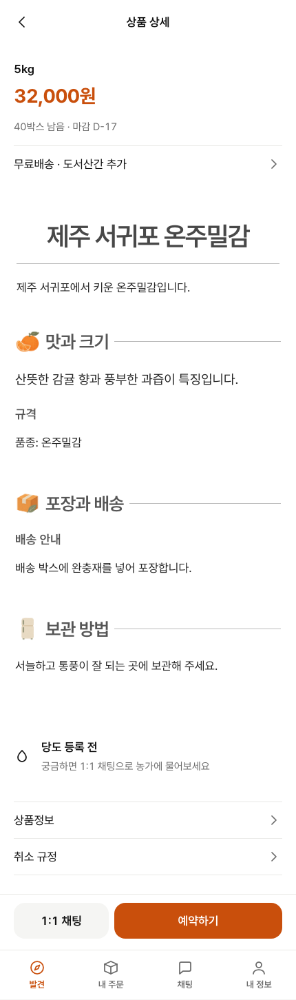

# AI Product Registration: Successful Workflow Report

This report records a producer uploading a photo and source material, generating a text draft with AI, editing the result, and checking the published consumer page.

**Upload images → extract text and generate a draft → edit → publish → verify the consumer view**

[Successful workflow video — silent, with step captions, 2 min 53 sec](./registration-success.mp4)

## 1. Upload the Product Photo and Source Image

In the new-product screen, the producer uploaded a product photo and separately attached an image containing product information for analysis. The product photo is a repository test fixture; the information image is a synthetic document created for this demonstration.

## 2. Extract Text and Generate the Draft

The producer selected **Fill with AI**. Actual Gemini calls transcribed the image, extracted facts, and generated a product name and draft sections for the introduction, taste, packaging, and storage. The generated title was **“서귀포 노지 감귤”**.

## 3. Edit the Extracted Content

The producer reviewed the result and edited the product name using the region and variety stated in the source image. This edit did not make another model call.

| Version | Product name shown in the UI |
| --- | --- |
| AI draft | 서귀포 노지 감귤 |
| Producer edit | 제주 서귀포 온주밀감 |

## 4. Enter the Sales Conditions

The producer entered the sales conditions separately from the AI draft: KRW 32,000 for the 5 kg option, available quantity, box count, maximum order quantity, receiving period, and shipping fees.

## 5. Preview and Request Publication

The buyer-view preview displayed the photo, edited title, price, and detailed content. The producer then requested the start of sales. A request does not immediately publish the product; approval was performed through the local administrator API for this demonstration.

## 6. Verify the Published Consumer Page

After approval, the product was opened in the consumer app. The edited title, **“제주 서귀포 온주밀감”**, appeared with the photo and price. Packaging and storage text generated by AI was also checked on the published detail page. The following content screenshots show the consumer page after publication.

### Check the Complete Body Content

The actual consumer page contains the introduction, taste and size, variety, packaging and delivery, and storage sections. The screenshot below shows the body of the same published product in one view. The final 36 seconds of the video hold this content on screen and then scroll through it.

## Results and Scope

| Check | Result |
| --- | --- |
| Workflow checks | Complete registration: 1 pass (73.16 s); read-only body inspection of the same product: 1 pass (51.9 s) |
| AI execution | Actual `google/gemini-3-flash-preview`; 3 calls for OCR, extraction, and refinement |
| Manual edit | The title changed between draft and edit, and the edited title matched the public API and consumer page |
| Publication state | Public API: 404 before approval, then 200 with `PUBLISHED` status |
| Model cost | Settled: $0.006706; unsettled: $0 |
| Environment | Isolated local database, test accounts, synthetic material; clock fixed to 2026-10-07 |
| Implementation | `main` commit `2693916ba956c771a61c3b07e479a8a47693c45e` |

The registration footage comes from one successful execution that passed the complete workflow checks. The final body-content segment was recorded through a read-only revisit to the same published product, without additional model calls or content changes. No failed screens were inserted. Screen-hold times were extended so that each step can be read. An environment-configuration error during preparation, before any model calls, is retained separately in local records and is not included in the video.

No production data was changed. This demonstrates the registration workflow, not the new draft instructions in the on-hold #464 or general model quality. Existing UI details, including repeated titles, are shown as they appeared in the actual application.
