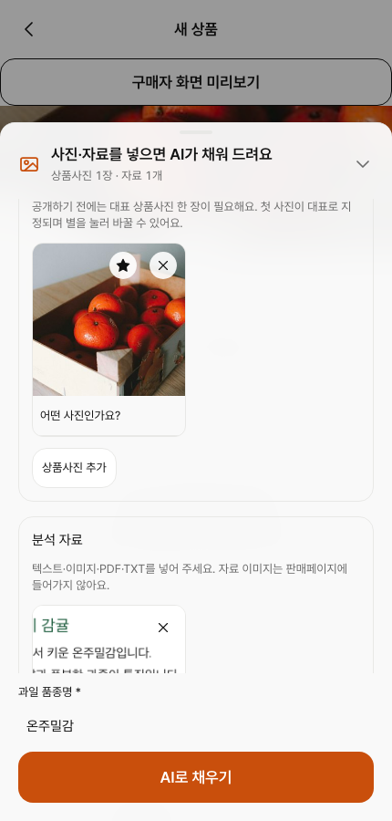
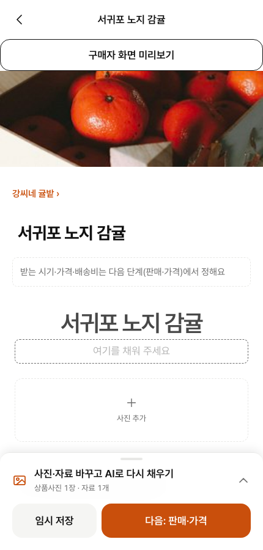
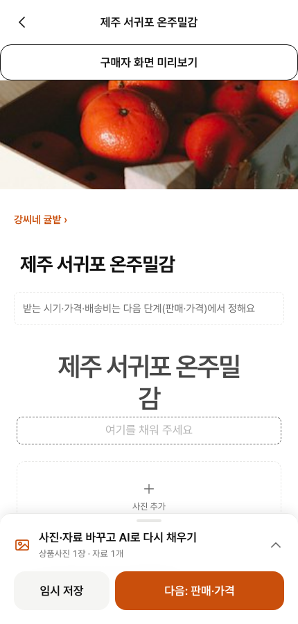
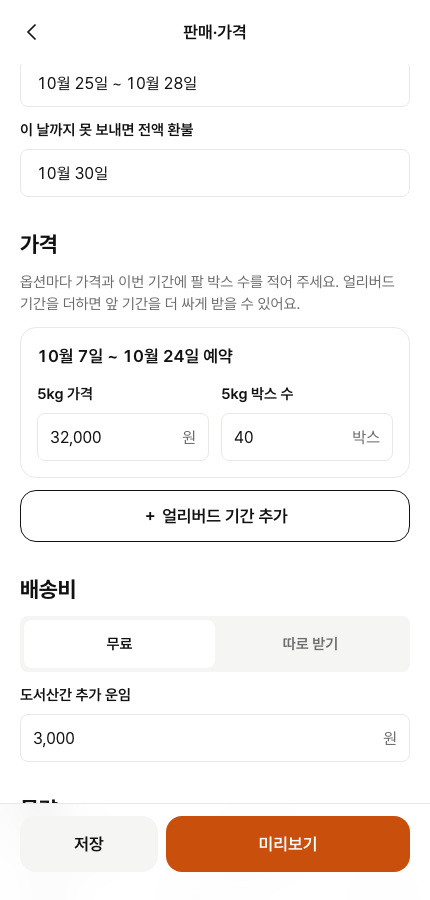
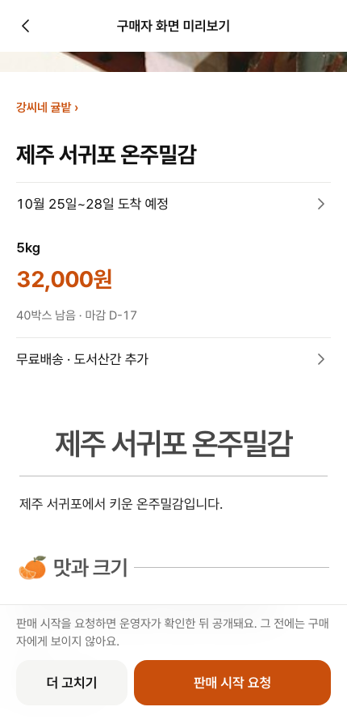
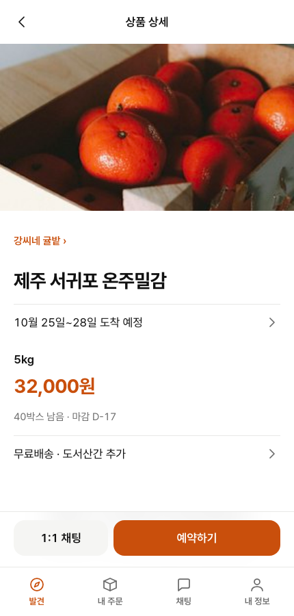
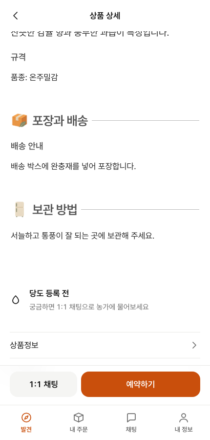

# AI 상품 등록 흐름 실행 보고서

사진과 자료를 넣어 AI가 텍스트 초안을 만들고, 생산자가 내용을 직접 수정한 뒤 등록하여 소비자 화면에서 확인하는 과정을 기록했다.

**사진 입력 → 텍스트 추출·초안 생성 → 직접 수정 → 등록 → 소비자 확인**

[전체 성공 실행 영상 — 한국어 해설, 2분 43초](./registration-success.mp4)

## 1. 사진과 분석 자료 넣기

새 상품 화면에 상품 사진을 올리고, 상품 정보가 적힌 안내 이미지를 분석 자료로 첨부했다. 상품 사진은 저장소의 테스트 사진이고, 안내 이미지는 이번 시연을 위해 만든 합성 자료다.

## 2. 이미지에서 텍스트를 뽑아 초안 만들기

‘AI로 채우기’를 실행했다. 실제 Gemini 모델이 이미지 글자를 읽고, 사실을 추출하여 상품명과 소개·맛·포장·보관 등의 초안을 만들었다. 이때 생성된 상품명은 **‘서귀포 노지 감귤’**이다.

## 3. 추출된 내용을 직접 수정하기

생산자가 AI 결과를 검토한 뒤 상품명을 수정했다. 안내 자료에 있는 지역과 품종을 사용해 표현을 정돈했으며, 이 편집에는 모델을 추가로 호출하지 않았다.

| 구분 | 상품명 |
| --- | --- |
| AI 초안 | 서귀포 노지 감귤 |
| 생산자가 수정한 내용 | 제주 서귀포 온주밀감 |

## 4. 판매 조건 입력하기

AI 초안과 별도로 사람이 판매 정보를 입력했다. 5kg 옵션의 가격을 32,000원으로 정하고, 물량·박스 수·주문 최대 수량·받는 시기·배송비를 설정했다.

## 5. 미리보기 확인 후 등록 요청하기

구매자 화면 미리보기에서 상품 사진, 수정된 제목, 가격과 상세 내용을 확인하고 판매 시작을 요청했다. 요청만으로 바로 공개되는 것은 아니며, 이 시연에서는 로컬 관리자 API로 승인 단계를 수행했다.

## 6. 소비자 화면에서 게시 결과 확인하기

승인 후 소비자 앱에서 공개 상품을 열었다. 생산자가 수정한 **‘제주 서귀포 온주밀감’** 제목과 사진·가격이 그대로 나타나는 것을 확인했다. AI가 만든 본문의 포장·보관 정보도 게시된 상세 화면에서 확인했다. 아래 본문 이미지는 게시 후 소비자 화면이다.

## 실행 결과와 범위

| 확인 항목 | 결과 |
| --- | --- |
| 전체 흐름 자동 확인 | Playwright 1회 통과, 실패·건너뜀·재시도 0 |
| AI 실행 | 실제 google/gemini-3-flash-preview, OCR·추출·초안 총 3회 |
| 직접 편집 | 수정 전후 제목이 다르고, 수정한 제목이 공개 API·소비자 화면에 동일하게 반영됨 |
| 공개 상태 | 승인 전 공개 API 404, 승인 후 200·PUBLISHED |
| 모델 비용 | 정산 $0.006706, 미정산 0 |
| 시연 환경 | 격리 로컬 DB·테스트 계정·합성 자료, 기준 시각 2026-10-07로 고정 |
| 구현 버전 | main의 2693916ba956c771a61c3b07e479a8a47693c45e |

영상은 위 전체 검사를 통과한 **한 번의 실행**에서 만들었다. 실패 화면을 이어 붙이지 않았고, 각 단계를 읽을 수 있도록 화면 유지 시간을 늘렸다. 준비 중 모델 호출 전에 발생한 환경 설정 오류는 별도 로컬 기록으로 보존했으며 이 영상에는 포함하지 않았다.

운영 데이터는 변경하지 않았다. 이 자료는 상품 등록 흐름의 동작 확인이며, 보류 중인 #464의 새 초안 지침을 평가한 영상이나 모델 품질 벤치마크가 아니다. 기존 화면에 보이는 제목 중복 등 UI 표현은 실제 실행 모습을 그대로 남겼다.
