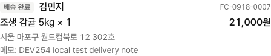

# I3-PRODORD-05 — DEV-254 수정 빌드 재실행

결과: **PASS** (새 실행). [원래 57d4843 빌드의 FAIL](../i3-b3-57d4843/I3-PRODORD-05.md)은 수정하지 않았다.

## 환경·실행 식별

- 실행: 2026-11-19 13:04:43~13:04:48 KST.
- 수정 빌드: `5660cee4eb7632c99c5517d5ace2bec9c0f4f5af` (생산 코드 dirty=false).
- 별도 로컬 DB: `farmclub_dev254`, seed reset, Alembic head `0036`.
- API `http://localhost:8000`, 생산자 `http://localhost:8082`, 고정 시각 `2026-10-07T10:00:00+09:00`.
- 실제 HTTP 서버·로컬 PostgreSQL·Expo 웹, 외부 결제·운영 DB·실제 모델 호출 없음.
- 명령: `I3_API=http://localhost:8000 I3_BASELINE=dev254-rerun uv run python ../scripts/i3-journeys/order_manager.py I3-PRODORD-05` (`server/`, 위 로컬 DATABASE_URL·FIXED_NOW 지정).
- 원시 HTTP/DB 기록: `.artifacts/i3-journeys/dev254-rerun/I3-PRODORD-05.json` (로컬 산출물, 미커밋).

## 판정

| 검사 | 실제 결과 | 판정 |
| --- | --- | --- |
| 신고 없는 입금 기한 경과 취소 | 소비자 CANCELED, 기한 경과 취소 사유 | PASS |
| 선점 물량 복구 | reserved 40 → 39 | PASS |
| 취소 뒤 늦은 입금 승인 거절 | 409 | PASS |
| 입금 신고 주문 유지·운영자 목록 | AWAITING_DEPOSIT, 운영자 overdue 목록 포함 | PASS |
| 생산자·소비자 상태 일치 | 취소 주문은 생산자 목록에서 빠지고 신고 주문은 입금 대기 | PASS |
| 배송 완료 주문 주소·전화 가림 | o-07 전화·주소·상세주소 빈 문자열 | PASS |
| 수령인·우편번호·메모 가림 (추가) | 이름 `○○○`, 우편번호 빈 문자열, 메모 null | PASS |
| dashboard 기존 최근 주문 이름 가림 | 기존 최근 주문들이 가림 이름을 반환 | PASS (관찰) |

`o-07`은 dashboard의 최근 3건에 포함되지 않으므로 마지막 관찰을 그 주문에 대한 AC-14-2 직접 증거로 세지 않는다. 배송 완료 주문 목록의 R-15 위반을 AC-17-13으로 검증했다.

기존 harness의 주소·전화 검사는 유지하고 수령인·우편번호·메모 검사를 더했다. 원래 FAIL을 통과로 덮지 않았다.

## 실제 화면·회귀

같은 합성 시드 `FC-0918-0007`을 생산자 전체 탭에서 확인했다. 수령인·주소는 기존 시드 값이고 배송 메모는 로컬 테스트 문자열을 넣었다.

| 이전 빌드 (1b4c9602 archive 서버) | 수정 빌드 |
| --- | --- |
|  |  |

- 사양 기반 독립 테스트의 구현 전 red: 서버·Mock 목록 개인정보 검사 각 18건 실패, 송장 수정 캐시 재시도 각 3건 실패. 접근 권한 검사의 403/404 기대값 오류는 기존 역할 계약에 맞게 정정했으며 개인정보 실패 수에 포함하지 않았다.
- 같은 UI 테스트: 이전 archive 서버에서 이름·주소·메모 노출 단언 1 failed, 수정 서버에서 1 passed. 첫 시도의 기본 탭 진입 오류는 제외하고 명시적인 `?status=all`로 재실행했다.
- 수정 후: API 개인정보 회귀 26 passed, Mock 전체 434 passed, 타입 검사·ruff·양쪽 앱 web export 통과. 같은 코드 커밋의 [공식 서버 CI](https://github.com/snuhcs-course/swpp-2026-project-team-06/actions/runs/44455786386/job/135330492107)도 2106 passed / 1 skipped. 중복 로컬 전체 pytest는 이 CI 통과 확인 후 중단했으며 로컬 전체 통과로 기록하지 않는다.
- 기존 실제 출하 회귀 `producer-i2.spec.ts` AC-17-2/5: 1 passed. 택배사 선택·송장 입력·출하 처리·새로고침 실패 후 재시도에서 송장 값이 유지된다.
- 배송 완료·구매 확정·배송 후 환불, 배송 완료 시각 우선, 여러 길이/유니코드 이름, 배송 전 정보 유지, 입금 전 가림, 본인 원본 보존, 농가·역할 격리, 송장 재시도의 현재 가림/최초 비개인정보 보존을 API·Mock에서 검사한다.

배포 검증이 아닌 로컬 수정 빌드의 재실행 증거다. 최종 PR CI와 사람 검토·배포는 별도로 확인한다.
