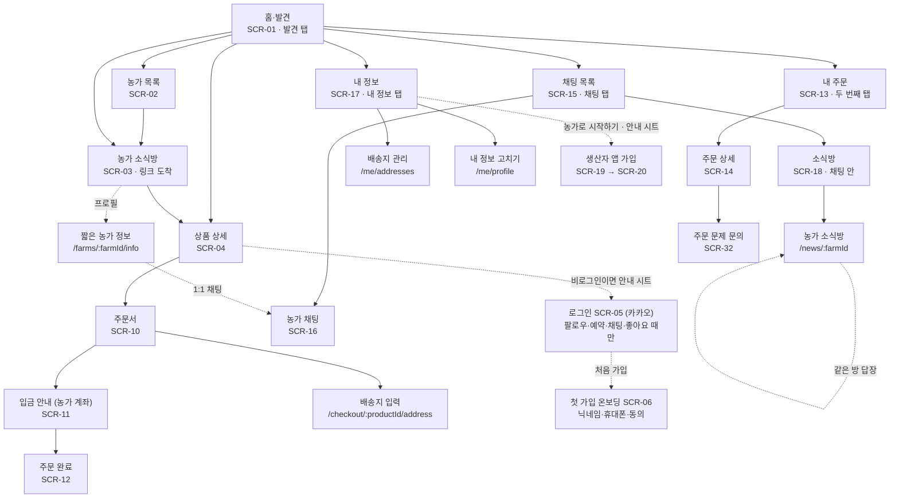
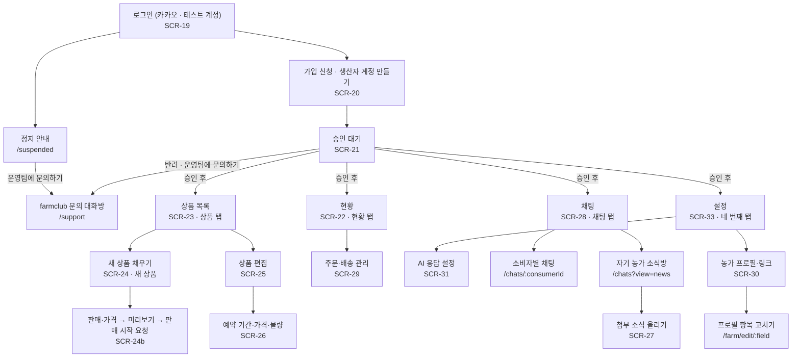
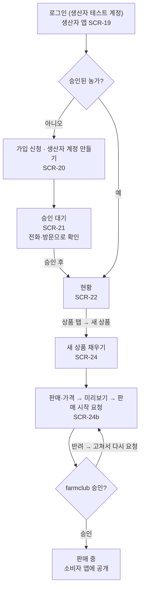
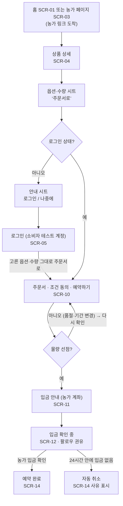

# farmclub IA·사용자 흐름 (I1-P15)

> 현재 프론트 화면 기준: [대화 중심 UI 1.6](./conversation-ui-1.6.md). 이전 화면 배치를 대체하며 API·권한·주문 전이는 유지한다.

> 농가/상품 상세·공개 소식방의 현재 기준: [스펙 1.5](./storefront-1.5.md). 기존 농가 소식 탭 설명을 대체한다.

> 공급 물량·승인·가격의 현재 기준: [스펙 1.4](./capacity-1.4.md). 기존 박스 한도/가격 재승인 계약을 대체한다.

I1 화면은 기존 화면과 SCR-31·32·33을 포함한다(로그인은 앱별로 소비자 SCR-05, 생산자 SCR-19). 그 밖에 하위 화면 7개(배송지 입력, 배송지 관리, 정지 안내, 소비자별 채팅, 프로필 항목 고치기, 소비자 소식방, 생산자 소식방)와 공통 권한 오류 화면이 있다. 운영자는 I1에서 화면 없이 Swagger UI로 관리 API를 호출했지만, 관리자 UI(`https://admin.farmclub.kr`)를 만들어 바꿨다(아래 운영자 절). 소비자 앱의 첫 화면은 홈·발견이고, 농가가 보낸 링크로는 농가 페이지에 바로 들어온다. 로그인은 팔로우·예약·채팅·좋아요를 누를 때만 한다. 앱은 소비자 앱과 생산자 앱 두 개(모바일 웹)로 나누고, 계정도 앱별로 따로다(소비자 계정·생산자 계정, ADR 0010. I1은 테스트 계정, 카카오 로그인은 I2).

스펙 1.2의 채팅·판매 설정 상세는 [공통 계약](./contracts-1.2.md)을 따른다. 과거 결정은 변경 이력이며 현재 화면 구조는 [1.3](./navigation-1.3.md)이며 SCR-33까지 적용한다.

## 0. 문서 정보

| 항목 | 내용 |
| --- | --- |
| 문서 | farmclub IA·사용자 흐름 (Information Architecture, User Flow) |
| 태스크 | \[I1-P15\] SWPP-19 · \[I1-P22\] SWPP-26(화면 명세와 합치며 갱신) · SWPP-81(확정 디자인 동기화, 계정 분리) |
| 상태 | P22 반영 — 열린 질문(7장) 모두 결정, 팀 확인 전 |
| 담당 | 박현(PM) |
| 상위 문서 | farmclub PRD(I1-P14). 충돌하면 PRD가 우선한다 |
| 담는 것 | 화면 목록, 메뉴 구조, 화면 간 이동, 역할별 진입점과 접근 권한 |
| 담지 않는 것 | 화면 안 요소·데이터·동작·예외([화면 명세](./screens.md)), 기능 동작·인수 조건(기능 명세 P16) |
| 참조 방식 | 화면은 SCR-xx로 부른다. 기능은 PRD의 FEAT ID, 시나리오는 S-x를 그대로 쓴다 |
| 기준 | 모바일 웹 우선(PRD N-01), 한 화면에 주요 행동 하나(N-02), I1 P0 기능 17개를 빠짐없이 화면에 배치 |

## 1. 사이트맵

앱마다 하단 탭 4개 아래로 화면이 이어진다. 로그인은 앱별로 따로다(소비자 SCR-05, 생산자 SCR-19).

&#91;embedded content: 소비자 앱 사이트맵 · 15개\]

소비자 앱은 홈·발견(SCR-01)에서 시작하고, 농가 링크로는 SCR-03에 바로 도착한다. 로그인은 팔로우·예약·채팅·좋아요를 누를 때만 거친다.

&#91;embedded content: 생산자 앱 사이트맵 · 13개\]

생산자 앱은 생산자 계정 로그인(SCR-19) → 가입 신청 → 승인 대기를 거쳐야 탭이 열린다(시드의 승인된 생산자 계정은 바로 SCR-22, 정지된 계정은 정지 안내). 운영자는 승인·배송 완료·환불을 운영자 전용 관리 API로 처리한다. I1에서는 화면 없이 Swagger UI로 호출했지만 관리자 UI를 만들어 바꿨다. 생산자 가입 신청과 상품 공급 물량 신청의 승인·반려는 임시 관리자 페이지(`scripts/admin-web`, DEV-82·DEV-83·DEV-87, 문의함 DEV-111)에서 한다. 로그인(`/login`, 공용 접속 비밀번호) → 가입 신청(`/producers`): 신청 목록 → 승인(두 번 눌러 확인) / 반려(사유 입력) → 결정 이력. 공급 물량 승인(`/capacity`, DEV-87): 상품별 첫 판매·증량 신청 목록 → 신청량 전체 승인(두 번 눌러 확인) / 반려(사유 입력). 테스트 농가(`/farms`, DEV-98): 운영 검증에 쓴 농가 목록 → 숨기기 / 다시 공개 → 미리보기(거부 사유, 출하 전 테스트 주문) → 두 번 눌러 실행. 숨긴 농가는 모든 소비자 화면에서 사라지고, 테스트 계정이 아닌 소비자 주문이 있으면 거부한다. 사용자(`/users`, DEV-107): 이름·닉네임·ID·농가 이름·전화 끝 4자리로 검색, 역할·테스트 여부 필터 → 팀원이 카카오로 가입한 운영 검증 계정을 「테스트로 표시」/해제(두 번 눌러 확인). 표시한 계정의 주문은 테스트 농가 숨기기에서 테스트 주문으로 센다. 사용자 찾기(`/user`, `/users/<id>`, DEV-106): 사용자 ID·주문 ID·주문 번호(입금자명)로 찾기 → 주문·입금·환불 내역 → 입금 확인 대행 / 배송 완료 / 환불(금액·사유)을 두 번 눌러 실행(기존 운영자 주문 API). 받는 사람 전화·주소는 보이지 않는다. 문의함(`/inbox`, DEV-111): 생산자가 farmclub 대화방에 남긴 문의 목록(답변 대기 먼저) → 대화 보기(열면 읽음) → farmclub으로 답장. AI 비용(`/ai-cost`, DEV-144): 기능별(코드 리뷰 spec-check·상품 초안·상세 초안·AI 답변·자료 분석)과 전체 합계를 이번 달·최근 7일·전체로 보는 표, 기능으로 거르는 호출 목록(모델·토큰·금액, spec-check는 PR·결과). 왼쪽 메뉴에 관리 화면을 하나씩 늘려 간다. 결정은 운영자 계정(`u-admin`)으로 기록되고, 로컬 또는 운영 주소 `https://admin.farmclub.kr`(Vercel, DEV-91)에서 중계가 운영자 토큰을 붙여 실서버를 부른다.

## 2. 화면 목록

경로는 이 문서와 화면 명세를 함께 갱신한다. 화면 ID와 FEAT 연결은 바꾸지 않는다. 공개·소비자 화면은 소비자 앱, 생산자 화면은 생산자 앱의 경로다. 화면별 요소·데이터·동작·예외와 API는 [화면 명세](./screens.md)에 있다.

소비자 앱 — **공개 (로그인 없이)**

| ID | 화면 | 경로 | 하는 일 | FEAT |
| --- | --- | --- | --- | --- |
| SCR-01 | 홈·발견 | `/` | 소식 가로 목록 → 상품 가로 목록, 헤더 검색 아이콘 → 농가 목록. 발견 탭의 첫 화면 | FEAT-06 |
| SCR-02 | 농가 목록 | `/farms` | 승인된 농가 둘러보기, 검색(필터는 I2). 발견 탭 안 | FEAT-06 |
| SCR-03 | 농가 소식방 | `/farms/:farmId` | 머리(‘팔로워 N명’·작은 팔로잉 칩) → 판매 품목 한 줄(기본 접힘, DEV-295) → 같은 방 대화. 프로필에서 짧은 정보로 진입 | FEAT-06, 12, 15 |
| SCR-03 하위 | 짧은 농가 정보 | `/farms/:farmId/info` | 지역·소개, ‘소식방으로’·‘1:1 채팅’·‘농가 링크 공유’(DEV-233에서 표에 추가) | FEAT-02, 19 |
| SCR-04 | 상품 상세 | `/products/:productId` | 품질·배송 예정 기간·옵션별 가격·옵션별 남은 물량 확인, 공유, 예약하기(옵션·수량 시트), 채팅 | FEAT-07 |
| SCR-05 | 로그인 | `/login` | 카카오로 로그인(I2) 또는 소비자 테스트 계정 선택(카카오가 꺼진 동안만). 카카오 복귀는 `/auth/kakao`. 안내 시트에서 들어오고, 끝나면 하려던 행동으로 돌아감(처음 가입이면 SCR-06을 거침). 생산자 계정은 없음 | FEAT-01 |
| SCR-06 | 첫 가입 온보딩 | `/onboarding` | 카카오로 처음 가입한 소비자만. 닉네임·휴대폰·가입 동의 한 화면(이름·배송지는 첫 주문서에서, DEV-142). 끝나면 하려던 화면·행동으로. 다시 온 회원은 거치지 않음 | FEAT-01 |

**소비자 앱 — 로그인 후**

| ID | 화면 | 경로 | 하는 일 | FEAT |
| --- | --- | --- | --- | --- |
| SCR-10 | 주문서 | `/checkout/:productId` | 중량 옵션·수량(생산자가 정한 한도 안), 받는 곳·배송 메모, 배송비 확인, 결제 전 동의 | FEAT-08 |
| SCR-10 하위 | 배송지 입력 | `/checkout/:productId/address` | 받는 사람·연락처·우편번호·주소 직접 입력(우편번호 찾기 없음), 기본 배송지로 저장 | FEAT-08 |
| SCR-11 | 입금 안내 | `/checkout/:productId/pay` | 농가 계좌·입금자명(주문 번호)·기한·판매자 정보·중개자 고지, ‘입금을 마쳤어요’ (DEV-68) | FEAT-09 |
| SCR-12 | 주문 완료 | `/orders/:orderId/done` | 예약 완료 안내, 농가 팔로우 권유, 소식·채팅으로 이동 | FEAT-09 |
| SCR-13 | 주문 내역 | `/orders` | 내 주문 목록과 진행 상황. 두 번째 탭 첫 화면 | FEAT-10 |
| SCR-14 | 주문 상세 | `/orders/:orderId` | 상태(입금 대기·입금 확인 중·예약 완료·수확·포장 중·배송 중·배송 완료)·입금 대기면 계좌 카드·배송 예정 기간·택배사·송장 번호·배송 조회, 보내기 전 취소, 구매 확정, 배송 기간 변경 시 동의·환불 선택 | FEAT-10, 11 |
| SCR-15 | 채팅 목록 | `/chats` | 소식방 / 1:1 채팅. 세 번째 탭 첫 화면 | FEAT-12 |
| SCR-16 | 농가 채팅 | `/chats/:farmId` | 내 질문, AI 안내(‘답변 확인 요청’과 깃발 상태, AC-13-5·11~13), 농가 답변(1:1) | FEAT-12, 13 |
| SCR-16 하위 | farmclub 문의 대화방 | `/chats/support` | 소비자가 운영팀에 묻는 대화방(글만, AI 없음). 채팅 목록의 ‘farmclub’ 행에서 들어감(DEV-150, AC-34-6~8, DEV-233에서 표에 추가) | FEAT-34 |
| SCR-17 | 내 정보 | `/me` | 프로필(닉네임), 팔로우 목록, 내 정보 고치기, 배송지 관리, 농가로 시작하기(생산자 앱은 따로 가입한다는 안내 시트), 로그아웃, 회원 탈퇴(DEV-94) | FEAT-01, 06, 08, 10 |
| SCR-17 하위 | 배송지 관리 | `/me/addresses` | 저장한 배송지 목록(계정당 50개), 수정, 삭제 확인, 기본으로 | FEAT-08 |
| SCR-17 하위 | 배송지 추가·수정 | `/me/addresses/edit?addressId=` | 배송지 입력과 같은 화면(값 채움, `addressId`가 없으면 새 배송지, DEV-233에서 표에 추가) | FEAT-08 |
| SCR-17 하위 | 내 정보 고치기 | `/me/profile` | 닉네임·이름·휴대폰 번호 수정, 카카오계정 이메일 보기 | FEAT-01 |
| SCR-18 | 소식방 | `/chats?view=news` | 팔로우한 농가별 소식방 목록과 말풍선 대화, 좋아요, 1:1 채팅. 채팅 안 소식방 목록 | FEAT-12, 15 |

**생산자 앱**

| ID | 화면 | 경로 | 하는 일 | FEAT |
| --- | --- | --- | --- | --- |
| SCR-19 | 로그인 | `/login` | 카카오로 시작하기(I2, 카카오 복귀는 `/auth/kakao`) 또는 생산자 테스트 계정 선택(카카오가 꺼진 동안, Mock은 함께). 처음이면 카카오로 시작 → 약관 동의 → 가입 신청 | FEAT-01 |
| SCR-19a | 약관 동의 | `/consent` | 지금 버전 이용약관·개인정보 처리방침 동의(필수 2개). 동의 전에는 관문이 이 화면만 연다(DEV-113, AC-01-18) | FEAT-01 |
| SCR-19 하위 | 정지 안내 | `/suspended` | 정지 사유와 처리 결과, 운영팀에 문의하기(farmclub 대화방), 로그아웃. 정지된 생산자는 이 화면과 문의 대화방만 | FEAT-01, 34 |
| SCR-19 하위 | farmclub 문의 대화방 | `/support` | 정지·반려 농가가 운영팀에 묻는 대화방(사진 포함, AI 없음). 승인 농가는 채팅 탭의 farmclub 방과 같은 방(DEV-209, AC-34-9) | FEAT-34 |
| SCR-20 | 가입 신청 | `/apply` | 대표자·농가 정보 입력, 신청. 생산자 계정 만들기를 겸함 | FEAT-01 |
| SCR-21 | 승인 대기 | `/pending` | 들어올 때 자동 확인, 전화·방문 확인 안내, 신청 내용 보기, 로그아웃, 회원 탈퇴(DEV-94). 승인 전에는 다른 화면 잠김 | FEAT-01 |
| SCR-22 | 현황(홈) | `/` | 할 일(AI 답변 확인 요청·답하지 않은 문의·입금 확인·환불 등), 주문 4칸, 대표 상품 물량 | FEAT-14 |
| SCR-23 | 상품 목록 | `/products` | 판매 중·심사 중·작성 중·판매 중지·판매 종료 필터. 카드마다 ‘판매페이지 수정’·‘판매 설정’·‘기간·가격’ | FEAT-04 |
| SCR-24 | 새 상품 채우기 | `/products/new` → `/products/source-analysis?composer=1` | 구매자 상품 페이지 모양 그대로, 빈 칸만 점선 네모로 보이고 바로 입력. 사진 위 제외 칩·AI 채움 후 결과별 1회 제외 사유 모달. 하단 AI 시트(정책 안내·상품사진·자료 → AI로 채우기). 자료 분석이 꺼진 서버는 `/products/manual`(문구 붙여넣기) | FEAT-03 |
| SCR-24b | 판매·가격 | `/products/:id/sell` | 새 상품의 중량 옵션·받는 시기·환불일·기간별 가격(기본 1기간 + 얼리버드 추가)·배송비·물량을 한 화면에서 → 구매자 화면 미리보기 → 판매 시작 요청(운영자 승인 대기) | FEAT-04, 05 |
| SCR-25 | 상품 편집 | `/products/:id/edit` | 옵션·배송 예정 기간·배송비·품질(실측 당도) 편집, 게시 요청 | FEAT-04 |
| SCR-26 | 예약 기간·가격·물량 | `/products/:id/stages` | 날짜 구간 추가·삭제, 가격·물량 입력 | FEAT-05 |
| SCR-23·25 하위 | 물량·판매 설정 | `/products/:id/sales` | 공급 물량 승인 요청·추가 신청·철회, 판매 한도·한 주문 최대, 판매 중지·재개(1.4, DEV-233에서 표에 추가) | FEAT-04 |
| SCR-23·25 하위 | 판매페이지 수정 | `/products/:id/detail` | 기존 상품의 구매자 상세를 비공개 수정본으로 고치고 미리보기 → 상품에 반영(자료 분석이 꺼진 서버는 블록 편집기, DEV-233에서 표에 추가) | FEAT-03, 04 |
| SCR-27 | 소식 올리기 | `/broadcast/new` | 글·사진·영상, 공개 여부 선택 | FEAT-12, 15 |
| SCR-28 | 채팅 | `/chats` | 자기 소식방 즉시 열기 / 1:1 채팅 | FEAT-13 |
| SCR-28 하위 | 소비자별 채팅 | `/chats/:consumerId` | 그 소비자와의 채팅 전체, 답 입력, 확인 요청된 AI 답변의 확인 카드(답이 맞아요·바로잡기, DEV-296) | FEAT-13 |
| SCR-29 | 출하 처리 | `/ship` | 예약 조회, 기존 출하 준비 주문 여러 건 골라 택배사·송장 번호 입력 → 출하 처리(자연어·AI는 I2) | FEAT-17 |
| SCR-30 | 농가 프로필·링크 | `/farm` | 농가 링크 복사·공유, 프로필 미리보기와 항목 줄 | FEAT-02, 19 |
| SCR-30 하위 | 프로필 항목 고치기 | `/farm/edit/:field` | 농가 이름·지역·소개 중 하나 고치기 | FEAT-02 |
| SCR-30 하위 | 입금 계좌 | `/farm/account` | 은행·계좌번호·예금주 등록·수정(DEV-68, DEV-233에서 표에 추가) | FEAT-09 |
| SCR-30 하위 | 농가 상세 편집 | `/farm/detail` | 농가 긴 소개(상세 블록) 초안 생성·편집·저장(DEV-233에서 구현대로 표에 추가, 감사 J8) | FEAT-02 |
| SCR-33 | 설정 | `/settings` | 프로필·공유 링크·AI 설정·로그아웃·회원 탈퇴(DEV-94) | FEAT-02, 19, 32 |
| SCR-31 | AI 응답 설정 | `/farm/ai-settings` | 농가 AI ON/OFF·원칙·FAQ·미리보기 | FEAT-32 |

추가 소비자 화면: SCR-32 주문 문제 문의 `/orders/:orderId/inquiry`(FEAT-33). 소식방 하위 경로는 양 앱 `/news/:farmId`. 소비자는 팔로우한 방, 생산자는 자기 농가만 접근한다. 본인 결제 주문 문의는 팔로우 예외를 적용한다.

**공통**: 개인정보 처리방침 `/privacy`, 이용약관 `/terms`는 두 앱에 있고 로그인·승인 상태와 상관없이 열린다(DEV-113, R-16). 배포에서는 같은 문안의 정적 HTML이 응답해 JS 없이도 읽힌다. 하단 사업자 정보(policy.md 6장)는 소비자 홈(SCR-01)·로그인(SCR-05)·내 정보(SCR-17), 생산자 로그인(SCR-19)·설정 끝에 둔다. 푸터는 스크롤 내용의 맨 아래에 붙고, 내용이 짧으면 화면 바닥(하단 바 바로 위)까지 내려간다(DEV-116). 가입 동의(SCR-06)의 ‘보기’ 시트에서 전문으로 간다.

**공통**: 권한 오류(403) 화면은 두 앱에 있다. ‘볼 수 없는 화면이에요’와 첫 화면으로(screens.md 3장).

**운영자**: 운영자 전용 관리 API로 생산자·상품 공급 물량 승인, 배송 완료, 환불을 처리한다. I1에서는 화면 없이 Swagger UI로 호출했지만, 관리자 UI(FEAT-23, `scripts/admin-web`, `https://admin.farmclub.kr`, 공용 비밀번호 로그인)를 만들어 바꿨다. 지금 화면은 가입 신청(`/producers`), 공급 물량 승인(`/capacity`), 테스트 농가(`/farms`), 사용자(`/users`)·사용자 찾기(`/user`), 문의함(`/inbox`), AI 비용(`/ai-cost`)이고, 메뉴를 하나씩 늘린다.

## 3. 콘텐츠 구성

화면에 들어갈 정보 묶음과 순서다. 위에서부터 중요한 순서이고, 요소·데이터·동작은 [화면 명세](./screens.md)가, 배치·디자인은 [확정 디자인](/docs/design/README.md)이 정한다.

| 화면 | 앱 | 정보 묶음 (순서대로) |
| --- | --- | --- |
| SCR-01 홈·발견 | 소비자 | 헤더·검색 → 사진/본문 소식 가로 목록 → 상품 가로 목록. 각 목록 독립 좌우 스와이프, 작성 농가 클릭은 소식방 직접 진입 |
| SCR-02 농가 목록 | 소비자 | 1) 검색창 2) 농가 카드(농가명·지역·대표 상품·현재 단계 가격·단계 마감일). 정렬은 예약 마감 임박순: 판매 중인 상품의 현재 단계가 가장 일찍 끝나는 농가가 위, 판매 중 상품이 없는 농가는 맨 아래 |
| SCR-03 농가 페이지 | 소비자 | 농가 소식방 직접 진입: 프로필 옆 팔로우 → 접이식 판매 품목 → 대화·답장. 짧은 정보는 프로필에서 열고 긴 이야기는 상품에서 본다. [1.6](./conversation-ui-1.6.md). |
| SCR-04 상품 상세 | 소비자 | 사진(뒤로·공유) → 판매자 줄·상품명·원산지·받는 시기·옵션 줄(최종 기간 취소선 비교, 옵션별 남은 박스)·취소 규정 한 줄 → 상세 이야기 → 품질/고시. 탭 바 없이 ‘채팅’·‘예약하기’ 고정(DEV-293) |
| SCR-10 주문서 | 소비자 | 1) 상품·옵션·수량(한도 안) 2) 받는 사람·연락처·주소·배송 메모(저장된 배송지가 기본, 메모는 선택 목록) 3) 입금 금액(상품 금액 + 배송비 = 총 입금액) 4) 예약 전 고지·동의(배송 기간, 지연 시 환불, 흉작 처리, 취소 조건, 제3자 제공; 본문은 ‘보기’)와 중개자 고지 5) ‘N원 예약하기’ |
| SCR-14 주문 상세 | 소비자 | 1) 진행 상태(예약 완료·수확·포장 중·배송 중·배송 완료) 2) 배송 예정 기간(바뀌었으면 동의·환불 선택) 3) 택배사·송장 번호·배송 조회(배송 중) 4) 상품·금액·받는 사람 5) 지금 할 수 있는 행동(보내기 전 취소, 배송 후 구매 확정) |
| SCR-16 농가 채팅 | 소비자 | 맨 위 시스템 문구 한 줄, 시간순: 내 질문, AI 안내(회색 테두리·라벨, 확인 요청하면 빨간 테두리·‘농가에 확인 요청함’, 농가가 확인·바로잡으면 초록 칩, DEV-296), 농가 답변(묶음 첫 줄에만 아바타·농가명, 시각은 묶음 끝 옆, 내 말풍선 옆 ‘읽음’). 맨 아래 입력줄(사진 첨부 · 입력 · 보내기). 농가 소식은 나오지 않는다(DEV-295) |
| SCR-18 소식 | 소비자 | 농가별 방 목록 → 날짜 알약별 말풍선(방송·본인 답장). 좋아요는 말풍선 옆 작은 하트(숫자 없음), 내 답장 옆 ‘농가만 봐요’. 농가 링크 직접 진입과 동일한 소식방(DEV-295) |
| SCR-22 현황 | 생산자 | 할 일 한 줄 목록(채팅은 ‘AI 답변 확인 요청 n건’·‘답하지 않은 문의 n건’ 건수 줄만, DEV-294·296) → 주문 4칸 → 대표 상품 예약/출하 kg. 채팅 내용 없음 |
| SCR-26 예약 기간·가격·물량 | 생산자 | 1) 날짜 구간 추가·삭제 2) 옵션별 가격·물량 3) 상품 총 한도 4) 저장 |

**나머지 화면**

| 화면 | 앱 | 정보 묶음 (순서대로) |
| --- | --- | --- |
| SCR-05 로그인 | 소비자 | 1) 로그인이 필요한 이유 한 줄 2) ‘카카오로 시작하기’(카카오에서 받는 것 한 줄)와 소비자 테스트 계정 목록(카카오가 꺼진 동안, 또는 평가용 주소 `/login?evaluator=1`, DEV-198) 3) 농가는 생산자 앱에서 따로 로그인한다는 한 줄 4) 약관·개인정보 처리방침 동의는 처음 가입할 때 받는다는 안내 |
| SCR-06 첫 가입 온보딩 | 소비자 | 1) 카카오계정 이메일 2) 닉네임·휴대폰 3) 모두 동의·개별 동의 4개(필수 3·선택 1) 4) 시작하기 |
| SCR-19 로그인 | 생산자 | 1) 워드마크 ‘농가용’ 2) ‘카카오로 시작하기’(카카오에서 받는 것 안내) 또는 생산자 테스트 계정 목록(농가명·상태, 카카오가 꺼진 동안, 또는 평가용 주소 `/login?evaluator=1`이면 카카오 버튼과 함께, DEV-198) 3) 처음이면 카카오로 시작해 농가로 가입 신청 4) 약관·개인정보 처리방침 |
| SCR-11 입금 안내 | 소비자 | 1) 입금할 금액 2) 농가 계좌·예금주·입금자명(주문 번호)·입금 기한, 복사 3) 판매자 정보·‘farmclub은 통신판매중개자’ 고지·에스크로 안내 4) 입금을 마쳤어요 |
| SCR-12 주문 완료 | 소비자 | 1) 예약 완료와 배송 예정 기간 2) 농가 팔로우 권유 3) 소식 보기·채팅하기 4) 주문 내역 보기 |
| SCR-13 주문 내역 | 소비자 | 주문 카드(상품·상태·배송 예정 기간), 할 일이 있는 주문(배송 기간 변경 동의, 구매 확정) 먼저, 그다음 최신순 |
| SCR-15 채팅 목록 | 소비자 | 밑줄 탭 소식방 / 1:1 채팅(1:1에 안 읽음 합계). 농가별 채팅(농가명·마지막 질문·답, 사진이면 사진 표시·안 읽음 표시), 최근 순(DEV-295) |
| SCR-17 내 정보 | 소비자 | 1) 프로필(닉네임, 이름·휴대폰·이메일), 온보딩이 남았으면 가입 마치기 2) 팔로우 목록 3) 내 정보 고치기·배송지 관리(하위 화면) 4) 농가로 시작하기(생산자 앱은 따로 가입한다는 시트) 5) 로그아웃 |
| SCR-20 가입 신청 | 생산자 | 1) 생산자 계정이 함께 만들어진다는 안내 2) 대표자 이름·농가명·지역·주 품목·연락처 3) 확인 절차 안내(전화·방문) 4) 입점 정책 동의 5) 신청하기 |
| SCR-21 승인 대기 | 생산자 | 1) 현재 상태(확인 중·반려) 2) 다음 절차(들어올 때 자동 확인) 3) 반려 시 사유, 다시 신청, 운영팀에 문의하기(DEV-209) 4) 신청 내용 보기·로그아웃 |
| SCR-23 상품 목록 | 생산자 | 1) 새 상품 2) 상태 필터·개수 3) 선택한 그룹의 상품 카드. 조건은 화면 구조 1.3 |
| SCR-24 새 상품 채우기 | 생산자 | 구매자 페이지 순서: 1) AI가 뺀 문구 N개 칩(0개 숨김)·대표사진 2) 농가·상품명 3) '가격은 다음 단계' 안내 4) 상세 스토리 5) 상품정보(품종·사이즈·예상 당도·원산지·보관). 빈 칸은 점선 네모. 상단 고정 편집/구매자 화면 미리보기 토글. 하단 AI 시트: 상품사진·자료 → 품종명(필수) → AI로 채우기(사진 없이 분석 가능, 공개 전 대표사진 필수). 임시 저장 / 다음: 판매·가격(상세 반영 → SCR-24b). 자료 분석이 꺼진 서버: 문구 붙여넣기 → 초안 → 편집 |
| SCR-24b 판매·가격 | 생산자 | 1) 중량 옵션 2) 받는 시기·전액 환불일 3) 가격(기간별 옵션 가격·박스 수, 얼리버드 기간 추가) 4) 배송비·도서산간 5) 총 물량·한 주문 최대 → 저장 / 미리보기(구매자 화면, 편집 칸 없음) → 판매 시작 요청. 판매 중·승인 대기 상품은 SCR-25/26/물량 화면에서 관리 |
| SCR-25 상품 편집 | 생산자 | 1) 기본 정보(상품명·품종·설명) 2) 품질(예상·실측 당도, 등급) 3) 중량 옵션·한 주문 최대 수량 4) 배송 예정 기간 5) 배송비·도서산간 6) 예약 기간·가격 설정으로 |
| SCR-27 소식 올리기 | 생산자 | 1) 본문 2) 사진·영상 3) 공개 여부 4) 받을 팔로워 수 5) 올리기 |
| SCR-28 채팅 | 생산자 | 내 소식방(자기 본문 즉시 열기, 판매 품목 한 줄 접힘 ‘판매 중 N개 · 팔로워 N명’) / 1:1 채팅 밑줄 탭 두 개만. 1:1 목록 맨 위 ‘확인해 달라는 AI 답변 N개 · 먼저 보기’ 띠와 줄 태그 ‘AI 답변 확인’(DEV-296). 공개 안내는 본문 시스템 메시지. 내 소식 아래 ‘♥ N’ 한 줄, ‘사진·영상’ 도구 칩. 입력칸 전송 → 보내기 전 확인 시트(받는 팔로워 수·미리보기) → 보내기, 내 소식 길게 누르기 → 삭제(DEV-210, M-23, DEV-295) |
| SCR-29 출하 처리 | 생산자 | 전체/예약 조회 → 출하 준비 주문 선택·송장 편집·출하 확인. 예약 탭의 ‘수확 시작하기’ 줄은 SCR-26 기간 카드로 데려가고, 수확 시작(예약 완료 → 출하 준비)은 SCR-26에서 기간 단위로 한다(DEV-231). 자동 전이 없음 |
| SCR-30 농가 프로필·링크 | 생산자 | 1) 농가 링크 복사·공유 2) 프로필 미리보기와 항목 줄(항목별 고치기) 3) 소비자 앱에서 내 농가 보기 |

**분류·탐색**: 홈(SCR-01)의 추천 상품과 농가 목록(SCR-02)은 예약 마감 임박순이다. 농가 목록에 검색을 둔다. 검색은 농가명·품종·지역을 찾는다. 품종은 판매 중 상품의 품종만 본다(FEAT-06). 지역·품종 필터는 I2에서 추가한다(IA-Q6\~Q8).

## 4. 내비게이션과 진입 경로

역할마다 하단 탭 4개를 둔다(IA-Q1, IA-Q10 결정). 탭에 없는 화면은 목록·버튼에서 들어간다.

| 역할 | 탭 1 | 탭 2 | 탭 3 | 탭 4 | 탭 밖 주요 버튼 |
| --- | --- | --- | --- | --- | --- |
| 소비자·비로그인 | 발견(SCR-01) | 내 주문(SCR-13) | 채팅(SCR-15·18) | 내 정보(SCR-17) | 상품 상세의 ‘예약하기’ → SCR-10, 농가 정보의 ‘1:1 채팅’·상품 상세의 ‘채팅’(DEV-293) → SCR-16 |
| 생산자 | 현황(SCR-22) | 상품(SCR-23) | 채팅(SCR-28) | 설정(SCR-33) | 소식방의 첨부(SCR-27), 현황 할 일 ‘출하할 주문’(SCR-29), 상품의 ‘+ 새 상품’(SCR-24) |

비로그인 상태에서 내 주문·채팅·내 정보 탭을 누르면 안내 시트 뒤 로그인(SCR-05)으로 간다.

**뒤로 규칙 (DEV-224)**

- 하단 탭을 누르면 언제나 그 탭의 첫 화면(SCR-01·13·15·17, 생산자 SCR-22·23·28·33)이 열린다. 다른 탭에서 연 하위 화면(1:1 방·주문 완료 등)을 탭 첫 화면처럼 남기지 않는다.
- 헤더 뒤로는 앱 안의 이전 화면으로 간다. 이전 화면이 없으면(주소로 바로 열기·새로고침) 아래 표의 부모 화면을 연다. 표에 없는 화면은 그 탭의 첫 화면, 탭 밖이면 홈.
- 상품 상세·짧은 농가 정보·주문 상세에서 연 1:1(SCR-16)의 뒤로는 연 화면이다(주소로 다시 열어도 같다). 채팅 목록에서 열었거나 주소로 연 1:1은 채팅 목록.

| 화면 | 이전 화면이 없을 때 뒤로 |
| --- | --- |
| 소비자 SCR-02 농가 목록, SCR-03 농가 소식방(없는 농가 포함), SCR-18 소식방, 개인정보 처리방침·이용약관 | SCR-01 홈 |
| SCR-03 하위 짧은 농가 정보 | 그 농가 SCR-03 |
| SCR-04 상품 상세 | 그 상품의 농가 SCR-03(불러오지 못했으면 홈) |
| SCR-10 주문서 / SCR-10 하위 배송지 입력 | 그 상품 SCR-04 / 그 주문서 SCR-10 |
| SCR-11 입금 안내 | 그 주문 SCR-14(주문은 이미 입금 대기다. 앱 안에서는 주문서로 돌아간다) |
| SCR-12 주문 완료, SCR-14 주문 상세 | SCR-13 주문 내역 |
| SCR-32 주문 문의 | 그 주문 SCR-14 |
| SCR-16 1:1 채팅, SCR-16 하위 farmclub 문의 대화방 | SCR-15 채팅의 1:1 목록 |
| SCR-17 하위 내 정보 고치기·배송지 관리 / 배송지 추가·수정 | SCR-17 내 정보 / 배송지 관리 |
| 생산자 상품 하위 화면(새 상품·판매페이지 만들기·문구 붙여넣기·SCR-24b·25·26·물량·판매 설정·판매페이지 수정) | SCR-23 상품 목록 |
| 생산자 소비자별 채팅 / SCR-27 소식 올리기 | SCR-28 1:1 목록 / 소식방 |
| 생산자 SCR-29 출하 처리 | SCR-22 현황 |
| 생산자 SCR-30 농가 프로필·SCR-31 AI 응답 설정 / SCR-30 하위 화면 | SCR-33 설정 / SCR-30 |

**진입 경로**

| 경로 | 도착 화면 | 그다음 |
| --- | --- | --- |
| 농가가 문자·카톡으로 보낸 링크 (첫 경로) | SCR-03 농가 페이지 | 상품(SCR-04) 또는 팔로우 |
| farmclub 소비자 앱 주소·SNS | SCR-01 홈·발견 | 소식 → 농가 소식방, 상품 → 상품 상세 |
| 생산자 시작 | 생산자 앱 주소, 또는 소비자 앱 내 정보(SCR-17)의 ‘농가로 시작하기’(‘생산자 앱은 따로 가입해요’ 시트 뒤 생산자 앱으로 이동) | SCR-19 → 처음이면 SCR-20(생산자 계정 만들기) → SCR-21 → 승인 후 SCR-22 |

레포 밖 마케팅 랜딩 페이지(`docs/farmclub-*.html`)는 앱 화면이 아니다.

**로그인 관문**: 팔로우·예약·채팅하기(질문하기)·좋아요를 누르면 안내 시트(로그인 / 나중에)를 먼저 띄우고, 로그인하면 소비자 로그인(SCR-05)으로 가고, 끝나면 누른 화면과 행동으로 돌아간다. 예약은 상품 상세의 옵션·수량 시트에서 ‘주문서로’를 누를 때 시트를 띄우고, 로그인 뒤 고른 옵션·수량 그대로 주문서(SCR-10)로 간다. 팔로우하지 않은 농가에서 ‘1:1 채팅’(버튼 이름, DEV-233. 상품 상세는 ‘채팅’, DEV-293)을 누르면 “팔로우하고 대화를 시작해요” 안내와 함께 팔로우되고 채팅(SCR-16)이 열린다.

**레이블**

탭·버튼·상태 이름은 아래 말로 통일한다. 예약판매이므로 ‘구매’보다 ‘예약’을 쓴다. 최종 문구는 화면 명세에서 다듬는다.

| 쓰는 말 | 쓰는 곳 | 쓰지 않는 말 |
| --- | --- | --- |
| 예약하기 | 상품 상세의 주문 버튼 | 구매하기, 주문하기 |
| 입금 대기 | 입금 안내를 받고 소비자가 아직 ‘입금을 마쳤어요’를 보내지 않은 주문(`AWAITING_DEPOSIT`, 소비자 차례, DEV-207) | 결제 대기, 미결제 |
| 입금 확인 중 | 소비자가 입금했다고 알린 뒤 농가가 통장을 확인하기 전 주문(`AWAITING_DEPOSIT` + `depositReportedAt`, 농가 차례) | 입금 완료 |
| 환불 대기 / 환불 완료 | 환불이 정해졌지만 농가가 아직 보내지 않음(`REFUNDED`) / 농가가 송금을 기록함(`refundSettledAt`). 송금 전에는 ‘환불됨’ 같은 완료형을 쓰지 않는다(DEV-207) | 환불됨 |
| 예약 완료 | 농가가 입금을 확인한 뒤 주문 상태 | 결제 완료 |
| 현재 가격 · 마지막 기간 비교 가격 | 현재 값 강조 + 유효한 비교 값 취소선 | 임의 정상가, 할인율 |
| 이번 기간 품절 · 전체 물량 품절 | 지금 기간 물량 소진(`PERIOD_SOLD_OUT`, 옵션 하나만 소진된 경우 포함) · 상품 총 판매 한도 소진(`TOTAL_SOLD_OUT`). 카드 가격 자리·상세 상태 제목·생산자 상품 목록이 같은 이름을 쓴다(DEV-227) | 매진, 현재 예약 불가, 현재 기간 품절 |
| 예약 시작 전 · 판매 일시 중지 · 예약 종료 | 첫 기간 전·기간 사이(`NOT_OPEN`) · 농가가 멈춤(`PAUSED`) · 마지막 기간이 끝남(`ENDED`). 위와 같은 곳에 같은 이름(DEV-227) | 현재 예약 불가, 예약 대기 |
| 당도 등록 전 · 받는 시기 확정 전 · 배송비 확정 전 | 값이 없을 때(M-24). 데이터에서 유도한 근사값에는 ‘예상’을 붙인다(‘11월 중순 이후 도착 예상’) | -Brix, 미정, 0명 예약 |
| 받는 시기 | 배송 예정 기간 표시 | 출고일 |
| 팔로우 · 팔로잉 | 농가 구독과 구독 중 상태 | 구독, 찜 |
| 발견 | 소비자 첫 탭(홈) | 홈, 쇼핑 |
| 소식 | 농가가 올리는 1:N 글. 채팅 안 소식방, 농가 링크의 소식방 | 메시지, 피드, 게시글 |
| 소식 올리기 | 생산자가 소식을 쓰는 화면(SCR-27) | 메시지 보내기, 공지 |
| 좋아요 | 소식 반응 | 하트, 추천 |
| 1:1 채팅 | 소비자와 농가의 비공개 대화(AI 안내 포함) | 단톡 |
| 답장 | 소식방에서 농가에만 보내는 비공개 글 | 댓글 |
| 채팅 | 양쪽 앱의 소식방·1:1 대화 탭 | 질문함 |
| AI 안내 | AI가 보낸 답 | 농가 답변 |
| 답변 확인 요청 · 확인 요청 | 소비자가 AI 안내를 농가에 확인해 달라고 하는 것. 소비자 표시 ‘농가에 확인 요청함’, 생산자 표시 ‘확인 요청’·‘AI 답변 확인’(DEV-296) | 틀렸어요, 신고, 소비자가 신고한 답변 |
| 답이 맞아요 · 바로잡기 | 확인 요청에 대한 농가의 두 응답. 소비자에게는 ‘농가가 답이 맞다고 확인했어요’·‘농가가 바로잡았어요’(DEV-296) | 오답 처리, 해결 |
| AI가 답하기 어려운 질문이라 농가에 답변을 요청했어요. 농가가 답하면 여기서 볼 수 있어요. | AI가 답하지 않고 넘길 때(AI 안내 메시지, 11/10 문구 변경) | — |
| 농가에 전달했어요 · 보통 N시간 안에 답해요 | 직접 응대·AI OFF 방에서 농가 답을 기다리는 내 질문 아래 상태 줄(숫자 없으면 ‘· 답이 오면 여기에 보여요’, DEV-208) | 읽음, 접수됨 |
| AI 안내가 꺼져 있어요 · 농가가 직접 답해요 | 직접 응대·AI OFF 방 대화 맨 위 시스템 문구(숫자가 있으면 ‘ · 보통 N시간 안에 답해요’를 붙임). AI 응대 방은 ‘AI가 등록된 정보로 먼저 안내해요 · 확인이 필요하면 농가에 전달해요’(DEV-295) | AI 안내 없이 농가가 직접 답해요, 농가가 직접 답변하는 대화예요 |
| 출하 준비 · 출하 | 생산자 앱의 주문 상태 | 발송 완료 |
| 수확·포장 중 · 배송 중 | 소비자 앱의 같은 상태(출하 준비 · 출하) | 출하(소비자 화면) |
| 구매 확정 | 배송 후 소비자 확인 | 수령 완료 |

소비자 화면에는 ‘메시지’라는 말을 쓰지 않는다.

## 5. 사용자 흐름

PRD의 시나리오 S-1\~S-4를 화면 단위로 풀고(‘생산자:’ 단계는 생산자 앱, ‘소비자:’ 단계는 소비자 앱), 기능 명세에서 필요한 흐름 두 개(F-5, F-6)를 더했다. 괄호는 화면 ID다.

**F-1. 생산자 가입과 상품 등록 (S-1)**

&#91;embedded content: F-1 생산자 가입·상품 등록 · 승인 2번\]

승인 대기 중에는 다른 생산자 화면이 잠기고, 상품은 반려되면 고쳐서 다시 요청한다. 판매가 시작되면 설정 → 농가 프로필(SCR-33 → SCR-30)에서 링크를 복사해 단골에게 보낸다.

**F-2. 소비자 예약 주문 (S-2)**

&#91;embedded content: F-2 소비자 예약 주문 · 분기 2개\]

로그인은 옵션 시트에서 ‘주문서로’를 누른 뒤에만 거치고, 끝나면 고른 옵션·수량 그대로 주문서로 돌아온다. 입금 안내 뒤에는 내 주문 탭(SCR-13)으로 이동할 수 있고, 생산자가 주문 현황(SCR-29)에서 입금을 확인하면 예약 완료가 된다(DEV-68).

디자인 흐름도 F-3~F-5(`docs/design/screens/f-3.html` 등)는 아래 F-3·F-4와 F-5·취소를 화면 그림으로 그린 것이다.

**F-3. 소식과 AI 응답 (S-3)**

1. 생산자: 채팅 → 자기 소식방에서 글 전송 또는 첨부 → 소식 올리기 → 방 복귀 (SCR-28 → SCR-27)
2. 소비자: 채팅 → 소식방 목록에서 팔로우한 농가를 골라 방송을 읽고 좋아요·비공개 답장을 보내거나 ‘1:1 채팅’ (SCR-18 → SCR-16). 공개 소식은 비로그인도 해당 농가 소식방(SCR-18)에서 읽는다
3. 농가 AI ON·방 AUTO에서 AI가 같은 채팅에 답하거나 ‘AI가 답하기 어려운 질문이라 농가에 답변을 요청했어요. …’ 안내 (SCR-16)
4. 생산자: 채팅에서 질문을 눌러 소비자별 채팅에서 답변 → 그 소비자의 채팅에만 표시 (SCR-28 → 소비자별 채팅 → SCR-16)

**F-4. 출하와 취소 (S-4)**

1. 생산자: 현황의 ‘배송 현황’ (SCR-22 → SCR-29)
2. 기존 출하 준비 주문 중 보낸 주문을 골라 줄마다 ‘송장 입력’으로 택배사·송장 번호를 넣고 ‘n건 선택 · 출하 처리’ → 확인 (SCR-29). 소비자 주문 상세는 수확·포장 중 → 배송 중(배송 조회)으로 바뀐다. 자연어 입력과 AI 주문 찾기는 I2
3. 소비자: 내 주문 → 주문 상세에서 보내기 전 취소 → 환불 완료 표시와 토스트 (SCR-13 → SCR-14)

**F-5. 배송 기간 변경 (R-21)**

1. 배송 예정 기간이 바뀌면 주문 내역에 표시가 뜨고, 주문 상세에서 새 기간 동의 또는 전액 환불을 고른다 (SCR-13 → SCR-14). I1은 알림이 없으므로 앱 안 표시만 한다

**F-6. 구매 확정 (R-14)**

1. 배송 완료 후 주문 상세에서 ‘구매 확정’을 누르거나, 8일이 지나면 자동 확정 (SCR-14)

**예외 경로**

정상 흐름이 아닐 때 보낼 화면이다. 화면 안 문구는 화면 명세가 정한다.

| 상황 | 보내는 곳 |
| --- | --- |
| 없는 농가·승인 취소된 농가의 링크 | 그 자리에 ‘찾을 수 없는 농가예요’ 안내와 ‘농가 둘러보기’ → 농가 목록(SCR-02). 헤더는 뒤로만(팔로우·소식방 이름 없음), 하단 탭 보임(DEV-224) |
| 판매 종료·승인 전 상품의 링크 | ‘판매 중이 아닌 상품’ 안내 → 농가 페이지(SCR-03) |
| 품절인 상품 | 상품 상세는 열리고 예약하기만 막힘, 다음 단계 시작일 표시 (R-06) |
| 주문서·입금 안내 중 단계가 바뀌거나 품절 | 주문서(SCR-10)로 돌아가 바뀐 가격·품절 안내, 입력값은 유지 (R-06, R-17) |
| 입금 기한(24시간) 초과 | 자동 취소·물량 복구. 주문 상세(SCR-14)에 ‘입금 기한이 지나 취소됐어요’, 다시 예약 가능 (R-28) |
| 로그인이 끝난 뒤 행동 | 로그인(SCR-05) 후 같은 화면으로 복귀, 입력값 유지. 처음 가입이면 온보딩(SCR-06)을 마친 뒤 복귀 |
| 가입 온보딩을 마치지 않은 계정(403 `ONBOARDING_REQUIRED`) | 예약·팔로우·채팅·좋아요를 누르면 온보딩(SCR-06), 마치면 누른 행동을 이어서 실행. 둘러보기·내 정보는 그대로 |
| 다른 앱 계정의 토큰(403 `WRONG_APP`) | 토큰을 지우고 그 앱의 로그인(소비자 SCR-05, 생산자 SCR-19) |
| 남의 주문·남의 채팅 주소로 직접 접근 | 내 주문 내역(SCR-13) 또는 그 농가 페이지(SCR-03) |
| 팔로우한 농가가 없는데 채팅의 소식방 목록을 염 | 빈 상태와 ‘농가 둘러보기’ → 홈(SCR-01)·농가 목록(SCR-02) |
| 가입 안 한 사람이 생산자 앱 진입 | 생산자 로그인(SCR-19)의 ‘농가로 가입 신청’ → 가입 신청(SCR-20) |
| 소비자 앱에서 ‘농가로 시작하기’ | ‘생산자 앱은 따로 가입해요’ 시트 → 생산자 앱 가입(SCR-19 → SCR-20) |
| 생산자 가입 반려 | 승인 대기(SCR-21)에 사유와 다시 신청, 운영팀 문의는 farmclub 대화방(`/support`, DEV-209) |
| 농가 승인 취소(활동 정지) | 생산자 앱에서 정지 안내(`/suspended`)와 farmclub 문의 대화방(`/support`, DEV-209)만 보임. 출하 전 주문은 전액 환불하고 소비자 주문 상세(SCR-14)에 사유를 표시 (R-24) |

## 6. 접근 권한

권한은 서버에서 검사한다(PRD N-06). 화면에서 숨기는 것만으로 막지 않는다.

| 화면 | 비로그인 | 소비자 계정 | 생산자 계정(승인 전·반려) | 생산자 계정(승인 후) |
| --- | --- | --- | --- | --- |
| SCR-01\~05 소비자 앱 공개 화면 | 가능 | 가능 | 소비자 앱에는 로그인할 수 없음(비로그인으로 둘러보기만) | 같음 |
| SCR-10\~18·32 소비자 화면 | 안내 시트 → SCR-05 | 자기 주문·채팅만, 팔로우한 농가의 소식만 | 불가(403 `WRONG_APP`) | 불가(403 `WRONG_APP`) |
| SCR-19 생산자 로그인 | 가능 | 생산자 앱에는 로그인할 수 없음 | 가능 | 가능 |
| SCR-20·21 가입·대기 | SCR-19로 이동 | 불가(생산자 앱에서 따로 가입) | 가능 | — |
| SCR-22\~31 생산자 화면 | SCR-19로 이동 | 불가(403 `WRONG_APP`) | SCR-21로 이동(정지면 정지 안내) | 자기 농가·상품·주문만 |
| `/support` farmclub 문의 대화방 | SCR-19로 이동 | 불가(403 `WRONG_APP`) | 반려·정지는 자기 방만, 확인 중은 SCR-21로 이동(DEV-209) | 자기 방(채팅 탭과 같은 방) |

- 소비자 계정과 생산자 계정은 따로다(ADR 0010, IA-Q4 변경). 계정 하나는 역할 하나이고, 로그인은 앱별이다(I1은 앱별 시드 테스트 계정, I2부터 카카오). 생산자가 다른 농가 상품을 사려면 소비자 계정을 따로 쓴다. 생산자 앱 권한은 승인 후에만 열린다.
- 생산자는 배송 완료 전 주문의 배송 정보만 본다(R-15).

## 7. 열린 질문

아래는 당시 결정 기록이며 1.2 변경은 화면 목록과 공통 계약을 따른다.

- [x] IA-Q1. 하단 탭 4개 구성(4장)이 맞는가. 생산자는 탭 대신 대화형 한 화면(말로 모두 처리)이 나은가 → 결정: 역할별 하단 탭 4개(4장 그대로)
- [x] IA-Q2. 랜딩(SCR-01)과 농가 목록(SCR-02)을 하나로 합칠지 → 결정: I1은 따로 둠(소개 → 목록). 합치는 안은 이후 검토 → P22에서 SCR-01을 홈·발견으로 재정의(IA-Q11)
- [x] IA-Q3. 출하 처리(SCR-29)를 별도 화면으로 둘지, 현황 화면의 입력창으로 넣을지 → 결정: 별도 화면(SCR-29), 현황의 ‘출하 처리’ 버튼으로 진입. P22에서도 유지
- [x] IA-Q4. 생산자가 소비자로도 주문할 수 있게 할지(역할 전환) → 결정: 가능. 소비자 앱과 생산자 앱을 따로 두고 같은 계정으로 둘 다 사용 → **변경(SWPP-81)**: 소비자·생산자 계정 완전 분리. 계정 하나는 역할 하나, 로그인은 앱별(SCR-05·SCR-19), 다른 앱 토큰은 403. 생산자가 소비자로 주문하려면 소비자 계정을 따로 쓴다([ADR 0010](./tech-design/adr/0010-separate-accounts.md))
- [x] IA-Q5. 주문 수량: 1주문 1옵션일 때 같은 옵션을 여러 개(예: 5kg × 2) 주문할 수 있는지 → 결정: 수량을 고를 수 있고, 한 주문의 최대 수량은 생산자가 상품마다 정한다(R-23). 배송지는 주문당 1곳

* [x] IA-Q6. 농가 목록(SCR-02)을 무엇으로 정렬하는가 → 결정: 예약 마감 임박순
* [x] IA-Q7. 농가 페이지(SCR-03)에서 상품과 공개 소식 중 무엇을 먼저 보여주는가 → 결정: 탭으로 나눔(상품 | 소식)
* [x] IA-Q8. I1에 검색·필터가 필요한가 → 결정: I1은 검색만, 지역·품종 필터는 I2

- [x] IA-Q9. 농가 승인이 취소되면 이미 받은 예약 주문을 어떻게 처리하는가(예: 전액 환불, 다른 농가로 대체) → 결정: 출하 전 주문은 전액 환불(R-24)
- [x] IA-Q10. 소비자 하단 탭을 P21처럼 바꾸는가 → 결정(P22): 발견 · 소식 · 1:1 채팅 · 내 정보. 주문 내역은 내 정보 안으로
- [x] IA-Q11. 소비자 앱 첫 화면 → 결정(P22): SCR-01을 홈·발견(시즌 히어로, 추천 상품, 소식 미리보기)으로 재정의. ‘농가로 시작하기’는 내 정보(SCR-17)로
- [x] IA-Q12. 소식과 채팅을 어떻게 나누는가 → 결정(P22): 소식 탭(SCR-18) = 팔로우한 농가별 소식방 목록과 말풍선 대화, 채팅 탭 = 1:1 질문·답만. 팔로우하지 않은 농가에서 채팅하기를 누르면 자동 팔로우(M-04 유지)

## 8. 변경 이력

| 날짜 | 버전 | 내용 |
| --- | --- | --- |
| 2026-11-10 | (1.6.7 뒤) | DEV-296: SCR-16·22·28 AI 답변 확인 요청 깃발, 용어 ‘확인 요청’·‘답이 맞아요’·‘바로잡기’(‘틀렸어요’·‘신고’ 대신) |
| 2026-11-10 | (1.6.7 뒤) | DEV-296: AI 전달 안내 레이블을 ‘AI가 답하기 어려운 질문이라 농가에 답변을 요청했어요. …’로(11/10 PM). 상태 줄 레이블은 그대로 |
| 2026-11-09 | 1.6.7 | DEV-293: 3장 SCR-04(공유, 옵션별 남은 물량, ‘채팅’)·화면 구성 표 SCR-04·SCR-10(입금 금액·동의 ‘보기’·금액 든 예약 버튼), 4장 상품 상세 버튼 이름 ‘채팅’, 상품 상세는 탭 바 없음 |
| 2026-11-05 | 1.6.6 | DEV-224: 4장 뒤로 규칙(탭은 늘 첫 화면, 이전 화면이 없을 때 부모 화면 표, 상품·농가 정보·주문 상세에서 연 1:1은 연 화면으로), 5장 없는 농가 안내 화면 |
| 2026-11-04 | 1.6.4 | DEV-227: 레이블 ‘품절’을 이번 기간 품절·전체 물량 품절로 나누고 예약 시작 전·판매 일시 중지·예약 종료와 빈 값 문구(당도 등록 전·받는 시기 확정 전·배송비 확정 전)를 추가. ‘현재 예약 불가’·‘현재 기간 품절’ 없앰 |
| 2026-11-04 | 1.6.5 | DEV-233: 구현된 화면에 맞춤(디자인 감사 2026-11-04). 2장 경로 표에 소비자 `/farms/:farmId/info`·`/chats/support`·`/me/addresses/edit`, 생산자 `/products/:id/sales`·`/products/:id/detail`·`/farm/account`·`/farm/detail` 추가. 3장 SCR-28에 보내기 전 확인·삭제(DEV-210). 4장 버튼 이름 ‘채팅하기’ → ‘1:1 채팅’ |
| 2026-11-04 | (1.6.3 뒤) | DEV-208: 직접 응대 머리 문구·‘농가에 전달했어요’ 상태 줄 레이블. DEV-209: 정지·반려 농가 `/support`와 예외 경로·접근 권한. DEV-210: 생산자 소식방 보내기 확인·내 소식 삭제(M-23, 이 문서 반영은 1.6.4) |
| 2026-11-04 | 1.6.3 | DEV-207: 용어 ‘입금 대기’(소비자 차례)·‘입금 확인 중’(농가 차례)·‘환불 대기/환불 완료’ 나눔, SCR-14 상태 목록 |
| 2026-10-23 | 1.6.2 | DEV-142: 가입 간소화(당근식). SCR-06은 닉네임·휴대폰·가입 동의 한 화면, 이름·배송지는 첫 주문서(SCR-10)에서 받음. `/onboarding/address` 삭제 |
| 2026-10-18 | 1.6.1 | DEV-32: 카카오 첫 가입 온보딩 SCR-06(닉네임·이름·휴대폰·가입 동의 → 기본 배송지), 내 정보 고치기 `/me/profile`, 배송지 계정당 50개 |
| 2026-10-18 | 1.4 | DEV-68: 결제를 농가 계좌 무통장 입금으로. SCR-11 입금 안내, 입금 확인 중 상태, F-2 흐름(선점 → 입금 → 농가 확인 → 예약 완료, 만료 취소), 생산자 입금 계좌(SCR-30 하위) |
| 2026-10-07 | 1.2 | DEV-3: 농가 채팅·소식방, AI 설정·주문 문의, 날짜 예약·판매 한도·중지. 화면 28개 |
| 2026-10-07 | 0.4 | SWPP-81: 확정 디자인 동기화와 계정 분리. 화면 26개(SCR-19 생산자 로그인), 하위 화면 5개와 공통 403, 홈 농가 둘러보기·검색, 관문 안내 시트, 소비자 상태 문구, 택배사·여러 건 출하, 접근 권한 표와 IA-Q4 변경 |
| 2026-10-07 | 0.3 | P22(SWPP-26): 소비자 탭(발견·소식·채팅·내 정보), SCR-01 홈·발견, SCR-18 소식 추가(화면 25개), 주문 내역을 내 정보 안으로, 채팅·소식 레이블, Mock 로그인, 출하 처리 송장 입력. 화면 명세(screens.md) 연결 |

## 1.3 변경 기록

IA-Q10·IA-Q12 등 과거 탭 결정은 변경 이력이다. 현재는 4장과 [화면 구조 1.3](./navigation-1.3.md)을 따른다. SCR-30은 설정의 하위 화면, SCR-33은 설정 허브다.

## DEV-54 기존 자료 분석 확장

[자료 분석 명세](./source-analysis.md)의 AC-SRC-1~8을 적용한다. 승인 생산자용 비공개 백엔드는 `/api/source-analysis`에 추가한다. 기존 단건 초안·상품 편집·상세 계약과 UI는 유지하며, 새로운 자료 검토 화면과 공개 상품 반영은 후속 통합이다. 내부 구현 계획 문서는 저장하지 않는다.

### SCR-24 제외 문구 안내 (DEV-186·DEV-188, 2026-11-01)
AI 채움 결과의 excluded가 있으면 “이 정보들은 상세 페이지에 못 넣어서 빼 뒀어요 🙂” 모달을 batch/refinementVersion별 한 번 표시하고 확인/닫기 뒤 사진 위 칩으로 다시 연다. 부제는 작은 muted 글씨로 “AI가 자료에서 찾았지만 팜클럽 상세에는 맞지 않는 내용이에요.”를 표시한다. 단일 상품은 칩 “AI가 뺀 문구 N개”와 제목에 상품명을 붙이지 않고, 여러 상품이면 칩·제목 앞에 “<상품명> · ”를 붙인다. 제외0개인 상품의 칩은 숨긴다. 칩은 기존 accent 토큰을 연하게 적용한 주황 배경과 주황 글씨다.

사유마다 짧은 이모지 pill과 보통 굵기 설명을 둔다. 💰 금액(price, 반품 배송비 포함)은 “가격·배송비는 다음 단계(판매·가격)에서 직접 정해 주세요.”, 📅 기간(period)은 “판매 기간이나 받는 날은 다음 단계(판매·가격)에서 정해요.”, 🛡️ 팜클럽 정책(platform)은 “교환·환불·문의는 팜클럽이 같은 기준으로 안내해 드려요.” 뒤 작은 muted 줄에 “출하 전 취소는 전액 환불, 배송 후 하자는 교환·환불이에요.”(R-07/R-11/M-04), 🚫 건강 효능(health)은 “건강 효능은 상세 페이지에 넣을 수 없어요.”를 표시한다. 이 네 pill은 연한 주황이다. 나머지는 중립 pill(🔒 개인정보, 📦 다른 상품, ❔ 근거 없음, 🔁 중복, 💤 미사용)과 기존 설명을 유지한다([전체 사유 문구](./source-analysis.md#제외-내역-계약생산자-안내-결정47)). 원래 후보 문구는 기울임·muted 색상·얇은 주황 왼쪽 막대·들여쓰기와 최대2줄 인용으로 표시한다.

모달은 화면 높이90% 이하이며 본문은 최대400px ScrollView 안에서 마지막 인용까지 스크롤한다. 제목·부제와 footer는 스크롤 밖에 둔다. footer는 “맨 위 'AI가 뺀 문구'에서 다시 볼 수 있어요”와 고정 확인 버튼이다.

AI 시트 업로드 위 문구: “가격·배송비·받는 시기는 다음 단계에서 직접 입력해요”(DEV-294). R-19에 따라 판매자가 출하하므로 배송 방법은 상품 정보다. story 금액/효능 입력 아래 즉시 힌트를 표시하고 저장을 거절한다. 생산자 플랫폼·기간 문구는 경고와 함께 저장 가능하다. SCR-24b 구매자 미리보기와 SCR-04 소비자 상세는 제외 칩/모달을 렌더링하지 않는다. 전체 계약: source-analysis.md DEV-186.

- DEV-186 리뷰 보완(AC-SRC-1/2/11): DEV-188부터 SCR-24와 자료 작업의 제외 칩·모달 제목은 여러 상품일 때만 상품명을 함께 표시한다. 다상품은 모달 하나씩 큐에서 확인한 뒤 다음 상품을 연다. 판매·가격 다음 단계 inline 안내는 새 상품 composer에만 표시하고 기존 상품 판매페이지 편집에는 표시하지 않는다.

### DEV-179 SCR-24·SCR-29 보완 (2026-11-02 owner 결정)
- SCR-24·상세 편집은 상단 고정 '구매자 화면 미리보기'/'편집으로 돌아가기'로 같은 화면에서 전환하고 미저장 값을 보존한다. AI 배지와 원문 보기/목록은 없으며 근거는 감사용으로 서버·review API에 남긴다. 적용 검토 진입은 '공개 전 검토'. 분석 시작은 대표사진 없이 가능하나 품종은 필수이며 새 상품 AI 시트의 시작 버튼 위에서 입력한다.
- SCR-29: 모든 주문 줄에 옵션×수량·주문 총액을 표시한다. 입금 승인은 기존 이름 마스킹 규칙을 따른 이름·옵션×수량·금액 확인 시트에서 최종 승인 후 실행한다. 주문 상세 화면은 추가하지 않는다. SHIPPED 줄의 ‘송장 수정’은 기존 편집 시트에서 현재 값을 불러와 저장한다. 자기 농가만, 택배사 필수·송장 50자 이하·버전/멱등 검사 후 수정하며 소비자는 새 값으로 배송을 조회한다. 이력(전후 값·시각·actor)은 서버 감사에만 남고 양쪽 UI에는 표시하지 않는다(AC-17-9).
- 진행/실패/제외 안내는 source-editor.md DEV-179 절을 따른다. Figma v6는 DEV-185 후속이다.
