# Requirements and Specifications

Team 6 | Farmclub | Iteration 3 | 6 November 2026

### I4 local editor follow-up — 8 November 2026 (DEV-287)

The producer composer keeps editable fields visually distinct after filling. The origin directly below the product name is editable and shares its value with the product-information row. The buyer-preview toggle remains usable while the AI material sheet is open and preserves unsaved fields. AI analysis accepts text or document material without a representative product photo; a photo is still required before public application. Header page/pencil controls toggle preview without saving, including incomplete sales settings; missing values remain explicitly missing. The composer-only AI control opens a sheet that starts closed and preserves its contents. Submission still validates and saves before requesting approval. The author reviewed the PR diff; release follows required CI and merge-queue checks.

Implementation reference: [`28feb94ac47b259b6a6299e9fd742b75e756a33d`](https://github.com/snuhcs-course/swpp-2026-project-team-06/commit/28feb94ac47b259b6a6299e9fd742b75e756a33d), the main snapshot used for this I3 closeout. This revision preserves existing feature/criterion identifiers, the original team material and dated owner notes. It reconciles the current source contracts without changing frozen evaluation criteria. Required behavior, local verification, recorded demonstrations, deployment observations and human acceptance remain separate.

## Table of Contents

- [Document Revision History](#document-revision-history)
- [1. Project Abstract](#1-project-abstract)
- [2. Customers](#2-customers)
- [3. Competitive Landscape](#3-competitive-landscape)
- [4. Scope and Shared Rules](#4-scope-and-shared-rules)
- [5. Functional Requirements](#5-functional-requirements)
- [6. Non-Functional Requirements](#6-non-functional-requirements)
- [7. User Interface Requirements](#7-user-interface-requirements)
- [8. Implementation Status and References](#8-implementation-status-and-references)

## Document Revision History

| Version | Date | Author | Major changes |
| --- | --- | --- | --- |
| 0.1 | 2026-10-07 | Team 6 | Initial specification from the product documents |
| 0.2 | 2026-10-07 | Team 6 | Separate consumer and producer accounts; revised login and UI requirements |
| 1.0 | 2026-10-09 | Team 6 | Submission edition: customers, competition, stories, criteria and UI flows; consolidate specs 1.2-1.5 |
| 1.1 | 2026-10-09 | Team 6 | Add Nongsafund to the competitive comparison with official sources |
| 1.2 | 2026-10-09 | Team 6 | Table of contents, O/X feature comparison, one scenario per acceptance criterion, screen-by-screen UI specification with screenshots, measurable non-functional targets |
| 1.6 | 2026-10-13 | Team 6 | DEV-51: conversation-centered Figma v6, horizontal feeds, direct farm rooms, collapsible shelves, fulfillment dashboard; API contracts unchanged |
| 1.7 | 2026-10-18 | Team 6 | DEV-68: payment becomes a direct bank transfer to the farm's account (farmclub is a marketplace intermediary and never holds money). Deposit instructions, 24-hour deposit deadline, producer deposit confirmation, refunds sent back by the farm, farm bank account registration; R-01/02/13 revised, R-28 added |
| 2.0 | 2026-10-22 | Team 6 | I2 scope and implementation alignment: Kakao onboarding, private source workspace, operator/support workflows, deposit exceptions, current UI journeys and explicit outstanding NFR validation |
| 2.1 | 2026-11-04 | Team 6 | DEV-233: screen summaries synced with the implemented screens (product sales page and sales settings routes, farm detail editor, news send confirmation and delete, late deposit notice, wrong-answer button) |
| 2.2 | 2026-11-05 | Team 6 | DEV-224: bottom tabs always open their first screen, Back has a parent screen when there is no previous one, 1:1 chats return to the screen that opened them, not-found farm screen |
| 3.0 | 2026-11-06 | Minsun Kim; existing Team 6 and owner contributions retained | DEV-158: I3 scope and status, paid-order entry and private reading-position criteria, current room permissions, source-workflow limits, and separate reproducible demo/evaluation references |
| 3.1 | 2026-11-10 | Team 6 | DEV-300: producer dashboard, product cards and sales settings show each weight option's current box price and reserved+shipped boxes (farmer feedback and 11/10 producer interview: per-option price and boxes first, total kg secondary); the product list API returns these option rows, and sales limits remain in kg |

## 1. Project Abstract

Farmclub connects consumers with small Jeju citrus farms through advance reservations, growing updates, and private communication. Consumers compare varieties, sweetness information, options, reservation prices, and expected delivery windows before ordering. Producers manage farm profiles, product descriptions, supply, prices, orders, and conversations through a separate application with web and native build paths. By Iteration 3, the project combines Kakao onboarding, an operator interface, private source analysis, media storage, direct bank transfer workflows, and producer-controlled harvest and shipment. Consumers transfer funds to the farm, while producers verify deposits and record refund settlement; Farmclub does not receive or hold payment funds. AI assists with drafting and routine factual questions, but producers retain responsibility for commercial information, uncertain answers, and publication. Existing documents can inform private product drafts, with evidence, editable modules, photo selection, and explicit application to product pages. Operators approve farms and capacity, support producers, and manage controlled visibility. Separate account permissions, recorded consent, transaction snapshots, and retry protection support understandable and consistent interactions. The intended customers include buyers who prioritize trustworthy citrus quality and farmers already selling through messaging channels. Implementation progress is assessed separately from operational readiness: deployment, automated regression, internal observations, and unresolved limitations inform validation and release decisions without substituting for farmer acceptance.

## 2. Customers

Farmclub has two sides. Consumers buy seasonal citrus and care most about taste. Producers are small Jeju farms that already sell to regulars through KakaoTalk or BAND and want less repetitive work.

| Customer | Context and need | Main task |
| --- | --- | --- |
| General audience | Korean buyers of seasonal citrus, and small farms that sell directly | Connect discovery, advance ordering and talking with the farm |
| Primary consumer | Adults in their 40s-50s who put taste first and want evidence before paying in advance | Check sweetness, grade, growing updates and delivery timing; reserve with clear terms |
| Family purchaser | Adults in their 20s-30s buying fruit for parents or someone else | Pick an option and send it to a recipient other than themselves |
| Producer | Small Jeju citrus farms that already sell through messaging apps | Reuse existing sales text, manage demand, post updates and ship orders |
| Operator | Farmclub team members | Verify farms, approve supply and handle exceptions |

We chose these groups from our I1 survey and producer interviews. Taste, uncertainty about quality before buying, and wanting to see the harvest come along were the recurring themes ([research summary](https://github.com/snuhcs-course/swpp-2026-project-team-06/blob/main/docs/spec/evidence.md)).

## 3. Competitive Landscape

Our closest competitors are **Nongsafund** (agricultural funding and advance purchases), **Wadiz** (crowdfunding and preorders across categories, including food) and **Local Line** (online storefronts and preorders for farms).

| Feature | Nongsafund | Wadiz | Local Line | Farmclub |
| --- | --- | --- | --- | --- |
| Buy before harvest (advance purchase / preorder) | O | O | O | O |
| Farm story and growing-process updates | O | O | X | O |
| Price set by reservation date (earlier is cheaper) | X | X | X | O |
| Measured or expected sweetness shown per product | X | X | X | O |
| Private 1:1 chat with the farm | X | O | X | O |
| AI draft of the product page from existing sales text | X | X | X | O |
| AI answers routine questions and hands off the rest | X | X | X | O |
| Supply limit approved by the platform before sale | X | X | X | O |
| Many product categories | O | O | O | X |
| Subscriptions | O | X | O | X |

O = offered, X = not offered (for competitors: not found in the official material we reviewed).

How Farmclub is different:
- **Built for citrus.** One crop means we can show what matters for it: sweetness, grade and the harvest window.
- **Timing is the price.** Each reservation period has its own price, so reserving early is visibly cheaper.
- **Farm relationships.** Public growing updates, private questions and order support all start from the farm page.
- **Less work for farmers.** AI turns their usual KakaoTalk text into a product draft and answers routine questions, and the farmer reviews anything that needs judgment.
- **Nongsafund is the closest.** It already links advance purchases with farmer stories. Our difference is the combination of citrus quality information, date-based reservation rules and the producer workflow.

Sources (checked 9 October 2026): [Nongsafund on funding and advance purchases, 28 December 2025](https://www.ffd.co.kr/think-ceo/?bmode=view&idx=169231526) and [storefront/subscriptions](https://www.ffd.co.kr/); [Wadiz company brief, June 2026, pp. 12-16](https://static.wadiz.kr/file/ir/wadiz_company_brief_ko.pdf); [Local Line farm e-commerce](https://www.localline.co/suppliers/e-commerce-for-farmers).

## 4. Scope and Shared Rules

### 4.1 Iteration boundary

- **I1 baseline retained:** discovery/following, separate accounts, farm/product setup, capacity approval, reservation/order history, fulfillment APIs, news/private chat, AI settings and order inquiries. The I1 simulated-payment path remains a local Mock facility, not the deployed I2 payment policy.
- **I2 implemented extension:** Kakao sign-in and onboarding, direct farm bank transfer with producer confirmation, operator browser tools, wrong-answer reporting, private document/photo-assisted product workspaces with explicit apply, public media/share previews, conversation UI 1.6, producer help and farmclub support, deployed API/source worker and optional client analytics.
- **I3 implemented refinement:** clearer order/deposit and server-clock states, source-aware Back navigation, retained news replies after unfollowing, news confirmation/deletion, harvest by sale period, sequence-ordered private messages, race-safe AI handoff, authorized paid-order conversation entry, and same-session private reading-position restoration. Source-assisted editing adds extraction/refinement, partial-page recovery, conflict choices and explicit publication review. These describe implemented scope; the evidence and remaining gates are in section 8.
- **Later / incomplete:** automatic bank matching, courier integration, external notifications, scheduled completion/refunds, natural-language shipping and independent farmer acceptance of AI extraction. Start harvest works per sale period only; there is no per-order move or automatic transition (DEV-231). Implementation availability does not establish that every deployed path has passed; see section 8 and Testing Documentation.

### 4.2 Transaction rules

| Area | Required behavior | Rules |
| --- | --- | --- |
| Approval | Farms are verified; an operator approves a product's initial supply and any increase | R-22, R-25 |
| Payment | One full **bank transfer to the farm's own account** per order (DEV-68). Issuing deposit instructions takes the stock and starts a 24-hour deposit deadline; the depositor name is the order number; the producer confirms the deposit after checking the bank statement, and only then is the order reserved. farmclub is a marketplace intermediary and never receives or holds money. The consents the buyer agreed to are recorded | R-01-03, R-28 |
| Deadline | Apps judge "past the deposit deadline" and "today/yesterday" with the server clock (every API response carries an `X-Server-Time` header), not the device clock, so labels match the server's deadline even when the device clock is wrong or the server clock is fixed for a demo (DEV-229). Automatically expire only unreported overdue deposits; a buyer-reported deposit stays awaiting confirmation/exception handling rather than being canceled automatically | R-28 |
| Pricing | Earlier periods are cheaper and periods do not overlap. Changed terms are reconfirmed before payment; paid orders keep their price | R-17-18 |
| Capacity | Reserved plus shipped weight <= sales limit <= approved weight. Limits are set in kg; producer sales screens show each weight option's current box price and sold boxes, with total kg as secondary text (DEV-300) | R-06, R-26 |
| Quantity | One option and one address per order, within the per-order and per-period box limits | R-23 |
| Pause | The product stays visible, new orders and unpaid payments are blocked, existing paid orders can still ship | R-27 |
| Cancellation | Before confirmed payment: cancel unpaid instructions with no recorded refund and release held stock once; a reported transfer requires factual reconciliation. After confirmed payment: full refund before shipment, sent by the farm back to the account the buyer paid from, and eligible stock is restored once. Refunds after shipping do not restore capacity | R-07-08, R-26, R-28 |
| Delivery change | The buyer accepts the new window or takes a full refund | R-21 |
| Shipment | Only PREPARING orders can ship. Starting harvest on a sale period moves that period's reserved orders to PREPARING (DEV-231). Delivery confirmation belongs to the operator, then receipt confirmation to the consumer | R-19 |
| Partial refund | Record a refund history/payment change without changing fulfillment status or releasing stock; only a final full refund ends fulfillment and releases eligible unshipped stock once | R-07-08, R-26 |

### 4.3 Communication and AI

- News rooms and private 1:1 chat are separate. Consumers never talk to each other (M-01-04). Reading a public room never follows the farm automatically; explicitly starting a general 1:1 inquiry follows an eligible farm. Starting with an owned paid-order context does not follow the farm. A valid paid-order conversation or existing order-problem inquiry remains accessible after unfollowing; every request rechecks current ownership and payment history.
- A consumer sees only their own replies; the farm owner sees every reply to their farm (M-02, M-19).
- Phone numbers and other contact details are masked; inquiry photos are visible only to the people in that conversation (M-16, M-21).
- AI answers automatically only when the farm has turned AI on for that chat. Once the producer replies, the chat is handled by the producer, and AI answers again only if the producer turns it back on (M-05, M-09, M-20).
- AI answers are labeled, show what they are based on, keep measured and expected sweetness apart, and hand off anything uncertain or sensitive (M-06-08, M-15).
- The consumer can report any non-forwarded AI answer in their conversation. A report links that answer to its preceding consumer question, opens a producer question, and stays visible from server state (M-17).
- Shipping details and private inquiry photos are never sent to the model (M-18, M-21).
- A generated draft is never published by itself. The producer reviews and saves it, and AI never sets prices or promises compensation (M-10-13).

## 5. Functional Requirements

Each feature below has a user story in Connextra format and its main acceptance criteria in Given-When-Then form. The AC numbers match our [functional specification](https://github.com/snuhcs-course/swpp-2026-project-team-06/blob/main/docs/spec/functional/README.md), which has the full list. The selected user-acceptance stories, frozen criteria and execution status are recorded in [Testing Documentation](https://github.com/snuhcs-course/swpp-2026-project-team-06/wiki/Testing-Documentation). This requirements synchronization does not rewrite a frozen oracle or establish user-acceptance completion. Historical I2 observations and I3 internal/automated evaluations retain their separate dates and denominators.

| Journey | Features | Main screens |
| --- | --- | --- |
| S-1: Prepare farm and product | FEAT-01-05, 19 | SCR-19-21, 23-26, 30 |
| S-2: Discover and reserve | FEAT-06-10 | SCR-01-05, 10-14 |
| S-3: Read updates and ask | FEAT-12-13, 15, 32-33 | SCR-15-18, 27-28, 31-32 |
| S-4: Manage demand and fulfillment | FEAT-10-11, 14, 17 | SCR-13-14, 22, 29 |

### FEAT-01: Account access and application

**As a** visitor, **I want to** browse before signing in with Kakao or a test account, **so that** I only sign in when I need to and always end up in the right app.

**AC-01-1: Return to checkout after login**
- **GIVEN** I am not logged in and I am on a product page
- **WHEN** I tap Reserve and log in with a consumer test account
- **THEN** the checkout screen opens with my option and quantity kept

**AC-01-3: Producer approval gate**
- **GIVEN** I am a producer who has not been approved yet
- **WHEN** I try to open a producer screen such as the dashboard
- **THEN** the app sends me to the application status screen
- **AND** the server refuses any producer action until I am approved

**AC-01-5: Test login switched off**
- **GIVEN** test-account login has been turned off
- **WHEN** I open the login screen or pick a test account
- **THEN** I cannot log in and see "You can't log in right now"

**AC-01-8: First Kakao login (UI 1.6, DEV-32)**
- **GIVEN** Kakao login is enabled and I am not logged in on a product page
- **WHEN** I tap Reserve and sign in with Kakao for the first time
- **THEN** a consumer account is created from my Kakao member number with only my Kakao email (and, once Kakao approves the consent item, my phone number) stored, I finish the one-screen sign-up (SCR-06: nickname, mobile number, consents), and then I return to checkout, where I enter the recipient and address for my first order (DEV-142)

**AC-01-9: Same Kakao account**
- **GIVEN** I have signed in with this Kakao account before
- **WHEN** I sign in with Kakao again
- **THEN** I get the same account and no duplicate is created

**AC-01-10: Separate producer account**
- **GIVEN** I have a consumer account made with Kakao
- **WHEN** the same Kakao account signs in to the producer app
- **THEN** a separate producer account is created (server contract only; producer screen is out of DEV-32)

**AC-01-11: Kakao login guarded**
- **GIVEN** the Kakao key is missing, the redirect address is not one of the two apps, or Kakao rejects the code
- **WHEN** the Kakao login API is called
- **THEN** it is refused (404 or 400) and no account is created

**AC-01-12: Finish sign-up before acting (DEV-32)**
- **GIVEN** I signed up with Kakao but have not finished the sign-up screens
- **WHEN** I reserve, follow, like, chat or reply in a news room
- **THEN** the server refuses with `ONBOARDING_REQUIRED` and the app opens sign-up
- **AND** once my nickname (2-12 characters), mobile number and the three required consents are saved (name is not required, DEV-142), the action I tapped continues

**AC-01-13: Returning member skips sign-up**
- **GIVEN** I finished sign-up before
- **WHEN** I sign in with Kakao again
- **THEN** I go straight back to the screen and action that asked for login

**AC-01-14: Consents are recorded**
- **GIVEN** I agree on the sign-up screen
- **WHEN** the consents are saved
- **THEN** each item (terms, privacy, age 14+, farm news alerts) keeps one row with my choice, the wording version and the time, and agreeing again updates that row

**AC-01-15: Address book**
- **GIVEN** I have saved addresses
- **WHEN** I edit, delete, or try to save a 51st address
- **THEN** edits only check the fields I sent, deleting the default makes my most recent address the default, and the 51st save is refused with `ADDRESS_LIMIT` (an order's "save as default" keeps the order and just skips saving)

**AC-01-16: Producer starts with Kakao (DEV-74)**
- **GIVEN** Kakao login is enabled and I open the producer app
- **WHEN** I start with Kakao for the first time
- **THEN** a producer account without a farm is created and I go to the farm application (SCR-20), without the consumer sign-up screens
- **AND** the owner name on my application becomes my account name, and signing in again takes me to the screen for my farm status

**AC-01-6: Accounts stay in their own app**
- **GIVEN** I have a consumer account and a separate producer account
- **WHEN** I open the producer app's login, or try to use one app while logged in with the other app's account
- **THEN** the producer app lists producer accounts only
- **AND** the other app refuses my account

### FEAT-02: Farm profile and story

**As an** approved producer, **I want to** edit my farm profile and story, **so that** buyers know who grows their fruit.

**AC-02-1: Rename the farm**
- **GIVEN** I am an approved producer
- **WHEN** I change the farm name and save
- **THEN** the new name shows on the farm list and farm page

**AC-02-2: Empty name**
- **GIVEN** I have cleared the farm name
- **WHEN** I tap Save
- **THEN** nothing is saved and the empty field is highlighted

**AC-02-4: Farm page on a small screen**
- **GIVEN** a farm has a long name or no products
- **WHEN** its page opens at 360px width
- **THEN** the direct room, adjacent follow action and collapsible product shelf remain usable; short information opens from the profile
- **AND** products appear before the story

### FEAT-03: AI-assisted drafting

**As a** producer, **I want to** turn my existing sales text into an editable product draft, **so that** I don't have to write the same thing again.

**AC-03-1: Missing facts stay empty**
- **GIVEN** my text does not mention sweetness or delivery timing
- **WHEN** I generate a draft
- **THEN** those two fields are left empty and marked as missing

**AC-03-2: Price is never filled in**
- **GIVEN** my text contains "5kg 25,000 won"
- **WHEN** I generate a draft
- **THEN** the price field stays empty

**AC-03-3: AI failure**
- **GIVEN** the AI call fails or times out
- **WHEN** I tap Create draft
- **THEN** I land on an empty edit screen and can fill it in myself
- **AND** the text I pasted is kept

**AC-03-4: Story editing**
- **GIVEN** I am editing a farm or product story
- **WHEN** I generate, reorder, preview, cancel a regeneration or a save fails
- **THEN** no public content changes until I save
- **AND** my edits are kept after a cancel or failed save

**AC-03-5: Expected Brix from sources (DEV-228)**
- **GIVEN** the expected Brix field of a new product is empty and my sources (text, photo OCR or PDF) say "Brix about 11"
- **WHEN** source analysis finishes
- **THEN** the expected Brix field is prefilled with 11 by a server rule (no model decides it), and I can edit it
- **AND** a range such as "11–12 Brix" fills the lower bound (11); different values ("12 this year, 13 last year") leave it empty; a value I already entered is never overwritten; weight, price, count and date numbers are ignored

### FEAT-03 extension: Private source-assisted product pages (AC-SRC)

**As a** producer, **I want to** turn my existing documents, sales text and original photos into a private, editable product page, **so that** I can reuse evidence while retaining control over facts and publication.

The current contract is [source-integration](https://github.com/snuhcs-course/swpp-2026-project-team-06/blob/main/docs/spec/source-integration.md) and [source-editor](https://github.com/snuhcs-course/swpp-2026-project-team-06/blob/main/docs/spec/source-editor.md). It supersedes the earlier separate redaction-approval/form-only workflow. These criteria extend FEAT-03/04/07 without renumbering AC-03.

| Criterion | Given | When | Then |
| --- | --- | --- | --- |
| AC-SRC-1 — target ownership | I am an approved producer with named target products | I add text/TXT, supported images/HEIC or PDF as common or product-specific sources | Sources stay in my farm's private workspace; ambiguous product links require review and no unrequested product is invented |
| AC-SRC-2 — evidence and editing | A run has returned candidates | I inspect and edit a field | Evidence remains on the server and review API for audit, without an evidence viewer in producer editors; I can retain/replace/exclude the editable text and direct edits retain producer provenance |
| AC-SRC-3 — factual limits | Sources contain missing, conflicting, historical or expected values | Analysis fills a page | Missing facts stay empty; conflicts and expected versus measured Brix remain distinct; old prices, stock and dates do not become current sales settings |
| AC-SRC-4 — original photos | A source document contains embedded images | I prepare page photos | Embedded images do not automatically become sales assets; I supply/select original product photos and review placement; descriptions do not become product facts |
| AC-SRC-5 — recovery and isolation | A file fails or I return after editing | I retry/reopen/reanalyse | Existing direct edits and valid results survive; partial failures remain explicit; another farm cannot access my sources |
| AC-SRC-6 — privacy and instructions | I am adding material for external analysis | I upload and analyse it | The interface tells me to remove personal information first; source instructions cannot override extraction rules; private originals and diagnostics are not public content or ordinary analytics/logs. Current automatic redaction is not represented as a complete privacy guarantee |
| AC-SRC-7 — private save | Several product drafts contain edits | I save them | Public pages, prices, stock, orders and publication status remain unchanged |
| AC-SRC-8 — format and failure | Files are absent, corrupt, unsupported or over a limit, or the viewport is 360/390/430px | I use the source workspace | Errors are actionable, input is retained where retryable, the editor remains usable and legacy detail/manual drafting remains available when analysis is disabled |
| AC-SRC-9 — explicit apply | I own a current product/draft | I explicitly apply with current versions and an idempotency key | Only permitted detail/photo content is copied; stale or foreign changes are refused; public photo life is separate from original-source life |
| AC-SRC-10 — cost and provider failure | The source provider fails, spend is exhausted or a response is uncertain | A run/retry is requested | Budget reservation prevents unapproved overspend; unknown cost is not zero; uncertainty is explicit and never replaced by mock success |
| AC-SRC-11 — direct page editing | Basic information, module visibility and a representative photo are being edited | I save/reopen, reanalyse, preview or apply | Direct edits outrank basic information and extraction; excluded items stay excluded after section restoration; empty sections are omitted publicly; apply requires a representative photo; analysis can start without one but still requires variety, while private edits can remain incomplete |

### FEAT-04: Product and capacity approval

**As a** producer, **I want to** set up a product and request supply approval, **so that** buyers only reserve products we can actually deliver.

**AC-04-1: Incomplete product**
- **GIVEN** the delivery window is empty
- **WHEN** I try to submit the product for approval
- **THEN** the submit button is disabled and the missing fields are listed

**AC-04-3: Initial approval**
- **GIVEN** a product is waiting for approval
- **WHEN** an operator approves it using the operator tools
- **THEN** it becomes Selling and appears on the farm page

**AC-04-4: Price change keeps old orders**
- **GIVEN** a product on sale has paid orders
- **WHEN** I change the price and save
- **THEN** new orders use the new price
- **AND** paid orders keep their original price

**AC-04-8: Requesting more supply**
- **GIVEN** a published product has approved capacity
- **WHEN** I request more and an operator approves or rejects it
- **THEN** sales continue within the old limit while the request is pending
- **AND** approval raises the approved capacity, rejection leaves it as it was

**AC-04-9: Sales limit**
- **GIVEN** a product has approved capacity
- **WHEN** I set, pause, resume or change periods
- **THEN** my sales limit stays between what is already sold and the approved amount
- **AND** it is not reset by those actions

### FEAT-05: Periods, prices and allocation

**As a** producer, **I want to** set reservation dates, prices and allocations, **so that** early buyers pay less and orders never exceed supply.

**AC-05-1: Earlier period must be cheaper**
- **GIVEN** the later period sells 5kg for 25,000 won
- **WHEN** I set the earlier period to 27,000 won and save
- **THEN** it is not saved and the reason is shown

**AC-05-2: No overlapping periods**
- **GIVEN** the first period runs 10/7-10/20
- **WHEN** I start the next period on 10/15
- **THEN** it is not saved because the periods overlap

**AC-05-4: Periods with reservations**
- **GIVEN** a period already has reservations
- **WHEN** I reorder periods, or try to delete or re-date that period
- **THEN** period IDs and reservation counts are kept
- **AND** deleting or re-dating it is refused, while its price can still change for new orders

### FEAT-06: Discovery and following

**As a** consumer, **I want to** search and follow farms, **so that** I can find fruit I like and keep up with how it is growing.

**AC-06-1: Closing soon comes first**
- **GIVEN** farm A's current period closes tomorrow and farm B's closes next week
- **WHEN** I open the farm list
- **THEN** farm A is listed above farm B

**AC-06-2: Search by variety**
- **GIVEN** two farms sell Gungcheon early mandarins, and one of them also has a draft Hallabong product
- **WHEN** I search for "Gungcheon", then for "Hallabong"
- **THEN** the first search shows just those two farms, and the second shows none
- **AND** only products on sale count. Drafts, products waiting for approval, rejected and closed products are not searched; paused products are, since they stay on the farm page

**AC-06-7: Failed search and retry**
- **GIVEN** four farms are listed
- **WHEN** the search for "Hallane" fails and I tap Retry, which succeeds
- **THEN** after the failure I see an error box under the search field and "Previous list · 4 farms"
- **AND** after Retry only that farm is shown, once

**AC-06-3: Follow a farm**
- **GIVEN** I am logged in
- **WHEN** I follow a farm
- **THEN** it appears in my followed farms under Me
- **AND** its news room appears in Chat

**AC-06-8: Unfollow with undo (DEV-230)**
- **GIVEN** I follow a farm and have replied in its news room
- **WHEN** I tap Following, then Undo (or Follow again in the banner)
- **THEN** right after unfollowing I see the toast "Unfollowed · Undo", my replies stay dimmed, follower-only posts are hidden, a banner says new posts will not come, the reply box is locked, and the farm leaves the Chat news room list
- **AND** following again brings back everything as before, including the list row

### FEAT-07: Product information

**As a** consumer, **I want to** see quality, price and delivery timing, **so that** I can decide whether to reserve.

**AC-07-1: Sold out**
- **GIVEN** the current period has no stock left
- **WHEN** I open the product page
- **THEN** I see "Sold out" and the next period's start date
- **AND** the Reserve button does not work

**AC-07-2: Measured sweetness**
- **GIVEN** the farm has recorded a measured sweetness
- **WHEN** I open the product page
- **THEN** the measured value is shown instead of the estimate

**AC-07-3: Not reservable**
- **GIVEN** a product is paused, out of total capacity, between periods, sold out for this period or ended
- **WHEN** I open the home, the farm list or the product page
- **THEN** it is left out of home recommendations and farm highlights, stays on its product page and farm page with Reserve turned off, and shows a next start date only when waiting for the next period will open it

**AC-07-7: Empty values**
- **GIVEN** a value is missing (no sweetness reading, no confirmed delivery window, no separate shipping fee amount, zero reservations, no deadline)
- **WHEN** a product card, product page or the producer's buyer preview shows it
- **THEN** no placeholder appears ("-Brix", "0 reserved", a dangling label, today's date); the label is dropped, or a finished phrase is shown ("Sweetness not registered yet", "Shipping fee not confirmed yet"), and an approximation derived from stored data is labelled "estimated" (e.g. "Arrives after mid-November (estimated)", from the last reservation period's end)
- **AND** a product that cannot be reserved shows one name per availability state on cards, the product page and the producer list

**AC-07-5: Full product story**
- **GIVEN** a product has story blocks, or only a plain description
- **WHEN** I read the product page
- **THEN** the full story is shown with images in their original proportions
- **AND** the legal disclosures and Reserve button stay reachable

### FEAT-08: Checkout

**As a** consumer, **I want to** choose quantity, recipient and address and review the terms, **so that** I can reserve for myself or for someone else.

**AC-08-1: All five consents required**
- **GIVEN** one of the five consents (the four R-03 items plus sharing personal data with the farm, DEV-120) is unchecked
- **WHEN** I tap Pay
- **THEN** I cannot continue

**AC-08-5: Saved address**
- **GIVEN** I have a saved address
- **WHEN** checkout opens
- **THEN** the address is filled in for me
- **AND** the order keeps its own copy, so later edits to my address book do not change it

**AC-08-8: Reconfirm a changed price**
- **GIVEN** the farm changed the price or box weight (or the sales period rolled over) while my checkout was open
- **WHEN** I tap Reserve
- **THEN** no order is created; the checkout shows the old and new price (for example 29,000 → 30,000 won) and the new total, keeps everything I entered, and only "Reserve at the new price" creates the order

**AC-08-9: Paused, sold out or ended comes first**
- **GIVEN** sales were paused, my option sold out, or the sales period ended while my checkout was open
- **WHEN** I tap Reserve
- **THEN** I see that reason even if the price also changed, without "Reserve at the new price": paused disables Reserve with a "Check again" link, a sold-out option offers "Change option", and an ended period or full stock offers "Back to product"

### FEAT-09: Bank transfer to the farm (deposit and confirmation)

**As a** consumer, **I want to** pay the full amount once by transferring it to the farm's account, **so that** stock is never taken twice and the farm, not a platform, receives my money. (Revised in DEV-68, 2026-10-18: card payment was put on hold; farmclub is a marketplace intermediary.)

Flow: Reserve on the checkout screen → the server takes the stock and sets the order to `AWAITING_DEPOSIT` with a deadline 24 hours later → the deposit screen shows the farm's bank, account number, account holder, the depositor name (= order number), the amount, the deadline, seller information, the intermediary notice and a one-line purchase-protection (bank escrow) notice with no recommendation → the consumer transfers from their own bank and may tap "I made the deposit" (a hint only) → the producer compares the bank statement with the order and taps "Confirm deposit" → `RESERVED`, with the payment date set to the confirmation time.

**AC-09-1: Last box**
- **GIVEN** one box is left
- **WHEN** two consumers request deposit instructions at the same time
- **THEN** one gets the instructions and the other is told it is sold out

**AC-09-2: Cancel before the deposit**
- **GIVEN** my order is awaiting a deposit
- **WHEN** I cancel it
- **THEN** it is canceled without a refund, the stock goes back and the order stays in my history with the reason

**AC-09-3: Retry with the same key**
- **GIVEN** I requested deposit instructions
- **WHEN** the same request is sent again because the response was lost
- **THEN** the stock is taken once and I get the same result as the first time

**AC-09-6: Mixed weights**
- **GIVEN** 5kg and 10kg options share one supply limit
- **WHEN** orders are reserved, canceled or shipped
- **THEN** the total weight sold never goes over the limit (orders awaiting a deposit count as reserved weight)
- **AND** canceling twice cannot release stock twice

**AC-09-7: Deposit deadline**
- **GIVEN** an order awaiting a deposit has passed its 24-hour deadline
- **WHEN** the consumer or producer loads it, or an operator runs the bulk expiry
- **THEN** an unreported order is canceled with the reason "deposit deadline passed", the stock goes back, and its late confirmation is rejected with 409
- **AND** if the buyer already reported the deposit, the order is not canceled; it stays awaiting and appears in the operator list (`GET /admin/orders/deposit-overdue`) so we can contact the farm, and the farm can still approve it

**AC-09-8: Producer confirms the deposit**
- **GIVEN** an order awaiting a deposit
- **WHEN** the producer of that farm (or an operator) confirms the deposit
- **THEN** the order becomes reserved with a payment date, confirming again changes nothing, and another farm gets 404

**AC-09-9: Producer rejects the deposit with a reason (DEV-68)**
- **GIVEN** an order awaiting a deposit
- **WHEN** the producer taps "Not approved" on the row and writes a reason (required)
- **THEN** with "Keep waiting" the order stays awaiting a deposit, the buyer sees the reason and can report the deposit again; with "Cancel order" it is canceled with the reason and the stock goes back

### FEAT-10: Order history

**As a** consumer, **I want to** see each order's status and anything I need to do, **so that** I can respond to changes and confirm when it arrives.

**AC-10-1: Delivery window changed**
- **GIVEN** the farm has proposed a new delivery window for my order
- **WHEN** I open My Orders
- **THEN** that order is shown first under Unconfirmed
- **AND** it stays there until I accept or take a refund

**AC-10-6: Order tabs**
- **GIVEN** I have orders in different states across more than one page
- **WHEN** I open My Orders
- **THEN** the tabs are Confirmed, Unconfirmed and Canceled/Refunded with counts that include every page
- **AND** Unconfirmed is selected by default, unpaid orders are left out, and my chosen tab is kept when I come back

**AC-10-7: Counts refresh**
- **GIVEN** I just confirmed receipt or got a refund
- **WHEN** I go back to the list
- **THEN** the order moves to the right tab and the counts update

**AC-10-8: Telling repeated orders apart (DEV-226)**
- **GIVEN** I ordered the same product twice and reported both deposits
- **WHEN** I open the Unconfirmed tab
- **THEN** each row ends with its own "order number · ordered on" line, and rows waiting for a deposit still show the delivery window

### FEAT-11: Cancellation before shipping

**As a** consumer, **I want to** cancel before shipping, **so that** I get a full refund if my plans change.

**AC-11-1: Cancel a reserved order**
- **GIVEN** my order is reserved and not shipped
- **WHEN** I cancel it
- **THEN** I get a full refund
- **AND** that period's remaining stock goes back up

**AC-11-2: Already shipped**
- **GIVEN** my order has shipped
- **WHEN** I open the order
- **THEN** there is no Cancel button

### FEAT-12: News rooms and private chat

**As a** producer, **I want to** post updates to my followers and answer questions privately, **so that** followers stay informed and no one sees another buyer's question.

**AC-12-1: Private chat stays private**
- **GIVEN** consumer A asked the farm a question in 1:1 chat
- **WHEN** consumer B opens the same farm's chat
- **THEN** A's question does not appear anywhere

**AC-12-6: Room replies stay private**
- **GIVEN** consumer A replied to a farm's news post
- **WHEN** consumer B looks at the room, its preview or the next page
- **THEN** A's reply is not shown
- **AND** the farm owner can see all replies in their own room

**AC-12-2: Phone numbers masked**
- **GIVEN** a message says "call me at 010-1234-5678"
- **WHEN** it is sent
- **THEN** it is saved and shown with the number masked

**AC-12-11: Access changes**
- **GIVEN** a room has public and follower-only posts
- **WHEN** I follow, unfollow or log out
- **THEN** I only see what my new role allows
- **AND** posts I can no longer see disappear right away

**AC-12-8: Polling and older history preserve the conversation**
- **GIVEN** I am reading an authorized private conversation
- **WHEN** polling, an older page or a delayed photo changes the loaded content
- **THEN** messages are merged without duplicate IDs or gaps, in the saved insertion-sequence order
- **AND** reading history does not jump to the latest message; new arrivals expose the new-message control

**AC-12-9: Return to the same private reading position**
- **GIVEN** I am in the same consumer session and reading older messages in farm A
- **WHEN** I go through the private list to farm B and then return to A
- **THEN** freshly authorized history restores the visible message, its signed offset and the loaded history boundary, with at most 8 CSS px drift at the same viewport
- **AND** history restoration does not mark unseen messages read; intentional scrolling or choosing the latest-message control ends correction of the old anchor

The detailed missing-anchor, empty-history, failure and session-invalidation rules are retained in the dated DEV-250–253 reading-position summary in section 8. Desktop-browser verification does not establish native-device behavior.

**Send confirmation and delete (DEV-210, rule M-23).** Sending from the producer's room input first opens a sheet with the follower count and a preview of what consumers will see. Producers can delete their own news at any time; there is no edit (delete and send again instead). Deleted news leaves every consumer view (news room, chat list preview, news list, public farm room) while consumer replies stay. The server keeps the row as a soft delete with no retention limit, for operator recovery only. If news notifications are added later, they must not include the post body.

**AC-12-13: Confirm before sending news**
- **GIVEN** I typed news in my own room
- **WHEN** I press Send
- **THEN** a sheet asks "Send to N followers?" with a preview
- **AND** "No" keeps my text without sending, and "Confirm · Send" posts it exactly once

**AC-12-14: Deleted news disappears**
- **GIVEN** I sent news from my farm
- **WHEN** I open its ⋯ menu and delete it
- **THEN** it leaves followers' rooms, chat list previews, news lists and the public farm room, and liking it returns 404
- **AND** consumer replies stay, and repeating the delete still succeeds

**AC-12-15: Only my own news**
- **GIVEN** the news belongs to another farm or does not exist
- **WHEN** a producer calls the delete API
- **THEN** it returns 404 and nothing changes; consumers and unapproved producers get 403

**AC-12-16: Delete and rewrite**
- **GIVEN** I sent a text-only news post
- **WHEN** I choose "Delete and rewrite"
- **THEN** it is deleted and its text returns to the input; photo or video news has no such option

### FEAT-13: Answers and handoff

**As a** producer, **I want** routine questions answered for me and judgment calls passed to me, **so that** I only spend time where I am needed.

**AC-13-1: Delivery question**
- **GIVEN** the farm has AI turned on and the product has a delivery window
- **WHEN** a consumer asks "When will it arrive?"
- **THEN** the AI answer uses that delivery window

**AC-13-2: Pesticide question**
- **GIVEN** the product description mentions how it is grown
- **WHEN** a consumer asks "How much pesticide do you use?"
- **THEN** the AI does not answer
- **AND** the chat goes to the producer's 1:1 chat list

**AC-13-5 (I2): Report a wrong answer**
- **GIVEN** the AI answered "ships in mid-January"
- **WHEN** the consumer taps "This is wrong"
- **THEN** the question appears in the farm's 1:1 chat list (server needsReply state) (SCR-28), marked as a wrong answer

**AC-13-8: Taste, quality and damage**
- **GIVEN** a measured value is on record
- **WHEN** a consumer asks about subjective taste, quality or damage
- **THEN** the question is passed to the producer instead of answered

**AC-13-6: Producer takes over**
- **GIVEN** automatic answering is on
- **WHEN** the producer replies, or the AI settings change while an answer is being generated
- **THEN** the producer takes over the chat and the AI's half-finished answer is thrown away
- **AND** if the producer turns AI back on, it only answers new questions

### FEAT-14: Producer dashboard

**As a** producer, **I want** demand and pending work summarized in one place, **so that** I can manage orders and shipments.

**AC-14-1: New payment**
- **GIVEN** I have the dashboard open
- **WHEN** a new order is paid and I reload
- **THEN** the order metrics, the representative product's reserved+shipped boxes for that weight option and its total kg update

**AC-14-3: Separate numbers**
- **GIVEN** a product has reservations and shipments
- **WHEN** I view the dashboard
- **THEN** order counts and, per weight option of the representative product, the current period's box price and reserved+shipped boxes (against that option's boxes for sale, all periods) are shown separately; options are never added together, total kg is small secondary text (11/10 producer interview: per-option price and boxes first, total kg secondary), and approved/available kg remain in product sales settings (DEV-300)
- **AND** they are not mixed up with the number of buyers or orders

### FEAT-15: Public news and reactions

**As a** consumer, **I want to** read growing updates and like them, **so that** I can get to know a farm before and after following it.

**AC-15-1: Follower-only post**
- **GIVEN** a post is for followers only
- **WHEN** an anonymous visitor or non-follower opens the public room
- **THEN** that post is not shown

**AC-15-8: After unfollowing (DEV-230)**
- **GIVEN** I replied in a farm's room and then unfollowed it
- **WHEN** I open that room
- **THEN** I see public posts and only my own replies, not follower-only posts or other consumers' replies, and sending a reply is refused

**AC-15-3: Like and unlike**
- **GIVEN** I am logged in and a post has 3 likes
- **WHEN** I tap Like and then tap it again
- **THEN** the server count goes to 4 with my like shown as a filled heart, then back to 3 with an empty heart. Consumers see only the small heart beside the bubble, never the number; the producer's room shows "♥ N" in its reaction line (DEV-295)

**AC-15-7: Coming back to the room**
- **GIVEN** I entered a room from Home, a farm link or Chat
- **WHEN** I come back from login or tap Back
- **THEN** the app returns me to the right room or screen

**AC-15-9: Per-post read count (DEV-297)**
- **GIVEN** one follower has read the room down to the latest post and another only down to the previous post
- **WHEN** the producer opens their own news room
- **THEN** the latest post shows "읽음 1" and the previous post "읽음 2"; reopening or re-sending an older position never adds to the count, consumers never receive read counts, and a non-follower's read is refused

**AC-15-10: Which post a reply answers (DEV-297)**
- **GIVEN** a follower replied after post A
- **WHEN** the farm later posts B or deletes A
- **THEN** that reply still counts under A; a reply sent after A was deleted attaches to the latest post that was not deleted

**AC-15-11: Fan reply sheet (DEV-297)**
- **GIVEN** a post has two unread replies, one from a paying customer
- **WHEN** the producer taps "답장 2 ›"
- **THEN** the sheet shows "전체 2 / 안 읽음 2", the "예약 고객" tag and unread dots; reopening shows "안 읽음 0"; quoting a reply with "모두에게 답장" marks it "모두에게 답장함 ✓" and "1:1 채팅" opens that consumer's private chat; other farms and consumers cannot read the list

### FEAT-17: Order lookup and shipment

**As a** producer, **I want to** inspect reservations and ship preparing orders, **so that** buyers can follow their order accurately.

**AC-17-3: Viewing reserved orders does not change them**
- **GIVEN** a product has three reserved orders
- **WHEN** I view them in the producer application
- **THEN** they remain reserved; there is no automatic transition, and only Start harvest on a sale period (AC-17-11) moves them
- **AND** only existing preparing orders can use the shipment flow

**AC-17-11: Start harvest moves one sale period to preparing**

- **GIVEN** period 1 has two reserved orders and one awaiting deposit, and period 2 has one reserved order
- **WHEN** I press "Start harvest · 2 to preparing" on period 1 and confirm
- **THEN** only period 1's two reserved orders become PREPARING, consumers see "harvesting and packing" and can still cancel before shipment, and the card then links to the preparing list

**AC-17-12: Start harvest is safe to retry**

- **GIVEN** a Start harvest request
- **WHEN** it lacks an Idempotency-Key, targets another farm or a foreign period, or is retried
- **THEN** it returns 400, 404 without changes, or the first response; nothing left to move returns 200 with zero, and each real change writes one audit event

**AC-17-2: Ship an order**
- **GIVEN** an order is Preparing
- **WHEN** I confirm shipment
- **THEN** the buyer sees "In delivery" and the Cancel button disappears

**AC-17-5: Tracking number**
- **GIVEN** I entered tracking number "123-456" for a preparing order
- **WHEN** I mark it shipped
- **THEN** the ship date and tracking number are recorded

**AC-17-7: Refund sent by the farm (DEV-68)**
- **GIVEN** an order was fully refunded
- **WHEN** I send the money back to the account the buyer paid from and tap "Approve" on the row (no confirmation sheet)
- **THEN** the settlement time is recorded, the buyer's order detail shows "Refund complete", and the dashboard's refund to-do count goes down

**AC-17-8: Refund not sent yet, with a reason (DEV-68)**
- **GIVEN** a refunded order whose money has not been sent back
- **WHEN** I tap "Not approved" on the row and write a reason (required)
- **THEN** the refund stays pending, the buyer sees "Refund delayed" with the reason, and approving later clears it
- **AND** the buyer sees the tracking number on the order page

**AC-17-10: Product name on order rows (DEV-226)**
- **GIVEN** one buyer ordered the same option of two different products
- **WHEN** I look at the order rows or the deposit approval sheet
- **THEN** each reads "name · product option × quantity"; on a row only a long product name is shortened, never the name or option × quantity

**AC-17-4: Producers cannot mark delivered**
- **GIVEN** an order has shipped
- **WHEN** the producer tries to mark it delivered
- **THEN** the request is refused and the order stays Shipped

### FEAT-19: Farm sharing

**As a** producer, **I want** a link to my farm I can share, **so that** my regular customers can come straight to my page.

**AC-19-1: Open an approved farm's link**
- **GIVEN** the link belongs to an approved farm
- **WHEN** someone opens it without logging in
- **THEN** the farm page opens directly

**AC-19-2: Farm no longer approved**
- **GIVEN** the farm's approval was revoked
- **WHEN** someone opens its link
- **THEN** they see "Farm not found" and then the farm list

**AC-19-3: Link preview**
- **GIVEN** an approved farm's link
- **WHEN** it is pasted into a KakaoTalk chat
- **THEN** the preview shows the farm name and main photo

### FEAT-32: AI settings

**As a** producer, **I want to** set how the AI answers and preview it, **so that** answers sound like my farm without breaking platform rules.

**AC-32-1: Save settings**
- **GIVEN** I changed AI on/off, my answering guidelines, FAQs or extra handoff topics
- **WHEN** I save and reload
- **THEN** my settings are still there

**AC-32-3: Preview**
- **GIVEN** I am editing settings I have not saved
- **WHEN** I preview an answer
- **THEN** I see the answer, what it is based on and any handoff reason
- **AND** no conversation, inquiry or setting is changed

**AC-32-4: Conflicting save**
- **GIVEN** someone else saved the settings after I opened them, or they belong to another farm
- **WHEN** I try to save
- **THEN** the save is refused and my input is kept

### FEAT-33: Order inquiries

**As a** buyer, **I want to** report a problem with my order and attach private photos, **so that** the farm can handle it with the order in front of them.

**AC-33-1: One inquiry per submission**
- **GIVEN** I own a paid order
- **WHEN** I send a type, description and optional photos, even if I retry
- **THEN** one inquiry is filed in that farm's conversation with the order attached

**AC-33-2: After unfollowing**
- **GIVEN** I no longer follow the farm
- **WHEN** I report a problem with my own paid order
- **THEN** I can still send it
- **AND** other buyers cannot see or reuse my photos

**AC-33-3: Handled by the producer**
- **GIVEN** an inquiry was sent
- **WHEN** the farm replies or marks it resolved
- **THEN** the producer handles the chat, not AI
- **AND** resolving it does not change payment or refund status

**Paid-order chat entry (DEV-245–249).**

Order-detail entry initializes the authorized conversation before loading its first page and enabling sends/photos. Legacy order links retain their Back target. Unconfirmed orders use the general follow-chat path with a notice, without claiming the paid-order exception. The selected paid order is visible; one linked order is selected automatically, several require an explicit choice. Changing context retains text and removes photos belonging to the prior context. Initial network waits are bounded at 15 seconds. Start and send retries reuse a key for the same complete request; a failed post-send refresh is retried as a read, not as a second send.

When an unfollowed sender omits the required order context, the API and Mock return 403 FORBIDDEN. A nonexistent, unpaid, foreign-consumer or wrong-farm order returns 404. Rejected sends persist no message.

The explicit chat-start request accepts an optional orderId. General starts retain automatic following. An owned order with payment history for the selected farm starts or reuses the consumer's private conversation without following. A separate thread–order association records the entry before the first message; it does not submit a problem inquiry, create a message, call AI, or change conversation mode. Every use revalidates the order owner, payment history, and farm. Valid empty conversations remain accessible through the private list, history and participant-controlled photos. Unfollowed sends still require an explicit valid orderId. A refund or cancellation does not erase payment history. GET requests remain read-only. See contracts-1.2, M-04 and AC-33-2. Implementation and executed verification are recorded separately in the linked task records.

### FEAT-34: Consumer and producer support through farmclub

**As a** producer, **I want to** ask the Farmclub team for help inside the app, **so that** I can resolve operational questions without confusing them with consumer conversations.

**As a** consumer, **I want to** contact the Farmclub team in my own support room, **so that** an operator can handle a platform question separately from my farm conversations.

| Criterion | Given | When | Then |
| --- | --- | --- | --- |
| AC-34-1 | My farm application is pending or already approved | An operator approves it, including repeated approval, or existing farms are migrated | Exactly one farmclub room and welcome message exist; rejection itself does not create one (a rejected producer gets the room on first open, AC-34-9) |
| AC-34-2 | My approved farm has a support room | I open producer 1:1 chats | The farmclub logo/name, recent-activity order and unread operator count appear; the room has no AI controls or order panel |
| AC-34-3 | I have sent a support inquiry | An operator opens it and replies, including a retry with the same key | Inbox marks it read, one operator reply reaches my room, and duplicate replies are prevented |
| AC-34-4 | A consumer or non-operator requests support data | They browse the app, user list or inbox API | The room is absent from consumer views, the non-login support identity is omitted from ordinary user search, and inbox access is denied |
| AC-34-5 | I start the producer help tour | The tour reaches support guidance | It opens the farmclub room when available; if unavailable it offers Next and skips those steps |
| AC-34-6 | I am a newly registered consumer, or an existing non-withdrawn consumer during migration | My account is provisioned | Exactly one consumer farmclub room and welcome message exist; a producer signup does not create this consumer room |
| AC-34-7 | I have completed consumer onboarding and current consent | I send a support message or receive an operator reply | My farmclub room is ordered by recent activity with unread counts; contact details are masked, the operator inbox identifies a consumer case, and the room has no AI or photo attachment |
| AC-34-8 | A support room belongs to a consumer | Another consumer or producer requests it, or its owner withdraws | Only its consumer and operators may read/mark it read; withdrawal removes the consumer’s own support text |
| AC-34-9 | My farm is suspended or my application was rejected | I tap "Contact the farmclub team" on the suspension notice or the rejected SCR-21 screen | `/support` opens my own farmclub room (created on first open with a status-specific operator message); I can send text and photos and mark replies read, while every other producer API and screen stays closed. Pending producers and consumers get 403 (DEV-209) |

Support history remains available to operators for hidden/suspended/rejected farms, and since DEV-209 suspended and rejected producers can still write to the team. The suspension notice also shows the business email when the build variable `EXPO_PUBLIC_BUSINESS_EMAIL` is set. Multi-operator assignment, notifications and operator photo viewing are outside I2; the inbox shows attachment counts only. Source: [FEAT-34](https://github.com/snuhcs-course/swpp-2026-project-team-06/blob/main/docs/spec/functional/FEAT-34-farmclub-support.md).

## 6. Non-Functional Requirements

| ID | Area | Requirement |
| --- | --- | --- |
| N-01 | Platform | Two mobile web apps (consumer and producer). Mobile first, still usable on desktop, opened from a link without installing anything |
| N-02 | Accessibility | Readable without reading glasses for users in their 40s-50s: tap targets at least 48px, body text at least 16px, inputs 16px, one primary action per screen. Since DEV-293 the screen spec uses body 16, secondary 14, meta 12, section titles 18 and tab-screen titles 22 |
| N-03 | Locale | Korean UI, dates and times in KST, prices in whole won |
| N-04 | Responsiveness | The legacy single-text AI product draft has a 20-second response budget. Asynchronous document analysis exposes persisted progress/partial/failure and manual recovery; its parser has a 120-second bound, not a 20-second end-to-end guarantee. If it fails or times out, the producer can keep editing by hand, and chat questions go to the producer |
| N-05 | Privacy | Collect only necessary account/consent and delivery information; exclude personal recipient/contact/address data from analytics events and AI context, with replay masking on relevant screens |
| N-06 | Security | Every role and ownership check happens on the server; hiding a button in the UI is never the only protection |
| N-07 | Reproducibility | Seeded local test accounts and fixed demo date; shared Mock flows run without providers. Real-API local flows use a disposable database and mock providers. Deployed Kakao login and farm transfers are separate environments, not simulated-payment evidence |
| N-08 | AI quality | At least 80% field-level accuracy when extracting a product draft, and no invented values for fields that are not in the source text |
| N-09 | Response latency | Browsing, checkout and payment requests answer within 1 second for 95% of requests. An AI chat answer, or the handoff to the producer, arrives within 20 seconds |
| N-10 | Scalability | Target: handle 100 concurrent users without errors; this is not yet a measured achievement. The I2 pilot is sized for about 1,000 consumers and 20 farms |
| N-11 | Availability | 99% monthly uptime once deployed for the I2 pilot |
| N-12 | Data integrity | Stock is never oversold: payment and stock change succeed or fail together, and a repeated request never charges twice |
| N-13 | Session security | HTTPS in deployment, login sessions expire after 7 days, and API keys and secrets live only in server environment variables |

N-04, N-08, N-09, N-10 and N-11 express quality targets, not measured I2 achievements. Fixed development fixtures do not establish independent model accuracy, production p95 latency, load capacity or monthly uptime. These validations remain outstanding. N-02 remains the general accessibility target; the source-editor contract currently uses 44px editing controls, an explicit deviation to reconcile with the 48px target. N-13 describes app JWT sessions; the operator proxy uses a separate approximately 12-hour cookie. Personal-data retention policy remains open (Q-20).

**Legal pages (DEV-113, R-16).** Both apps show a footer with the business information (trade name, representative, business and mail-order registration numbers, address, contact, privacy officer, hosting provider) on the first screen, plus links to the Privacy Policy (`/privacy`) and Terms of Service (`/terms`). Both pages open without login and are also served as static HTML so they can be read without JavaScript. The business values come from build-time variables and are never stored in the repository; until they are set, the footer only says "test service". The footer sits at the end of the scrolling content; on short screens (such as the Kakao login) it is pushed down to just above the bottom bar instead of floating mid-screen (DEV-116). The current retention periods follow how the service behaves today and still need legal review. PostHog (US) gets its own row in the overseas-transfer section (DEV-122): what is sent (device and browser details, IP address, page and click events, the masked web session replay, the internal member ID after login; never names, contacts, addresses or message text), when and how (over HTTPS while the official-domain web pages are in use), why, how long PostHog keeps it (under PostHog's retention settings, up to seven years for events and up to 30 days for replays), and how to refuse (no in-app switch yet; a tracker-blocking extension stops it without breaking the service). We now treat it as an outsourced processor disclosed in the policy (Personal Information Protection Act Art. 28-8(1)(3)(a)) rather than relying on "legitimate interest". That revision takes effect on 2026-11-13.

**Account withdrawal (DEV-94, AC-01-20).** Members can withdraw from My info (consumer) or Settings and the pending screen (producer) after a two-step confirmation. Personal data (name, nickname, phone, email, Kakao id, saved addresses, follows, likes, and the text and photos of their own chats and news replies) is deleted immediately; orders, deposits, refunds, order complaints and consent records are kept apart for the legal retention periods. Withdrawal is blocked while an order is awaiting deposit, reserved, being prepared or shipped. A producer's farm is hidden and its bank account removed. Signing in again with the same Kakao account starts a new account. Automatic deletion of the kept records after their retention period is a follow-up.

**Origin labeling notice (DEV-121).** Since 22 Oct 2026 an online marketplace operator must tell its sellers about the country-of-origin labeling rules (Act on Origin Labeling of Agricultural and Fishery Products, Art. 6(6); what to say is set by Enforcement Decree Art. 5-2, how to say it by Enforcement Rule Art. 4-2). farmclub uses method 1 of the rule: the notice is posted on the producer app's first screen and producers are asked to read it. A producer who has not read the current notice version sees "Please read the origin labeling notice" at the top of the dashboard to-do list; the notice screen (`/origin-notice`) explains what to label and how (domestic produce as "국산"/"국내산" or a province/city name), what is forbidden (false or confusing labels, removing labels, mixing origins) and the sanctions, in plain words, ending with the legal sources and a line saying it is a plain-language summary. Tapping "확인했어요" records the read time and notice version on the server (`notice_reads`, kept after withdrawal as evidence), and the dashboard then keeps a permanent "Origin labeling notice · read on <date>" row at the bottom. The product origin field shows a one-line format hint with a link to the notice, and the application's seller policy sheet has an origin labeling item. Terms Art. 14 now states that the company gives this notice (terms effective 13 Nov 2026); the consent version is unchanged because no consented item changed.

**Kakao phone (DEV-78, DEV-140, DEV-142).** Kakao login asks for the member number and account email today. The phone number is requested as a required Kakao consent item once the business-app review passes; the scope is added only then, because asking for it earlier makes Kakao login fail. Because it is the number registered with KakaoTalk, no verification code is sent. It is used for delivery contact, order and delivery inquiries, and the producer verification call, and only prefills the sign-up mobile number (SCR-06), the first checkout's contact (SCR-10) and the producer application (SCR-20), which users can edit. The name is not requested from Kakao; it is typed as the recipient at the first checkout, as on Karrot. The privacy policy (effective 2026-10-24) already lists the phone.

**Re-consent (DEV-113, AC-01-17/18).** The terms and privacy policy carry a version (2026-10-29 since DEV-150 added the consumer farmclub support room as a purpose; 2026-10-24 after DEV-140 added the Kakao phone (DEV-142 keeps the name out of Kakao login); 2026-10-23 before). The server checks that each member agreed to the current version: consumers must agree to the terms, privacy and age-14 items before ordering, following, liking or chatting, and producers must agree to the terms and privacy items before any producer API (including the application). Members who agreed to an older version see a short "terms changed" screen (consumers) or the consent screen `/consent` (producers) and are blocked until they agree. Seeded test accounts are exempt. The version only moves when something members consented to changes; a wording-only revision, like the 2026-11-13 PostHog disclosure (DEV-122), changes the effective date but keeps the version, so nobody is asked again. New Kakao users get no account until they agree (DEV-132, AC-01-19): the first Kakao login returns only a 30-minute signed sign-up token, and `POST /api/auth/kakao/signup` creates the account and the consent records together once the required items are agreed. Leaving the consent screen stores nothing.

## 7. User Interface Requirements

### 7.1 Navigation

| App | Tabs, left to right | Notes |
| --- | --- | --- |
| Consumer | Discover / My Orders / Chat / Me | Chat has two views: News Rooms and 1:1 |
| Producer | Dashboard / Products / Chat / Settings | Farm profile, share link and AI settings live under Settings; news is written inside the farm's own room |

- Farm pages, product pages and public rooms can be read without logging in. Reserve, Follow, Chat and Like ask the user to log in first and then return to where they were.
- Product filters: Selling / Under review / Draft / Paused / Ended. A pending capacity increase stays in the current group with a label.
- My Orders opens on Unconfirmed and keeps the selected tab after viewing an order.
- On desktop the content is centered at 480px wide.
- Tapping a bottom tab always opens that tab's first screen (Chat → chat list, My Orders → order list), never a sub-screen left over from another tab. The header Back goes to the previous screen in the app; when there is none (opened from a link or after a reload) it opens a fixed parent screen, so Back never does nothing. A 1:1 chat opened from a product, short farm info or an order goes back there; one opened from the chat list goes back to the list (DEV-224).
- A sheet button that leads to another screen (for example "To checkout", the login prompt's "Log in", "Enter a new address") closes the sheet at once, without the slide-down animation, so the sheet never stays on top of the new screen (DEV-225).

### 7.2 Main flow and failure branches

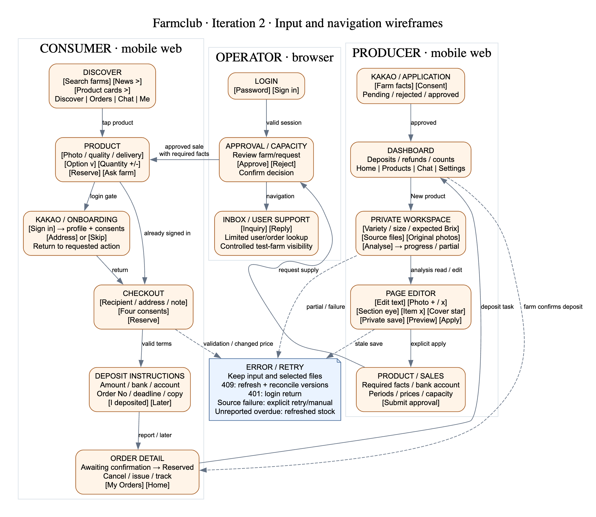

Figure 1a. Current schematic wireframes and user-triggered transitions for consumer, producer and operator. Error/retry branches preserve input; a private save and explicit product apply are separate actions. This diagram is a specification view, not a claim that every drawn state passed testing.

The images in sections 7.2–7.5 are archived I1 evaluation captures, not current v6 acceptance references. Current screen behavior is specified in the tables below and [UI 1.6](https://github.com/snuhcs-course/swpp-2026-project-team-06/blob/main/docs/spec/conversation-ui-1.6.md). The editable source is [Figma v6](https://www.figma.com/design/X8RKiRPZbFEEEwi4OhkF0G).

Current additions: AC-06-6 independent horizontal feeds; AC-07-6 same-option comparison and fixed purchase/tabs; AC-12-12 shelf defaults, draft retention and same-room replies; AC-14-4 fulfillment-only dashboard; AC-17-6 no automatic state transition (Start harvest lives on the sale-period card since DEV-231). Chat previews do not show AI/direct-response badges; private-thread AI controls remain.

Since DEV-231 the producer starts harvest per sale period: the card button "Start harvest · n to preparing" opens a confirmation sheet listing the orders and what the consumer sees ("harvesting and packing", still cancellable before shipment), then moves that period's reserved orders to PREPARING. The dashboard to-do and the Reserved tab link to that card. The approved AI farm-story sample is used only by the matching Mock seed product, never as fabricated live product content.

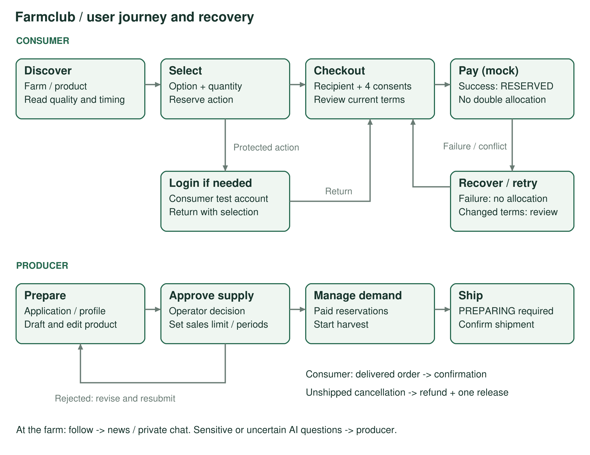

Figure 1b (historical I1). The earlier simulated-payment and harvest UI is superseded by the I2 deposit flow, current screen tables and Figure 1a. Initial sale still requires operator supply approval; editing an already selling page uses explicit apply and current version checks.

### 7.3 Consumer app screens

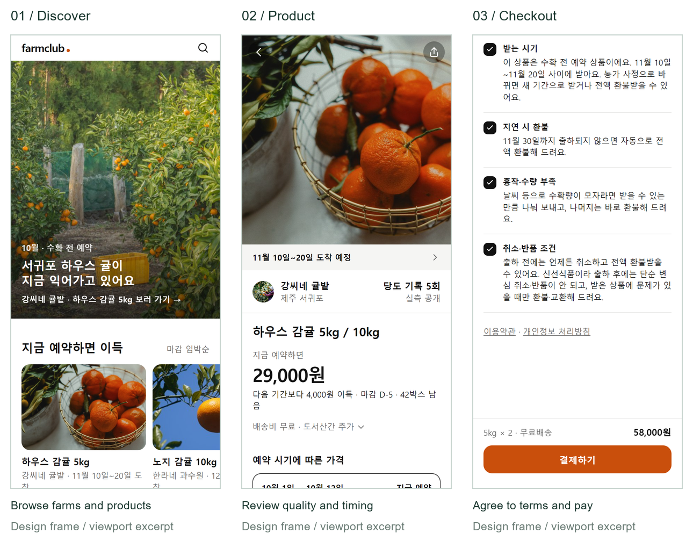

Figure 2. Discover (SCR-01), product detail (SCR-04) and checkout (SCR-10). The user picks a product, option and quantity, enters a recipient and agrees to four terms.

Key consumer screens:

| SCR-01 Discover | SCR-04 Product detail | SCR-10 Checkout | SCR-16 1:1 chat |
| --- | --- | --- | --- |
| 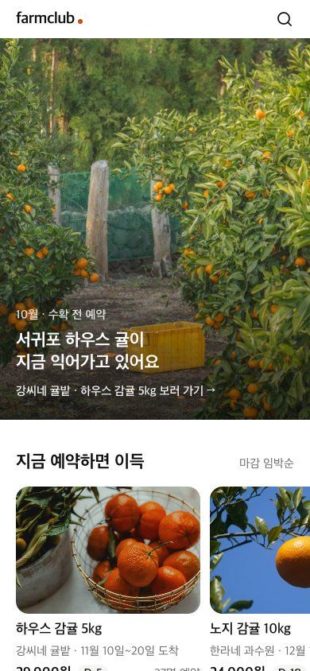 | 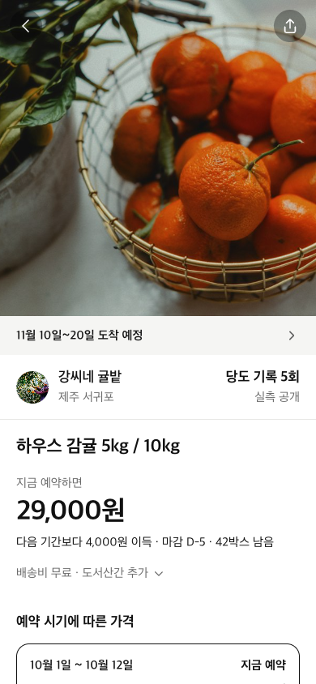 | 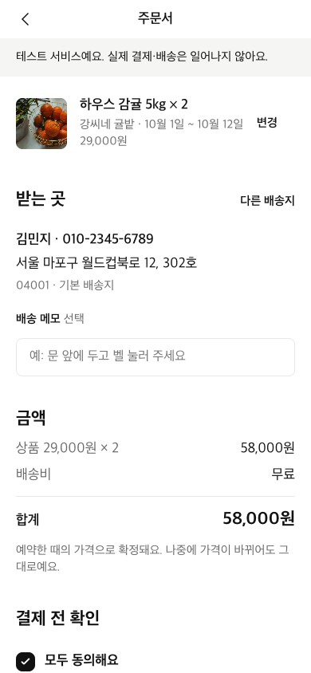 | 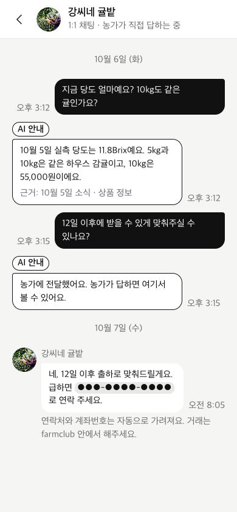 |

| SCR-03 Farm page | SCR-12 Order complete | SCR-13 My Orders | SCR-14 Order detail |
| --- | --- | --- | --- |
| 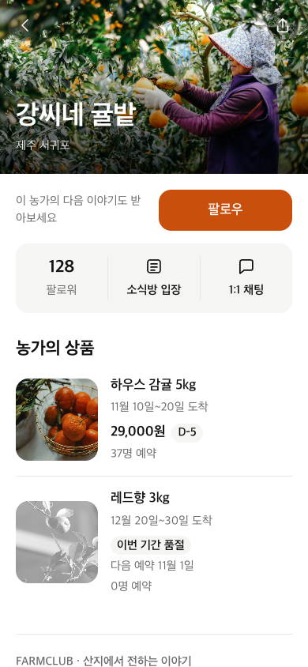 | 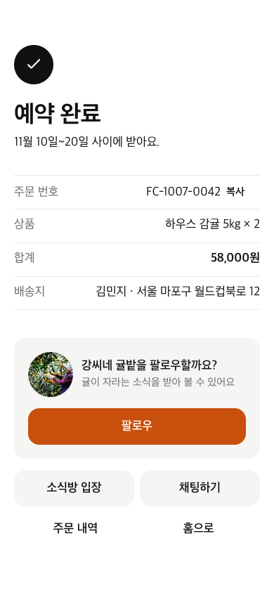 | 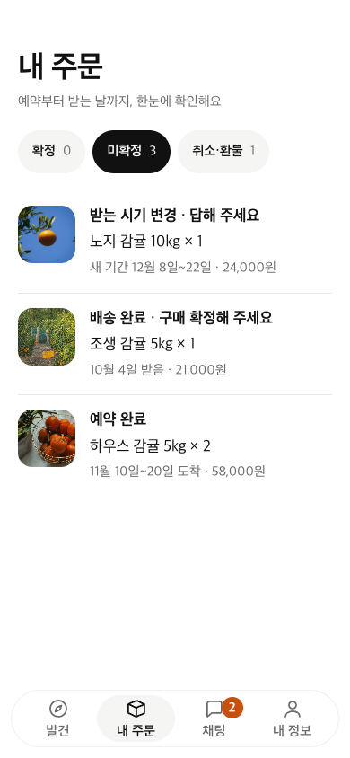 | 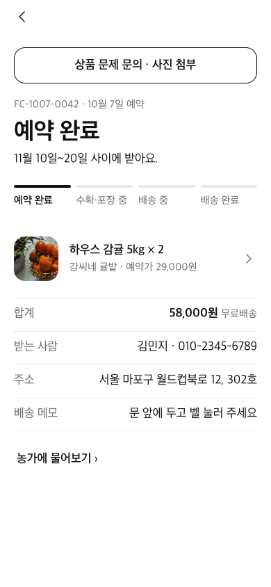 |

| Screen | What it does | Input and actions | Goes to | Failure / not allowed |
| --- | --- | --- | --- | --- |
| **SCR-01 Discover** | First screen under the logo header: "Farm news" (horizontal photo cards, "All" link), then "In season" as a two-column product grid (DEV-293). No page title or subtitle | Search, open a news card or product | News/farm → direct room; product → SCR-04 | Each section has its own empty/error state; no profile-only row or seasonal hero |
| **SCR-02 Farm list** | Approved farms, closing soonest first, with search | Type a search term; scroll for more | Farm card → SCR-03 | No results: "We couldn't find that farm" and a link back to all farms. Search fails with farms already listed: an error box under the search field with Retry, the remaining list labelled "Previous list"; Retry reloads that search from the start without duplicates |
| **SCR-03 Farm page** | Direct farm news room with profile and adjacent Follow button | Fold/unfold the product shelf, send a same-room reply, open short farm info | Product → SCR-04; profile → short info | Header shows "N followers" and a small Following chip; the shelf starts as one collapsed line "N on sale · cheapest item price~" (DEV-295, was expanded for consumers); public/follower access unchanged; no reply-privacy hint. A farm that does not exist or was suspended shows "We can't find this farm" with Browse farms (→ SCR-02) and only a Back button in the header (DEV-224) |
| **SCR-04 Product detail** | Photo (300 high, swipe when there are several) with Back and Share on top, seller row (avatar, farm, region), title, the origin line right under the title at the title's size and color (both 22; Country of Origin Labeling Act enforcement rule, Annex 3; hidden if empty; product cards are out of scope for now, DEV-258), delivery row with shipping and deadline, option rows each with its own boxes left and a right-aligned price (boxes are never summed across options because options share stock, DEV-293), a one-line cancellation policy that expands, full-ratio story image/blocks, quality and disclosures | Reserve opens option sheet; Chat; Share; farm link | Checkout → SCR-10; farm → direct room | The tab bar is hidden and only the Chat/Reserve bar stays fixed (DEV-293); no period price table; comparison is the same option’s final-period price only when higher and available |
| **SCR-05 Login** | Sign in with Kakao (returns through `/auth/kakao`); test accounts appear only while Kakao is off, in the app Mock mode, or on the evaluator link `/login?evaluator=1` (DEV-198), next to the Kakao button (same as the producer app, DEV-136). The Kakao button sits right below the description in the body; with Kakao only there is no fixed bottom bar, and the consent note joins the line under the button (DEV-283) | Tap Kakao or an account; close | Back to the screen and action that asked for login; first sign-up goes through SCR-06. The Kakao return screen shows only a spinner and one line; a reload while signed in goes home without an error | Producer accounts are not listed. Test login off: "You can't log in right now"; if only a leftover evaluator mark opened the list, the mark is cleared and only Kakao shows (DEV-283). No server reply within 15 s: "Login is taking too long". Closing does nothing |
| **SCR-06 Sign-up** | First Kakao sign-up only, one screen: nickname, mobile number, consents (terms, privacy, age 14+ required; farm news alerts optional). Name and address are asked at the first checkout instead, like Karrot (DEV-142) | Fill in, agree, Start | Back to the screen and action that asked for login | Start stays off until required fields and consents are valid. Closing keeps the account and asks again at the next login gate. Kakao values are prefilled; only missing ones are typed |
| **SCR-10 Checkout** | Option, quantity, recipient, address, delivery note (pick from a list or type your own), deposit amount ("Product", "Shipping" shown as 0 won when free, "Total to deposit"), five consents shown as titles with "View" (incl. consent to share delivery details with the farm), one-line intermediary notice; the button reads "29,000원 예약하기" with no paragraph above it (DEV-293) | Change option, pick another saved address or enter a new one, check consents, Reserve | Address → address screen; Reserve → SCR-11 | Reserve is disabled until an address exists and all five consents are checked. Unfinished sign-up → SCR-06. With 50 saved addresses a new one is used for this order only. Price or stock changed meanwhile: screen refreshes with the latest values and keeps the input. The farm has no bank account: 409 explained on the checkout |
| **SCR-11 Deposit instructions** | Rows in the existing list style: amount, bank and account number (copy), account holder, depositor name = order number (copy), 24-hour deadline (amount, account number and depositor name in bold); seller information; "farmclub is a marketplace intermediary" notice; one factual line that buyers may use their own bank's escrow transfer (no recommendation) | "I made the deposit" (hint only), "I'll deposit later" | Both → SCR-12, closing the checkout and deposit screens so Back from SCR-12 never reopens the finished checkout (DEV-222) | Unreported deadline passed: return to current checkout/stock. Reported transfers remain pending operator/farm reconciliation. Lost response on the deposit request: retried with the same key without taking stock twice |
| **SCR-12 Order received** | While unconfirmed: "Awaiting deposit" ("Checking your deposit" once the buyer has said they paid, DEV-207) with the deposit rows, then product and address only (order number and total are not repeated). After confirmation: "Reserved" with order number, product, total and address; following | Copy account number or depositor name, Follow, View order details (DEV-293), My Orders, Home | SCR-14, SCR-13, SCR-01 | No news-room entry button; failed load offers retry |
| **SCR-13 My Orders** | Orders grouped into Confirmed / Unconfirmed / Canceled-Refunded with counts (32px chips, no subtitle; each card is four lines with the delivery window and deposit/refund event on one line, DEV-293). Each card reads "status · next step", e.g. "Awaiting deposit · please transfer", "Checking your deposit · the farm is checking", "Refund pending · the farm will send it" (DEV-207), and ends with "order number · ordered on" so repeated orders can be told apart; cards waiting for a deposit also show the delivery window (DEV-226) | Switch tabs, tap an order | Order → SCR-14 | No orders: "You haven't reserved anything yet" and Home. Empty tab: "No {tab} orders" |
| **SCR-14 Order detail** | Header "Order details"; the product-issue inquiry button sits right under the status title; no bottom bar without a button (DEV-293). Status steps, delivery window, tracking, available actions; while awaiting a deposit: the account card, deadline and "I made the deposit"; after "I made the deposit" the title is "Checking your deposit", the deadline and Cancel disappear, the time of the notice and "Ask the farm" appear (DEV-207); refunded: "Refund pending" (the farm sends it back within 3 business days), "Refund delayed" if the farm has not approved it, and "Refund complete" only after the farm records the transfer (DEV-207); expired: "canceled because the deposit deadline passed"; reported but still unconfirmed at the deadline: the title stays "Checking your deposit" and the body says farmclub is contacting the farm and the order will not be canceled (DEV-233) | Cancel (confirm sheet; no refund before the deposit), Confirm receipt, accept the new window or take a refund (a confirm sheet comes first, DEV-291), copy or track the number, report a problem | Report a problem → SCR-32 | No Cancel after shipping. Someone else's order → SCR-13. Status already changed: refreshes to the latest state |
| **SCR-15 / SCR-18 Chat** | News Rooms (farms you follow) and 1:1 chats in one tab, switched by underline tabs; the 1:1 tab shows the unread total and photo-only messages preview as a photo icon with "Photo" (DEV-295). The 1:1 list also has the consumer's own "farmclub" support room (DEV-150): created at sign-up with a welcome message, sorted by recent activity, answered by the farmclub team from the admin Inbox (no AI, text only, contact details masked) | Switch views, open a room or chat | Room → news room; chat → SCR-16 | No chats: "Ask a farm anything" with a link to farms. Other buyers' replies never appear |
| **SCR-16 1:1 chat** | Private questions to one farm; labeled AI answers (each answer that was not forwarded has a "This is wrong" report button, AC-13-5) or "Sent to the farm". Messages are grouped under a centered date pill in Korean time ("10월 7일 수요일", same as News Rooms). Bubble-chat layout (DEV-295): one gray system line at the top instead of the notice band, consecutive bubbles from the same sender in the same minute are grouped (avatar and real name once, time beside the last), AI answers have a thin gray border and an "AI 안내" label with the answer-check request as a text button below, "읽음" beside my last read bubble, a 40/40/40 composer, Copy in the long-press menu (also in rooms without replies) and tap-to-zoom photos | Type up to 1,000 characters, attach up to 3 photos, Send | Farm header → SCR-03 | General explicit entry starts the thread and follows the eligible farm; a valid paid-order start records context without following. Inaccessible farms/roles are refused. After unfollowing, valid linked paid-order or formal-inquiry context preserves access, with an explicit eligible order required for sending. Return within the same session restores authorized history and the reading position; new history messages do not force latest scrolling. Send fails: text and photos are kept for the same context’s retry. AI fails or times out: question goes to the producer |
| **SCR-17 Me** | Nickname, followed farms, edit profile, address book (up to 50, edit and delete), "Start as a farm", log out | Tap a farm, edit profile, manage addresses, log out | Farm → SCR-03; profile → `/me/profile`; addresses → address book; log out → SCR-01; screens left in the stack no longer turn into a login, so logging in again never reopens an earlier checkout (DEV-222) | Unfinished sign-up shows "Finish signing up" (title only). Starting a farm explains in one sentence that the producer app needs its own account. "Reset demo data" is a list row shown only in Mock mode (DEV-293). 50 addresses: adding is off until one is deleted |
| **SCR-32 Order problem** | Report damage, quality, taste or other with up to 3 private photos | Pick a type, describe it, attach photos, Send | Success → SCR-16 with the order attached | Not your order or not paid: cannot be sent. Upload or send fails: input is kept, and a retry never files it twice |

### 7.4 Producer app screens

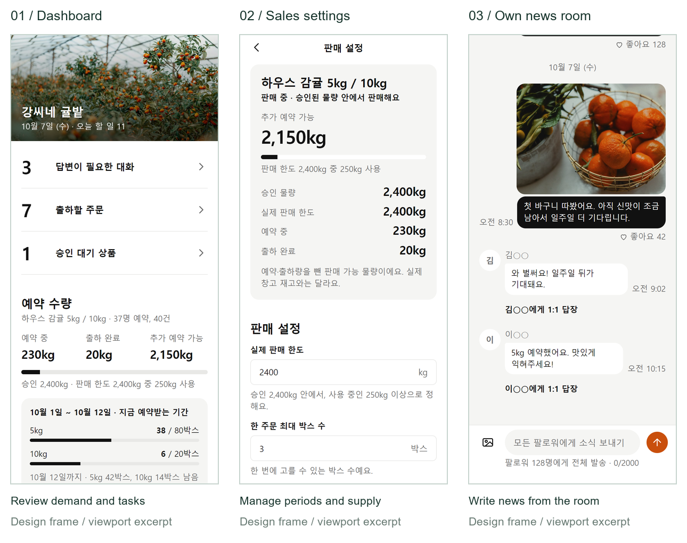

Figure 3. Dashboard (SCR-22), sales settings and the farm's own news room. The producer checks demand, manages supply and prices, and posts updates from the room.

Key producer screens:

**Help guide (DEV-109).** All four tab screens (SCR-22, 23, 28, 33) have a "Guide" button (question-mark icon and the word on one line, read aloud as "Help", 48 touch area) at the top right (DEV-294). Tapping it returns to the dashboard and starts a 13-step hands-on spotlight tour.
- **Display:** The screen is dimmed except for the element being explained, which is outlined. A card and an arrow point to that element.
- **Steps:** In "tap" steps the producer must tap the highlighted element and the real screen changes; taps on the dimmed area are blocked. "Explain" steps use Next.
- **Flow:** Welcome → Products tab → New product button (explained only: it opens the sales-page builder, where the AI reads text, photos and PDFs in Source materials to fill product details and draft the sales page, while product photos go in their own box) → Chat tab → News Room → 1:1 Chat → farmclub support room → how to ask (explained) → back → Settings tab → AI reply settings (repeated questions are answered by the AI, judgment calls are passed on) → auto-reply on/off (saved only with Save) → the Help button ("tap [?] to see it again; ask anything else in the farmclub room", with the real Help icon in the text). Each card body is one or two short sentences (DEV-294) with "please ask in the farmclub chat room" (DEV-111). The copy is friendly and gives concrete examples of what the AI does.
- **Exceptions:** With no 1:1 chats the conversation steps are skipped. If a target cannot be found for 3 seconds the card is centred with Next. X or Esc ends the tour at any time.
- **Start:** Only the Guide button starts it. It no longer starts by itself on the first dashboard visit (DEV-294).
- **Server state:** The tour never presses a server-changing button. New product is only explained because opening it creates a draft product on a real server (SCR-24).
- **Native app (DEV-206):** The app cannot measure target positions, so each step is a centred card with its description and Next, without the cut-out or arrow (tap steps also use Next). The card is drawn over the screen inside the status and navigation bars, and X ends the tour. The web behaves as above.

| SCR-22 Dashboard | SCR-24 AI product draft | SCR-25 Product edit | SCR-29 Shipping |
| --- | --- | --- | --- |
| 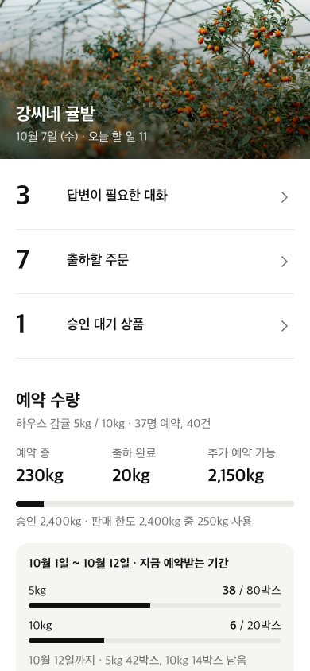 | 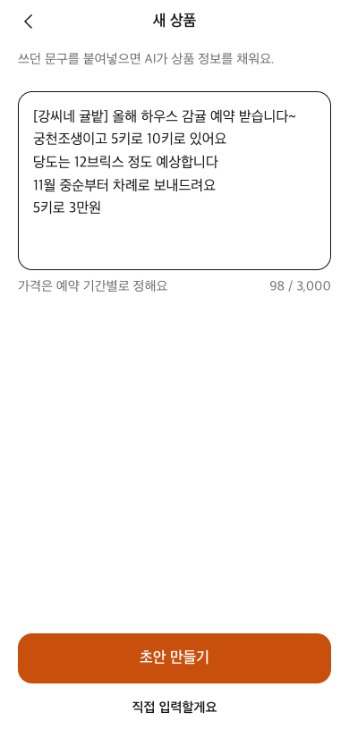 | 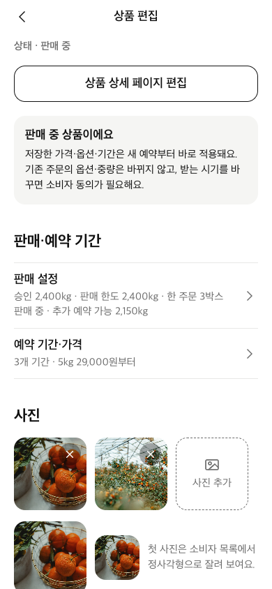 | 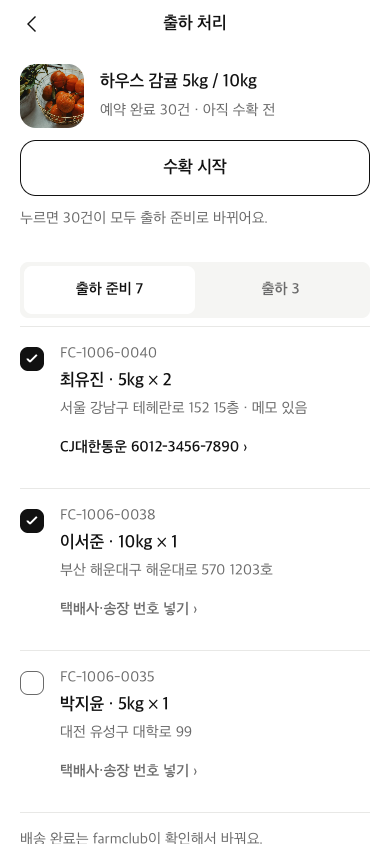 |

| SCR-21 Pending approval | SCR-26 Periods and prices | SCR-28 Chat | SCR-31 AI settings |
| --- | --- | --- | --- |
| 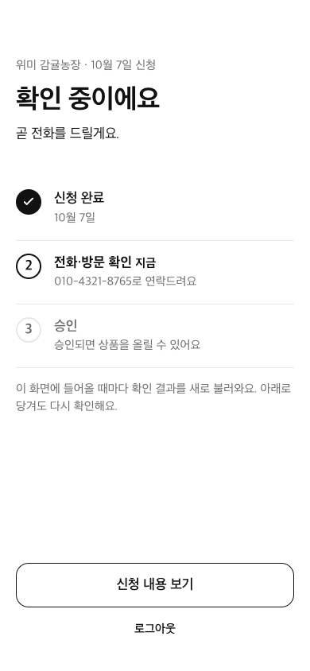 | 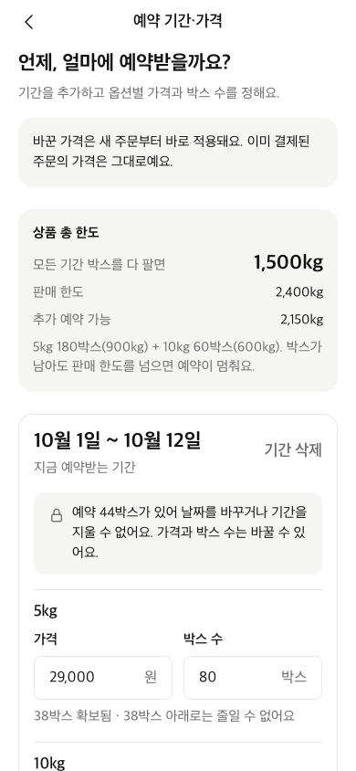 | 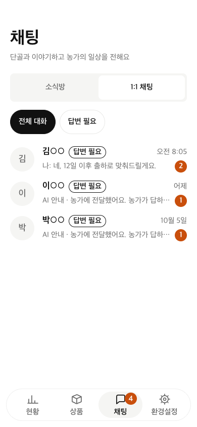 | 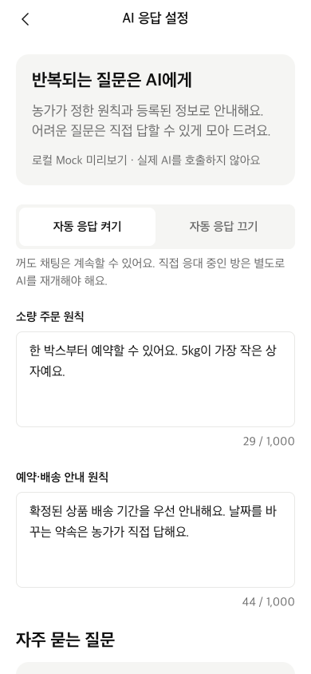 |

| Screen | What it does | Input and actions | Goes to | Failure / not allowed |
| --- | --- | --- | --- | --- |
| **SCR-19 Login** | Start with Kakao (returns through `/auth/kakao`); test accounts appear only while Kakao is off (the Mock and the evaluator link `/login?evaluator=1`, DEV-198, keep both). The Kakao button sits right below the description in the body, as in the consumer app; with Kakao only there is no fixed bottom bar and the footer sits at the bottom (DEV-283) | Tap Kakao, or an account and Start | No farm → SCR-20; under review or rejected → SCR-21; approved → SCR-22; suspended → suspension notice (reason box, "Contact the farmclub team" main button to `/support`, log out; DEV-209). The Kakao return screen shows only a spinner and one line, sends the producer straight to that screen, and a reload while signed in goes there too | Consumer accounts are not listed. Test login off: "You can't log in right now"; if only a leftover evaluator mark opened the list, the mark is cleared and only Kakao shows (DEV-283). No server reply within 15 s: "Login is taking too long" and Log in again |
| **SCR-20 Application** | Farm details for joining; creates the producer account | Owner name, farm name, region, main crops, mobile number, policy consent; Apply | SCR-21 | Field errors keep the input. Already applied → SCR-21. Reapplying after rejection fills in the previous values |
| **SCR-21 Pending approval** | Application status, refreshed every time the screen opens | View application, pull to refresh, log out, reapply if rejected (main button) or contact the farmclub team (text button, opens `/support`, DEV-209) | Approved → SCR-22 automatically; reapply → SCR-20 | Before approval, every other producer screen redirects here |
| **SCR-22 Dashboard** | One-line header with the existing icon logo and the title "Dashboard", then farm name and date (DEV-294). To-do list of 56px one-line rows with an accent count or a "Required" tag (read the origin labeling notice (DEV-121), register a bank account, deposits to confirm, reservations to harvest, refunds to send, unanswered questions from `openQuestions`), one grey card with four counts in a row (all/reserved/preparing/shipped, preparing in accent), the representative product with total reserved+shipped kg against its sales limit as small secondary text and one row per weight option ("5kg  32,000 won   24 boxes / 72 boxes": the current period's box price, then boxes over all periods) with a thin progress bar (DEV-300; falls back to the kg bar when the dashboard has no period data), and a permanent origin notice row at the bottom once read. No card hints or duplicate order/shipping buttons | Open a to-do, a count, "Shipping ›" or "Products ›" | SCR-29 filtered list, bank account screen, SCR-26, 1:1 chat list, sales settings | All cursor pages contribute to order counts (orders awaiting a deposit included); no chat tasks or news-writing entry |
| **SCR-23 Products** | Products grouped by status with reservation counts, one row per weight option ("5kg  32,000 won   24 boxes / 72 boxes" from the list API's `options`, no per-card detail request, DEV-300) and approved/available kg as small grey secondary text; drafts show when they were last saved (DEV-226) | Filter, tap a product, "+ New product"; per card "Edit sales page", "Sales settings", "Periods and prices" | Product → SCR-25; new → SCR-24 | No products: "Add your first product" |
| **SCR-24 Product source workspace** | When analysis is enabled: basic variety/size/expected Brix, source attachments and a separate original-photo box; analyse and directly edit the page. Disabled flag: legacy text/manual editor | Save basic facts, add/edit text/TXT/image/PDF, describe/select photos, Analyse, edit modules, hide sections/items, choose representative photo, Save privately, Apply explicitly | Fill the buyer-shaped page → "Next: sell and price" applies the detail and opens SCR-24b (published products: confirm, then SCR-25) | Upload waits for pending basic-info save; show partial/failed work and explicit retry, preserve direct input/files, reject stale versions; no representative photo blocks new analysis/apply but not private editing. Legacy AI failure retains text and manual editing |
| **SCR-24b Sell and price (new products, DEV-184)** | Weight options, delivery window, refund date, period prices (one period by default, add early-bird periods), shipping fees, total supply and per-order limit on one screen | Save, Preview (buyer page without edit boxes), Request to start selling | Request → operator approval → published | Later periods must cost more and end before delivery; separate shipping needs an amount; missing bank account shows a link to register it and keeps input |
| **SCR-25 Product edit** | Product details, quality, options, delivery window, shipping fee, sales settings | Save, set periods, Submit for approval, pause or resume | Periods → SCR-26 | Submit stays disabled until required fields and period prices are set; an origin of only spaces counts as empty, and the origin field says where it shows to buyers (DEV-258). Unsaved changes: confirm before leaving. Changing the delivery window with existing orders asks buyers to accept or refund |
| **SCR-26 Periods, prices and supply** | Date-based reservation periods with a price and box count per option | Add or remove periods, pick dates, enter prices and quantities, Save | Back to SCR-25 | Earlier price must be lower and periods cannot overlap. A period with reservations cannot be deleted or re-dated If someone else saved first, the input is kept |
| **SCR-28 Chat** | News Room / 1:1 Chat only; own room opens immediately by default. The 1:1 list also shows a "farmclub" support room with the logo, sorted by recent activity like other chats (DEV-111): the producer asks the farmclub team there and the team replies from the admin Inbox; no AI answers in that room and consumers never see it | Send (a confirm sheet shows the follower count and a preview first; "Not now" keeps the text), attach from the "Photo·Video" chip, fold product shelf, delete own news from the long-press menu (text news can also be deleted and rewritten), switch to private chat list (DEV-210) | Private thread or attachment composer | Underline tabs "My news room / 1:1 Chat N"; the shelf is one collapsed line "N on sale · N followers"; each own post has a single right-aligned "읽음 N · ♥ N · 답장 N ›" line (DEV-295, DEV-297); "답장 N ›" opens the fan reply sheet; broadcast notice is the first scrolling system message; composer is fixed above four tabs |
| **SCR-27 Post news** | Text with up to 5 photos (10MB each) or 1 video (60s, 100MB); public or followers only | Write, attach, choose visibility, Post | Back to the farm's own room | Wrong format or size: reason per file. Attachment fails: the text is kept |
| **SCR-29 Orders and shipping** | Underlined, horizontally scrolling tabs with counts (all/awaiting deposit/reserved/preparing/shipped/refunded) and a one-line hint per tab (DEV-294). Rows show the buyer name with the order number on the right, then "product option × quantity" with the amount on the right (an option list at the end of the product name is dropped when it repeats the option), then a one-line address; sheets keep "name · product option × quantity" (DEV-226). The All tab puts a status chip before the name and dims cancelled rows; confirm deposits; mark refunds as sent; ship existing preparing orders | Approve / Decline on deposit and refund rows (deposit approval opens a sheet: Close / Confirm deposit); on Preparing: "Select all", a centred checkbox per row, a 32px "Enter invoice" button (filled rows show carrier and number with "Edit"), then "N selected · Ship" → confirm sheet (Close / Ship N); decline reasons are a vertical radio list | Back to the list | Rows awaiting a deposit hide the delivery address. The Reserved tab lists one "Start harvest" link per sale period that leads to the period card (SCR-26), with no state-changing button on rows; no automatic RESERVED → PREPARING; stale states refresh after conflict |
| **SCR-33 Settings** | Farm summary, profile and share link, AI settings, log out | Tap an item | SCR-30, SCR-31, SCR-19 | Retry if loading fails |
| **SCR-30 Farm profile and link** | Edit name, region, introduction and the deposit bank account (bank, account number, holder); copy or share the farm link | Copy, Share, edit one field, change photo, register the account, edit the farm detail page | Field → single-field edit screen; account → bank account screen (`/farm/account`); detail → farm detail editor (`/farm/detail`: draft from notes and photos, edit blocks, save; DEV-233) | Name and region cannot be empty. The link is hidden until the farm is approved. Without a bank account the first capacity approval request is rejected (`NO_FARM_ACCOUNT`) |
| **SCR-31 AI settings** | AI on/off, answering guidelines, FAQs, extra handoff topics, preview | Edit, Save, Preview | Back to SCR-33 | Unsaved changes are marked and confirmed before leaving. On `STALE_VERSION`, fetch the latest version while keeping producer edits so they can save again |

### 7.5 Failure screens

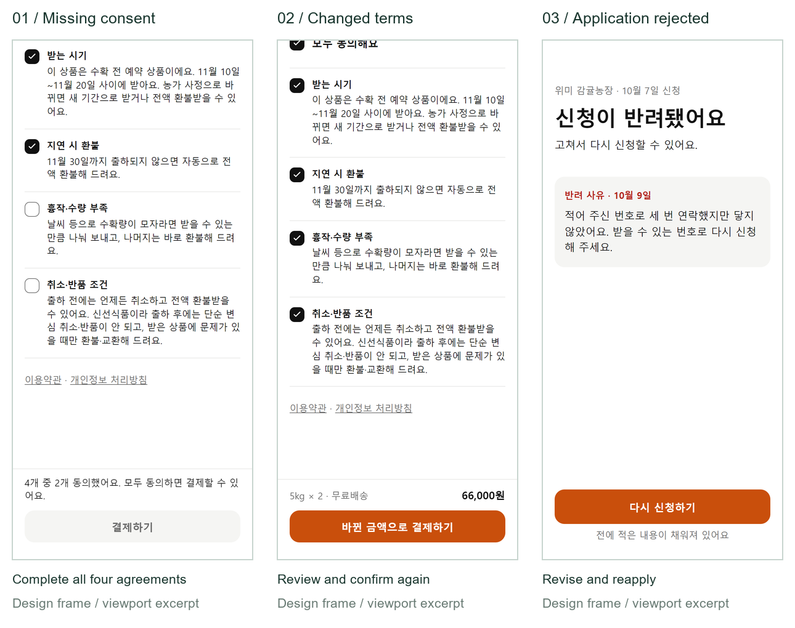

Figure 4. Missing consent, changed reservation terms and a rejected application. The app blocks the next step, asks the user to confirm the new terms, and lets a rejected farm apply again.

More failure states:

| Sold out (SCR-04) | Missing consent (SCR-10) | Payment failed (SCR-11) | AI draft failed (SCR-24) |
| --- | --- | --- | --- |
| 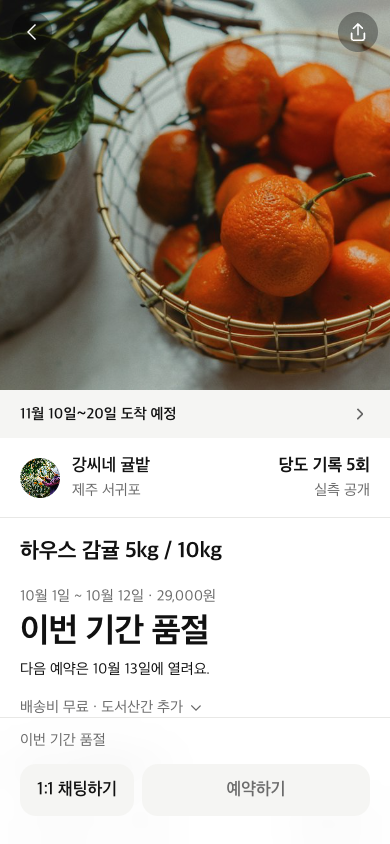 | 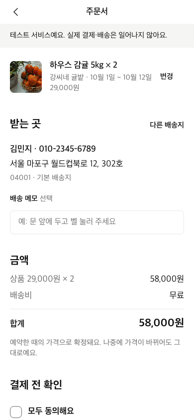 | 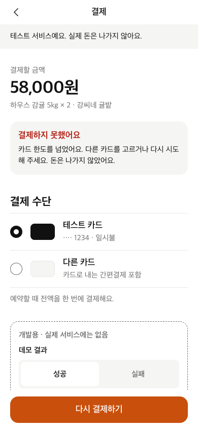 | 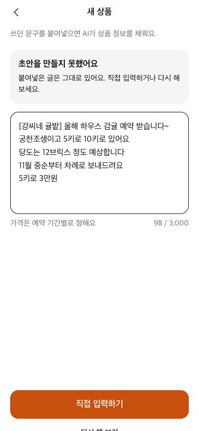 |

Rules that apply on every screen:
- Buttons lock while a request is being processed, and an order or payment is never processed twice even if the user taps again or the connection drops.
- When a save fails (network, validation or conflict), what the user typed and the photos they picked are kept, including after a detour to login.
- If the user is not allowed to see a screen, it shows "You can't view this screen" with a link to the first screen.
- Network errors show "Your connection is unstable" with Retry. Success messages appear as a short toast.

### 7.6 Operator screens (I2)

| Screen / input | Successful transition | Failure / restriction |
| --- | --- | --- |
| `/login`: shared operator password | Session → producer approvals | Invalid/expired session returns to login; token never enters browser storage |
| `/producers`: pending farm, review, approve/reject confirmation | Decision refreshes status; approval provisions support room | Role/session failure blocks action; failed response remains retryable |
| `/capacity`: initial/increase request, approve/reject | Updated approved limit and request state | Version/validation conflict refreshes; UI/proxy failure is not approval |
| `/farms`: preview controlled hide/restore | Test farm becomes absent/present on public discovery | Refuse hiding where protected non-test orders exist; hiding is distinct from pause or deletion |
| `/users` and user detail: search, tester marker, order lookup | Limited user and recent-order support data | Phone masked in search; recipient delivery fields excluded from support lookup |
| `/inbox`: select producer or consumer inquiry, reply | Read position and one operator message update | Operator only; producer photo count shown without photo viewing; consumer support is text only; no AI answer or order-state mutation |
| `/ai-cost`: view AI cost by feature | Per-feature and overall totals (this month, last 7 days, all time) for spec-code-review, product draft, detail draft, AI answer and source analysis; filterable call list | Read-only; amounts are estimates from public per-token prices (source analysis uses the provider-reported cost), unpriced calls are counted separately; spec-check runs are reported by CI with a dedicated token |

### 7.7 Room permissions

| Viewer | Public news | Follower news | Private replies | Can do |
| --- | --- | --- | --- | --- |
| Anonymous | Read | Hidden | Hidden | Log in first |
| Consumer, not following, with no own reply history | Read | Hidden | Hidden | Like public news; follow to reply |
| Former follower with own reply history (DEV-230) | Read | Hidden | Own retained replies, dimmed | Read history; follow again to unlock replies; farm is absent from the followed news-room list |
| Consumer, following | Read | Read | Own only | Reply; like news they can see |
| Owning approved producer | Read | Read | All replies in their room | Post news; open a private chat |
| Other producer | No access | No access | No access | None |

Reading a room never follows the farm automatically.

## 8. Implementation Status and References

| Area | Implemented through the I3 reference | Remaining boundary |
| --- | --- | --- |
| Accounts and communication | Kakao onboarding/state return, wrong-answer reports, farmclub support/help tour; order-aware private entry, sequence ordering and same-session reading restoration | Live account behavior needs environment-specific validation; external notifications are not implemented |
| Commerce | Farm account registration, deposit instructions/report/confirmation, expiry exceptions, refund settlement and retry protection | No automatic bank matching, payment custody or integrated escrow; RESERVED → PREPARING only through per-period Start harvest |
| Producer pages | Private source worker/editor, direct module editing, photos, explicit apply and manual/legacy fallback | Numeric OCR, omissions/conflicts and actual farmer acceptance require review; deployment does not establish general AI accuracy |
| Operator | Producer/capacity tools, controlled farm visibility, privacy-limited user lookup and support inbox | Shared admin identity; no full multi-operator case management or inbox image rendering |
| Deployment/media | Vercel clients/admin, Railway API/worker, R2 media/private sources, approved-farm Open Graph sharing, optional PostHog client instrumentation | Sentry/Langfuse and server analytics events are not wired; performance/uptime targets are not yet established |

The [Testing Documentation](https://github.com/snuhcs-course/swpp-2026-project-team-06/wiki/Testing-Documentation) retains the I2 77-case internal workbook, other owners' evaluations, the original I3 consumer-chat baseline and separately dated fix/CI evidence. Later commits do not rewrite earlier deployed failures or blockers. PR [#482](https://github.com/snuhcs-course/swpp-2026-project-team-06/pull/482) was squash-merged as `86e5410` on 6 November; its required local regression evidence is 57 browser cases and seven real-API scenarios. Those results concern the two scoped fixes, not every app requirement, a human approval record or a native-device pass. The dated implementation reports below retain their pre-merge gate descriptions; the later Testing Documentation merge/CI chronology supplies the subsequent state.

| I3 finding / decision | Disposition and evidence boundary |
| --- | --- |
| First paid-order conversation unavailable after unfollowing (DEV-242) | Explicit authorized order association, entry initialization and context-scoped sends implemented in DEV-245–249; local closure is recorded in the order-chat report below |
| Reading position lost on farm A → B → A (DEV-243) | Metadata-only session store, measured anchor restoration and race guards implemented in DEV-250–253; local closure is recorded in the reading-position report below |
| Original ordering-oracle discrepancy (DEV-244) | Separate decision; preserve insertion sequence and KST grouping without changing the frozen evaluation expectation to manufacture a pass |
| Visual synchronization and producer notification replacement race | Follow-ups DEV-256 and DEV-257; the two chat fixes do not claim to resolve them |
| AI source quality and independent acceptance | Development improvements, historical holdout failures and the current v2 lock are distinct evidence; review omissions, qualifiers and numeric OCR before applying output. A lock or refinement-only score is not full-pipeline acceptance |
| Native and production mutation scenarios | Shared implementation and browser tests do not establish physical-device background/keyboard behavior or an authenticated production mutation result |

**I3 demonstration.** The [iteration-3-demo README](https://github.com/snuhcs-course/swpp-2026-project-team-06/blob/iteration-3-demo/README.md) provides the runnable snapshot, environment, I3 progress and four [demo-i3 recordings](https://github.com/snuhcs-course/swpp-2026-project-team-06/releases/tag/demo-i3), also presented at [demo.farmclub.kr](https://demo.farmclub.kr/). The recorded product snapshot is `efa684b4`, before the later PR #482 chat fixes. The overall recording includes harvest and shipment; the role recordings and story are complementary views of the same controlled scenario. Local deposit-report/confirmation and transfer labels are simulations: no money moves, no bank reconciliation or courier delivery is demonstrated. The I2 branch and recordings remain historical artifacts.

I3 primary evidence: [authorized order-chat regression](https://github.com/snuhcs-course/swpp-2026-project-team-06/blob/28feb94ac47b259b6a6299e9fd742b75e756a33d/docs/evaluation/dev-242-order-chat-regression.md), [reading-position regression](https://github.com/snuhcs-course/swpp-2026-project-team-06/blob/28feb94ac47b259b6a6299e9fd742b75e756a33d/docs/evaluation/dev-243-scroll-restoration.md), [DEV-253 task and retained verification history](https://github.com/snuhcs-course/swpp-2026-project-team-06/blob/28feb94ac47b259b6a6299e9fd742b75e756a33d/docs/evaluation/tasks/DEV-253.md), [source evaluation with historical denominators](https://github.com/snuhcs-course/swpp-2026-project-team-06/blob/28feb94ac47b259b6a6299e9fd742b75e756a33d/docs/spec/validation/source-final-eval-i3-2026-11-01.md), and [independent source holdout v2 protocol](https://github.com/snuhcs-course/swpp-2026-project-team-06/blob/28feb94ac47b259b6a6299e9fd742b75e756a33d/docs/spec/validation/source-final-holdout-i3-v2.md). No new app or model-quality evaluation was run for this document revision.

**I2 producer recovery:** empty AI strings/option arrays require review; manual creation excludes concurrent generation/retry; failed calls preserve text; missing origin/storage blocks initial supply submission. Failed browser sharing copies the server URL, while user cancellation is silent. Shipping saves carrier/tracking before a refresh retry and does not undo a successful shipment.

**Share boundary:** the public share endpoint renders escaped Open Graph metadata for approved visible farms. Ineligible/missing farms receive the same uncached 404 without private metadata. Share delivery and public visibility are distinct from product approval.

Sources: [PRD](https://github.com/snuhcs-course/swpp-2026-project-team-06/blob/main/docs/spec/prd.md), [functional criteria/rules](https://github.com/snuhcs-course/swpp-2026-project-team-06/tree/main/docs/spec/functional), [screen specification](https://github.com/snuhcs-course/swpp-2026-project-team-06/blob/main/docs/spec/screens.md), [source integration](https://github.com/snuhcs-course/swpp-2026-project-team-06/blob/main/docs/spec/source-integration.md), [source editor](https://github.com/snuhcs-course/swpp-2026-project-team-06/blob/main/docs/spec/source-editor.md), [UI 1.6](https://github.com/snuhcs-course/swpp-2026-project-team-06/blob/main/docs/spec/conversation-ui-1.6.md), [Design Documentation](https://github.com/snuhcs-course/swpp-2026-project-team-06/wiki/Design-Documentation). The later contracts' current-state notices take precedence over their retained historical proposals.

### DEV-179 producer workflow decisions (owner, 2026-11-02)
Representative photos are required before public application, but not before analysis. Variety remains mandatory and uses the existing basic-info save/flush from the AI sheet above the start button; the older workspace retains its basic-info card. Producer editors remove AI provenance badges and evidence buttons/lists, while evidence remains stored and returned by the review API for audit. Distinct normalized values for the same fact (specification/origin, composition/weight, piece count, or Brix) show the choice picker, including the current refined/basic-info value. Without a current refinement (including a pending refinement), multiple distinct safe raw candidates remain selectable for both fact and narrative fields. With no refinement requested, fact candidates that normalize to one value use a representative raw value and its evidence as ready/EXTRACTED/UNREVIEWED; while refinement is pending they stay missing. Successful refinement omissions stay missing. Refined complementary facts and combined narrative summaries/farm stories remain ready and auto-save as UNREVIEWED; outdated and explicit producer decisions are preserved.

The fixed editor-header buyer preview toggles the same view using the shared 18-module renderer and preserves unsaved edits. Start errors appear beside the start button and clear on a new attempt. Current run phases/status and available page counts indicate progress without an invented ETA; producers are told they can leave and return. OCR and chunk failures expose separate page-number lists and notices, and all UI retries require the displayed cost acknowledgement. Exclusion acknowledgement overwrites the latest version per producer/workspace/target in browser storage, migrating only the committed `farmclub-producer:excluded-seen:<batchId>:<refinementVersion>` sessionStorage acknowledgement once the session user is available, with an application-lifetime fallback; the chip remains available on demand. Reanalysis explains the editing lock, and the saved-draft review action is labeled “Review before publication.”

Deposit approval now requires a confirmation sheet showing the existing permitted name display, option × quantity and total amount; cancellation sends no approval request. Every producer order row shows the total already supplied by the API. No new order-detail screen is introduced. Shipped rows reuse the tracking editor for own-farm corrections (FEAT-17/SCR-29/R-19, AC-17-9). Carrier is required and the existing optional 50-character tracking format is retained. Version and idempotency checks prevent lost or duplicate changes. The consumer delivery lookup uses the latest value; status/shipped time stay unchanged. Every actual correction records previous/new values, time and actor atomically in the existing server audit mechanism. History is available only through DB/operator APIs and never appears in producer or consumer UI. Figma synchronization is follow-up **DEV-185**. Implementation and automated/static results are recorded separately from pending human Playwright verification.

Analysis requires at least one source; an empty batch disables the start action with the same reason returned by the API. The buyer preview uses the shared ProductPageBody/BrixReading renderers, and progress has one visible instance.

### HE source-input recovery (DEV-237)
An unsaved first text with non-whitespace content enables analysis while the input remains focused. Both producer editors flush that text and basic information before reading the current batch version and requesting analysis. An empty batch with no pending text remains disabled. A failed text save preserves input and does not request analysis. In the new-product composer, collapsed-sheet save/next failures use the existing error panel beside the footer actions, once; the expanded sheet retains its existing error location. Error wording, refresh eligibility and publication validation are unchanged.

### DEV-179 demo-recording follow-up (owner, 2026-11-02)
Both source editors share the composer's server `representativePhoto` field-reason mapping. In the workspace private-save/review/apply flow, a missing representative photo shows “대표 상품사진을 한 장 이상 올려 주세요.” beside the apply confirmation action. A new attempt or cancellation clears the prior error, and the apply reason is shown once inside the confirmation, not repeated in the page alert. Only input validation errors (400 with field reasons) hide server refresh; version or state conflicts (409), network failures and server errors keep it. Connection failures show Korean copy instead of the browser message. Before a new product has sale settings, its buyer preview hides the stock, deadline and shipping rows instead of showing "0 boxes left". Conflict pickers show one button per normalized value.

Retry consent keeps the existing uncertainty wording when any current-run item has `REQUEST_UNCERTAIN`, including mixed definite/uncertain failures. Otherwise it reads “다시 분석하면 비용이 다시 들 수 있어요. 확인했어요.” The consent gate still disables retries until checked, disables them again when unchecked, and resets after a successful start/retry. The new-product analysis view retains the current run progress and removes the redundant 220px loading block and its two skeleton lines; initial product loading retains its skeletons. Figma v6 synchronization remains follow-up DEV-185.

### Chat insertion order and handoff summaries (DEV-235, DEV-213)
Messages expose the existing persisted insertion sequence. Clients use that order even when question and AI reply timestamps match; pagination and read cursors retain their existing semantics. During a rolling API update, a missing sequence anywhere in a loaded set uses stable timestamp order for the entire set. Random message IDs do not reorder equal-time messages. Mock private/support chats preserve insertion order too. Forwarded notices have no model-reason source summary, including older saved notices; evidence summaries for normal answers remain.

### Private farm-chat reading positions (DEV-250–253)

After a freshly authorized head page verifies the consumer, farm and server thread, same-session farm A → private list → B → list → A restores the first visible message and its signed viewport offset, together with the loaded history boundary. Older pages are reloaded and merged by saved message sequence. Historical restores suppress initial latest scrolling and read advancement; same-viewport anchor drift must be at most 8 CSS px. Delayed photos, text reflow and prepends retain the anchor until intentional wheel/drag/scroll-key movement or the explicit latest action. New messages remain unread while the reader stays in history and expose the existing new-message control.

A removed anchor falls back to a saved surviving neighbor, then to clamped geometry in freshly authorized history. Transient failures expose retry; terminal authorization failure removes protected conversation state. Only IDs and geometry live in memory, bounded to 20 rooms and 30 idle minutes. Consumer/user/auth generation/thread/visit leases reject old callbacks. Logout, token loss/401, WRONG_APP and every new login clear the store synchronously, including equal-token relogin. Ordinary same-session auth.me refresh preserves it; a hard reload starts cleanly. Selected-order changes retain the thread reading identity while the composer keeps DEV-248's order/photo isolation. Browser regression results and deployment/native limitations are recorded separately under docs/evaluation.

DEV-287: The producer edits content inline in the final buyer layout. Only the selected field displays editing controls; page/pencil icons switch between buyer view and editing. Chat list headers use the brand logo.

DEV-287: Editable fields and photos retain warm orange highlights before selection; buyer view has no editing highlights.

DEV-287: The add-content tray uses existing section artwork, the module title, and a trailing plus. Intro and summary use the page icon; add actions remain unchanged.

DEV-287: Summary is part of the introduction, with no separate add control or divider; original fields and evidence are retained. Cover add/change opens a single-image picker without opening AI or starting analysis.

DEV-287: Adding a section enables it independently of focus. Multiple empty editor sections stay added; empty content remains omitted from buyer view.

DEV-287: Validation uses a compact footer message and scrolls to the invalid editor region, pulsing red three times before keeping a static border. Reduced-motion users receive a static border. The closed AI sheet uses a flat action footer.

DEV-287: AI retry uses a single action without a cost-confirmation checkbox. A three-second local click gate supplements existing server active-run and idempotency guards.

DEV-287: Header actions always display captions below their icons: 미리보기 (편집하기 in buyer view) and AI 초안.

DEV-287: Sales settings are edited inline within the product page using highlighted controls and a preview/edit toggle. Expected Brix entry is available in the composer. Next requires a prepared representative photo, while draft save permits none. A manual draft transfers photos without requiring AI analysis.

DEV-287: Brix entry and display use one 측정 당도 field. Existing measured values take precedence over legacy expected values. Edits and clearing synchronize both existing API fields; no schema migration is required.

DEV-287: Composer and AI draft variety controls share the same state. In-app back navigation saves edits before showing the saved toast and leaving; failure retains the current editor and inputs.

### DEV-289 chat interaction contract
Both participants can quote a message in the same private thread. Failed sends retain text, attachments and quote. A producer quote resolves only matching open escalations; order inquiries keep their separate completion action. One farm-wide AI toggle replaces room controls. Successful producer sends pause that room for ten minutes from the last send, extended by further sends, using server timestamps. Idempotent retries do not extend deadlines. Global OFF overrides expiry; resumption applies to new questions only and preserves sensitive-topic handoff. Legacy HUMAN states migrate using the latest producer timestamp. Explicit answer-confirmation buttons and broadcast/private composer wording replace ambiguous controls without visual redesign.

DEV-289 migration preserves permanent direct handling for legacy rooms with open order inquiries and farmclub support. Other legacy HUMAN rooms get the remaining ten-minute window from their latest producer message; deadlines are evaluated by server time.

DEV-289 compact controls: reply icons sit beside bubbles, cancellation uses a close icon, and the producer header contains one farm-wide AI icon with enabled/disabled visual states. Touch targets remain44px and accessible button names remain explicit. Timer text appears only while global AI is enabled.

### DEV-289 context actions and text edits
The AI icon is captioned AI 답변 ON/OFF. Reply and edit actions live in right-click or mobile long-press menus. Both private-chat participants and newsroom authors can edit their own text; edited bubbles show italic 수정됨 below the content. Photos, original creation time, visibility, reactions, read pointers and human-response deadline are retained. Edits do not resend or rerun AI. Own-author access, onboarding/consent, optimistic editVersion and idempotency are enforced. Quoted snapshots retain the original quoted text. Polling and saved responses never regress a newer edit; permission changes close edit/menu UI and discard stale responses.

Producer quote replies in news rooms are sent to all followers after audience/quote confirmation. Consumer originals remain private; only an anonymous, contact-masked text snapshot is included in the producer broadcast. Source authors, IDs and media are not exposed. Quotes remain fixed after source edits. A separate “1:1 채팅” context action opens the private conversation. Quote broadcasts do not trigger private chat AI or its human-response timer.

Quoted broadcast text and answers mask phone/account numbers and email addresses.

An OPEN order inquiry retains its separate HUMAN handoff with no timer after producer replies. Ordinary ten-minute pauses apply again to producer sends after all inquiries are resolved. News deletion and delete-and-rewrite are chosen in the confirmation sheet opened from the context menu.

### DEV-295 bubble-chat look (no server change)
News rooms and 1:1 chats now read like a private bubble chat (approved Figma review TEN0IqovZJenoRqSIma3wL 1:38, 7:75, 7:78, 7:90). Bubbles from the same sender in the same minute are grouped: avatar and name appear once on the first bubble and the time sits beside the last one. Dates are centered pills such as "10월 7일 수요일" in Korean time. Likes stay as the reaction (FEAT-15): consumers see a small heart beside the post without a count, and the producer sees one right-aligned "♥ N" line under each post. A consumer's own reply shows a lock and "농가만 봐요" (only the farm sees it); a producer's quoted reply shows the anonymous quote inside the bubble. The product shelf starts as one collapsed line in both apps. The 1:1 chat replaces the notice band with one system line, shows "읽음" from the read positions the API already returns, adds Copy to the long-press menu and opens photos full screen. On iOS the screen now moves up with the keyboard like on Android. Per-post read and reply counts with the fan reply sheet shipped in DEV-297 (below). News-room unread counts and "followed for N days" were dropped by the PM on 11/10; the producer list's "Me:" prefix (outside DEV-297) and optimistic send with a failed-bubble retry are follow-ups.

### DEV-297 per-post read counts and fan reply sheet
The producer's own news room now shows one right-aligned line under each own post: "읽음 N · ♥ N · 답장 N ›" (Figma review 7:90). A follower's read position moves forward when they are at the bottom of the room, and a post's read count is the number of followers whose position has reached it, so each follower counts once per post. Each consumer reply is linked, when it is sent, to the latest post the farm had not deleted; consumer replies carry no quote of their own (the DEV-289 quote goes the other way), so the bubble right above the reply is treated as what it answers. "답장 N ›" opens the fan reply sheet (Figma 7:93): title "답장 N", the post's opening words and date, "전체 N / 안 읽음 N" chips, and one row per reply with an initial avatar, masked name, a "예약 고객" tag for consumers with a paid order at this farm (not for withdrawn members), an unread dot, time, text, "모두에게 답장" (the DEV-289 anonymous quote flow, shown as "모두에게 답장함 ✓" once quoted) and "1:1 채팅". Opening the sheet marks the loaded replies as read while the dots and chips keep the state from when it opened. The "질문" filter, news-room unread counts and "followed for N days" are out of scope.
