# Requirements and Specifications

Team 6 | Farmclub | Iteration 2 | 22 October 2026

Implementation reference: [`691949e985080f372a45d54fa950191e88adb8ce`](https://github.com/snuhcs-course/swpp-2026-project-team-06/commit/691949e985080f372a45d54fa950191e88adb8ce). This revision preserves existing feature/criterion identifiers and distinguishes required behavior from verified readiness.

## Table of Contents

- [Document Revision History](#document-revision-history)
- [1. Project Abstract](#1-project-abstract)
- [2. Customers](#2-customers)
- [3. Competitive Landscape](#3-competitive-landscape)
- [4. Scope and Shared Rules](#4-scope-and-shared-rules)
- [5. Functional Requirements](#5-functional-requirements)
- [6. Non-Functional Requirements](#6-non-functional-requirements)
- [7. User Interface Requirements](#7-user-interface-requirements)
- [8. Implementation Status and References](#8-implementation-status-and-references)

## Document Revision History

| Version | Date | Author | Major changes |
| --- | --- | --- | --- |
| 0.1 | 2026-10-07 | Team 6 | Initial specification from the product documents |
| 0.2 | 2026-10-07 | Team 6 | Separate consumer and producer accounts; revised login and UI requirements |
| 1.0 | 2026-10-09 | Team 6 | Submission edition: customers, competition, stories, criteria and UI flows; consolidate specs 1.2-1.5 |
| 1.1 | 2026-10-09 | Team 6 | Add Nongsafund to the competitive comparison with official sources |
| 1.2 | 2026-10-09 | Team 6 | Table of contents, O/X feature comparison, one scenario per acceptance criterion, screen-by-screen UI specification with screenshots, measurable non-functional targets |
| 1.6 | 2026-10-13 | Team 6 | DEV-51: conversation-centered Figma v6, horizontal feeds, direct farm rooms, collapsible shelves, fulfillment dashboard; API contracts unchanged |
| 1.7 | 2026-10-18 | Team 6 | DEV-68: payment becomes a direct bank transfer to the farm's account (farmclub is a marketplace intermediary and never holds money). Deposit instructions, 24-hour deposit deadline, producer deposit confirmation, refunds sent back by the farm, farm bank account registration; R-01/02/13 revised, R-28 added |
| 2.0 | 2026-10-22 | Team 6 | I2 scope and implementation alignment: Kakao onboarding, private source workspace, operator/support workflows, deposit exceptions, current UI journeys and explicit outstanding NFR validation |

## 1. Project Abstract

Farmclub connects consumers with small Jeju citrus farms through advance reservations, growing updates, and private communication. Consumers compare varieties, sweetness information, options, reservation prices, and expected delivery windows before ordering. Producers manage farm profiles, product descriptions, supply, prices, orders, and conversations through a separate mobile web application. During Iteration 2, the project extends its prototype with Kakao onboarding, an operator interface, private source analysis, media storage, and direct bank transfer workflows. Consumers transfer funds to the farm, while producers verify deposits and record refund settlement; Farmclub does not receive or hold payment funds. AI assists with drafting and routine factual questions, but producers retain responsibility for commercial information, uncertain answers, and publication. Existing documents can inform private product drafts, with evidence, editable modules, photo selection, and explicit application to product pages. Operators approve farms and capacity, support producers, and manage controlled visibility. Separate account permissions, recorded consent, transaction snapshots, and retry protection support understandable and consistent interactions. The intended customers include buyers who prioritize trustworthy citrus quality and farmers already selling through messaging channels. Implementation progress is assessed separately from operational readiness: deployment, automated regression, internal observations, and unresolved limitations inform validation and release decisions without substituting for farmer acceptance.

## 2. Customers

Farmclub has two sides. Consumers buy seasonal citrus and care most about taste. Producers are small Jeju farms that already sell to regulars through KakaoTalk or BAND and want less repetitive work.

| Customer | Context and need | Main task |
| --- | --- | --- |
| General audience | Korean buyers of seasonal citrus, and small farms that sell directly | Connect discovery, advance ordering and talking with the farm |
| Primary consumer | Adults in their 40s-50s who put taste first and want evidence before paying in advance | Check sweetness, grade, growing updates and delivery timing; reserve with clear terms |
| Family purchaser | Adults in their 20s-30s buying fruit for parents or someone else | Pick an option and send it to a recipient other than themselves |
| Producer | Small Jeju citrus farms that already sell through messaging apps | Reuse existing sales text, manage demand, post updates and ship orders |
| Operator | Farmclub team members | Verify farms, approve supply and handle exceptions |

We chose these groups from our I1 survey and producer interviews. Taste, uncertainty about quality before buying, and wanting to see the harvest come along were the recurring themes ([research summary](https://github.com/snuhcs-course/swpp-2026-project-team-06/blob/main/docs/spec/evidence.md)).

## 3. Competitive Landscape

Our closest competitors are **Nongsafund** (agricultural funding and advance purchases), **Wadiz** (crowdfunding and preorders across categories, including food) and **Local Line** (online storefronts and preorders for farms).

| Feature | Nongsafund | Wadiz | Local Line | Farmclub |
| --- | --- | --- | --- | --- |
| Buy before harvest (advance purchase / preorder) | O | O | O | O |
| Farm story and growing-process updates | O | O | X | O |
| Price set by reservation date (earlier is cheaper) | X | X | X | O |
| Measured or expected sweetness shown per product | X | X | X | O |
| Private 1:1 chat with the farm | X | O | X | O |
| AI draft of the product page from existing sales text | X | X | X | O |
| AI answers routine questions and hands off the rest | X | X | X | O |
| Supply limit approved by the platform before sale | X | X | X | O |
| Many product categories | O | O | O | X |
| Subscriptions | O | X | O | X |

O = offered, X = not offered (for competitors: not found in the official material we reviewed).

How Farmclub is different:
- **Built for citrus.** One crop means we can show what matters for it: sweetness, grade and the harvest window.
- **Timing is the price.** Each reservation period has its own price, so reserving early is visibly cheaper.
- **Farm relationships.** Public growing updates, private questions and order support all start from the farm page.
- **Less work for farmers.** AI turns their usual KakaoTalk text into a product draft and answers routine questions, and the farmer reviews anything that needs judgment.
- **Nongsafund is the closest.** It already links advance purchases with farmer stories. Our difference is the combination of citrus quality information, date-based reservation rules and the producer workflow.

Sources (checked 9 October 2026): [Nongsafund on funding and advance purchases, 28 December 2025](https://www.ffd.co.kr/think-ceo/?bmode=view&idx=169231526) and [storefront/subscriptions](https://www.ffd.co.kr/); [Wadiz company brief, June 2026, pp. 12-16](https://static.wadiz.kr/file/ir/wadiz_company_brief_ko.pdf); [Local Line farm e-commerce](https://www.localline.co/suppliers/e-commerce-for-farmers).

## 4. Scope and Shared Rules

### 4.1 Iteration boundary

- **I1 baseline retained:** discovery/following, separate accounts, farm/product setup, capacity approval, reservation/order history, fulfillment APIs, news/private chat, AI settings and order inquiries. The I1 simulated-payment path remains a local Mock facility, not the deployed I2 payment policy.
- **I2 implemented extension:** Kakao sign-in and onboarding, direct farm bank transfer with producer confirmation, operator browser tools, wrong-answer reporting, private document/photo-assisted product workspaces with explicit apply, public media/share previews, conversation UI 1.6, producer help and farmclub support, deployed API/source worker and optional client analytics.
- **Later / incomplete:** automatic bank matching, courier integration, external notifications, scheduled completion/refunds, natural-language shipping and independent farmer acceptance of AI extraction. The retained harvest-start API has no current producer UI action. Implementation availability does not establish that every deployed path has passed; see section 8 and Testing Documentation.

### 4.2 Transaction rules

| Area | Required behavior | Rules |
| --- | --- | --- |
| Approval | Farms are verified; an operator approves a product's initial supply and any increase | R-22, R-25 |
| Payment | One full **bank transfer to the farm's own account** per order (DEV-68). Issuing deposit instructions takes the stock and starts a 24-hour deposit deadline; the depositor name is the order number; the producer confirms the deposit after checking the bank statement, and only then is the order reserved. farmclub is a marketplace intermediary and never receives or holds money. The consents the buyer agreed to are recorded | R-01-03, R-28 |
| Deadline | Automatically expire only unreported overdue deposits; a buyer-reported deposit stays awaiting confirmation/exception handling rather than being canceled automatically | R-28 |
| Pricing | Earlier periods are cheaper and periods do not overlap. Changed terms are reconfirmed before payment; paid orders keep their price | R-17-18 |
| Capacity | Reserved plus shipped weight <= sales limit <= approved weight. Shown to producers in kg | R-06, R-26 |
| Quantity | One option and one address per order, within the per-order and per-period box limits | R-23 |
| Pause | The product stays visible, new orders and unpaid payments are blocked, existing paid orders can still ship | R-27 |
| Cancellation | Before confirmed payment: cancel unpaid instructions with no recorded refund and release held stock once; a reported transfer requires factual reconciliation. After confirmed payment: full refund before shipment, sent by the farm back to the account the buyer paid from, and eligible stock is restored once. Refunds after shipping do not restore capacity | R-07-08, R-26, R-28 |
| Delivery change | The buyer accepts the new window or takes a full refund | R-21 |
| Shipment | Only PREPARING orders can ship; the current producer UI has no RESERVED → PREPARING control. Delivery confirmation belongs to the operator, then receipt confirmation to the consumer | R-19 |
| Partial refund | Record a refund history/payment change without changing fulfillment status or releasing stock; only a final full refund ends fulfillment and releases eligible unshipped stock once | R-07-08, R-26 |

### 4.3 Communication and AI

- News rooms and private 1:1 chat are separate. Consumers never talk to each other (M-01-04). Reading a public room never follows the farm automatically; explicitly starting a 1:1 inquiry does follow an eligible farm. An existing order-problem inquiry remains accessible after unfollowing.
- A consumer sees only their own replies; the farm owner sees every reply to their farm (M-02, M-19).
- Phone numbers and other contact details are masked; inquiry photos are visible only to the people in that conversation (M-16, M-21).
- AI answers automatically only when the farm has turned AI on for that chat. Once the producer replies, the chat is handled by the producer, and AI answers again only if the producer turns it back on (M-05, M-09, M-20).
- AI answers are labeled, show what they are based on, keep measured and expected sweetness apart, and hand off anything uncertain or sensitive (M-06-08, M-15).
- The consumer can report any non-forwarded AI answer in their conversation. A report links that answer to its preceding consumer question, opens a producer question, and stays visible from server state (M-17).
- Shipping details and private inquiry photos are never sent to the model (M-18, M-21).
- A generated draft is never published by itself. The producer reviews and saves it, and AI never sets prices or promises compensation (M-10-13).

## 5. Functional Requirements

Each feature below has a user story in Connextra format and its main acceptance criteria in Given-When-Then form. The AC numbers match our [functional specification](https://github.com/snuhcs-course/swpp-2026-project-team-06/blob/main/docs/spec/functional/README.md), which has the full list. We will select and freeze at least five user stories and their acceptance criteria for user acceptance testing by the end of Iteration 3; after that freeze, those selected stories/criteria will not be changed. I2 implementation progress is not that acceptance-test completion.

| Journey | Features | Main screens |
| --- | --- | --- |
| S-1: Prepare farm and product | FEAT-01-05, 19 | SCR-19-21, 23-26, 30 |
| S-2: Discover and reserve | FEAT-06-10 | SCR-01-05, 10-14 |
| S-3: Read updates and ask | FEAT-12-13, 15, 32-33 | SCR-15-18, 27-28, 31-32 |
| S-4: Manage demand and fulfillment | FEAT-10-11, 14, 17 | SCR-13-14, 22, 29 |

### FEAT-01: Account access and application

**As a** visitor, **I want to** browse before signing in with Kakao or a test account, **so that** I only sign in when I need to and always end up in the right app.

**AC-01-1: Return to checkout after login**
- **GIVEN** I am not logged in and I am on a product page
- **WHEN** I tap Reserve and log in with a consumer test account
- **THEN** the checkout screen opens with my option and quantity kept

**AC-01-3: Producer approval gate**
- **GIVEN** I am a producer who has not been approved yet
- **WHEN** I try to open a producer screen such as the dashboard
- **THEN** the app sends me to the application status screen
- **AND** the server refuses any producer action until I am approved

**AC-01-5: Test login switched off**
- **GIVEN** test-account login has been turned off
- **WHEN** I open the login screen or pick a test account
- **THEN** I cannot log in and see "You can't log in right now"

**AC-01-8: First Kakao login (UI 1.6, DEV-32)**
- **GIVEN** Kakao login is enabled and I am not logged in on a product page
- **WHEN** I tap Reserve and sign in with Kakao for the first time
- **THEN** a consumer account is created from my Kakao member number with only my Kakao email (and, once Kakao approves the consent item, my phone number) stored, I finish the one-screen sign-up (SCR-06: nickname, mobile number, consents), and then I return to checkout, where I enter the recipient and address for my first order (DEV-142)

**AC-01-9: Same Kakao account**
- **GIVEN** I have signed in with this Kakao account before
- **WHEN** I sign in with Kakao again
- **THEN** I get the same account and no duplicate is created

**AC-01-10: Separate producer account**
- **GIVEN** I have a consumer account made with Kakao
- **WHEN** the same Kakao account signs in to the producer app
- **THEN** a separate producer account is created (server contract only; producer screen is out of DEV-32)

**AC-01-11: Kakao login guarded**
- **GIVEN** the Kakao key is missing, the redirect address is not one of the two apps, or Kakao rejects the code
- **WHEN** the Kakao login API is called
- **THEN** it is refused (404 or 400) and no account is created

**AC-01-12: Finish sign-up before acting (DEV-32)**
- **GIVEN** I signed up with Kakao but have not finished the sign-up screens
- **WHEN** I reserve, follow, like, chat or reply in a news room
- **THEN** the server refuses with `ONBOARDING_REQUIRED` and the app opens sign-up
- **AND** once my nickname (2-12 characters), mobile number and the three required consents are saved (name is not required, DEV-142), the action I tapped continues

**AC-01-13: Returning member skips sign-up**
- **GIVEN** I finished sign-up before
- **WHEN** I sign in with Kakao again
- **THEN** I go straight back to the screen and action that asked for login

**AC-01-14: Consents are recorded**
- **GIVEN** I agree on the sign-up screen
- **WHEN** the consents are saved
- **THEN** each item (terms, privacy, age 14+, farm news alerts) keeps one row with my choice, the wording version and the time, and agreeing again updates that row

**AC-01-15: Address book**
- **GIVEN** I have saved addresses
- **WHEN** I edit, delete, or try to save a 51st address
- **THEN** edits only check the fields I sent, deleting the default makes my most recent address the default, and the 51st save is refused with `ADDRESS_LIMIT` (an order's "save as default" keeps the order and just skips saving)

**AC-01-16: Producer starts with Kakao (DEV-74)**
- **GIVEN** Kakao login is enabled and I open the producer app
- **WHEN** I start with Kakao for the first time
- **THEN** a producer account without a farm is created and I go to the farm application (SCR-20), without the consumer sign-up screens
- **AND** the owner name on my application becomes my account name, and signing in again takes me to the screen for my farm status

**AC-01-6: Accounts stay in their own app**
- **GIVEN** I have a consumer account and a separate producer account
- **WHEN** I open the producer app's login, or try to use one app while logged in with the other app's account
- **THEN** the producer app lists producer accounts only
- **AND** the other app refuses my account

### FEAT-02: Farm profile and story

**As an** approved producer, **I want to** edit my farm profile and story, **so that** buyers know who grows their fruit.

**AC-02-1: Rename the farm**
- **GIVEN** I am an approved producer
- **WHEN** I change the farm name and save
- **THEN** the new name shows on the farm list and farm page

**AC-02-2: Empty name**
- **GIVEN** I have cleared the farm name
- **WHEN** I tap Save
- **THEN** nothing is saved and the empty field is highlighted

**AC-02-4: Farm page on a small screen**
- **GIVEN** a farm has a long name or no products
- **WHEN** its page opens at 360px width
- **THEN** the direct room, adjacent follow action and collapsible product shelf remain usable; short information opens from the profile
- **AND** products appear before the story

### FEAT-03: AI-assisted drafting

**As a** producer, **I want to** turn my existing sales text into an editable product draft, **so that** I don't have to write the same thing again.

**AC-03-1: Missing facts stay empty**
- **GIVEN** my text does not mention sweetness or delivery timing
- **WHEN** I generate a draft
- **THEN** those two fields are left empty and marked as missing

**AC-03-2: Price is never filled in**
- **GIVEN** my text contains "5kg 25,000 won"
- **WHEN** I generate a draft
- **THEN** the price field stays empty

**AC-03-3: AI failure**
- **GIVEN** the AI call fails or times out
- **WHEN** I tap Create draft
- **THEN** I land on an empty edit screen and can fill it in myself
- **AND** the text I pasted is kept

**AC-03-4: Story editing**
- **GIVEN** I am editing a farm or product story
- **WHEN** I generate, reorder, preview, cancel a regeneration or a save fails
- **THEN** no public content changes until I save
- **AND** my edits are kept after a cancel or failed save

### FEAT-03 extension: Private source-assisted product pages (AC-SRC)

**As a** producer, **I want to** turn my existing documents, sales text and original photos into a private, editable product page, **so that** I can reuse evidence while retaining control over facts and publication.

The current contract is [source-integration](https://github.com/snuhcs-course/swpp-2026-project-team-06/blob/main/docs/spec/source-integration.md) and [source-editor](https://github.com/snuhcs-course/swpp-2026-project-team-06/blob/main/docs/spec/source-editor.md). It supersedes the earlier separate redaction-approval/form-only workflow. These criteria extend FEAT-03/04/07 without renumbering AC-03.

| Criterion | Given | When | Then |
| --- | --- | --- | --- |
| AC-SRC-1 — target ownership | I am an approved producer with named target products | I add text/TXT, supported images/HEIC or PDF as common or product-specific sources | Sources stay in my farm's private workspace; ambiguous product links require review and no unrequested product is invented |
| AC-SRC-2 — evidence and editing | A run has returned candidates | I inspect and edit a field | I can inspect its source, retain/replace/exclude it, and direct edits retain producer provenance |
| AC-SRC-3 — factual limits | Sources contain missing, conflicting, historical or expected values | Analysis fills a page | Missing facts stay empty; conflicts and expected versus measured Brix remain distinct; old prices, stock and dates do not become current sales settings |
| AC-SRC-4 — original photos | A source document contains embedded images | I prepare page photos | Embedded images do not automatically become sales assets; I supply/select original product photos and review placement; descriptions do not become product facts |
| AC-SRC-5 — recovery and isolation | A file fails or I return after editing | I retry/reopen/reanalyse | Existing direct edits and valid results survive; partial failures remain explicit; another farm cannot access my sources |
| AC-SRC-6 — privacy and instructions | I am adding material for external analysis | I upload and analyse it | The interface tells me to remove personal information first; source instructions cannot override extraction rules; private originals and diagnostics are not public content or ordinary analytics/logs. Current automatic redaction is not represented as a complete privacy guarantee |
| AC-SRC-7 — private save | Several product drafts contain edits | I save them | Public pages, prices, stock, orders and publication status remain unchanged |
| AC-SRC-8 — format and failure | Files are absent, corrupt, unsupported or over a limit, or the viewport is 360/390/430px | I use the source workspace | Errors are actionable, input is retained where retryable, the editor remains usable and legacy detail/manual drafting remains available when analysis is disabled |
| AC-SRC-9 — explicit apply | I own a current product/draft | I explicitly apply with current versions and an idempotency key | Only permitted detail/photo content is copied; stale or foreign changes are refused; public photo life is separate from original-source life |
| AC-SRC-10 — cost and provider failure | The source provider fails, spend is exhausted or a response is uncertain | A run/retry is requested | Budget reservation prevents unapproved overspend; unknown cost is not zero; uncertainty is explicit and never replaced by mock success |
| AC-SRC-11 — direct page editing | Basic information, module visibility and a representative photo are being edited | I save/reopen, reanalyse, preview or apply | Direct edits outrank basic information and extraction; excluded items stay excluded after section restoration; empty sections are omitted publicly; apply/new analysis requires a representative photo, while private edits can remain incomplete |

### FEAT-04: Product and capacity approval

**As a** producer, **I want to** set up a product and request supply approval, **so that** buyers only reserve products we can actually deliver.

**AC-04-1: Incomplete product**
- **GIVEN** the delivery window is empty
- **WHEN** I try to submit the product for approval
- **THEN** the submit button is disabled and the missing fields are listed

**AC-04-3: Initial approval**
- **GIVEN** a product is waiting for approval
- **WHEN** an operator approves it using the operator tools
- **THEN** it becomes Selling and appears on the farm page

**AC-04-4: Price change keeps old orders**
- **GIVEN** a product on sale has paid orders
- **WHEN** I change the price and save
- **THEN** new orders use the new price
- **AND** paid orders keep their original price

**AC-04-8: Requesting more supply**
- **GIVEN** a published product has approved capacity
- **WHEN** I request more and an operator approves or rejects it
- **THEN** sales continue within the old limit while the request is pending
- **AND** approval raises the approved capacity, rejection leaves it as it was

**AC-04-9: Sales limit**
- **GIVEN** a product has approved capacity
- **WHEN** I set, pause, resume or change periods
- **THEN** my sales limit stays between what is already sold and the approved amount
- **AND** it is not reset by those actions

### FEAT-05: Periods, prices and allocation

**As a** producer, **I want to** set reservation dates, prices and allocations, **so that** early buyers pay less and orders never exceed supply.

**AC-05-1: Earlier period must be cheaper**
- **GIVEN** the later period sells 5kg for 25,000 won
- **WHEN** I set the earlier period to 27,000 won and save
- **THEN** it is not saved and the reason is shown

**AC-05-2: No overlapping periods**
- **GIVEN** the first period runs 10/7-10/20
- **WHEN** I start the next period on 10/15
- **THEN** it is not saved because the periods overlap

**AC-05-4: Periods with reservations**
- **GIVEN** a period already has reservations
- **WHEN** I reorder periods, or try to delete or re-date that period
- **THEN** period IDs and reservation counts are kept
- **AND** deleting or re-dating it is refused, while its price can still change for new orders

### FEAT-06: Discovery and following

**As a** consumer, **I want to** search and follow farms, **so that** I can find fruit I like and keep up with how it is growing.

**AC-06-1: Closing soon comes first**
- **GIVEN** farm A's current period closes tomorrow and farm B's closes next week
- **WHEN** I open the farm list
- **THEN** farm A is listed above farm B

**AC-06-2: Search by variety**
- **GIVEN** one farm grows Hallabong
- **WHEN** I search for "Hallabong"
- **THEN** only that farm is shown

**AC-06-3: Follow a farm**
- **GIVEN** I am logged in
- **WHEN** I follow a farm
- **THEN** it appears in my followed farms under Me
- **AND** its news room appears in Chat

### FEAT-07: Product information

**As a** consumer, **I want to** see quality, price and delivery timing, **so that** I can decide whether to reserve.

**AC-07-1: Sold out**
- **GIVEN** the current period has no stock left
- **WHEN** I open the product page
- **THEN** I see "Sold out" and the next period's start date
- **AND** the Reserve button does not work

**AC-07-2: Measured sweetness**
- **GIVEN** the farm has recorded a measured sweetness
- **WHEN** I open the product page
- **THEN** the measured value is shown instead of the estimate

**AC-07-5: Full product story**
- **GIVEN** a product has story blocks, or only a plain description
- **WHEN** I read the product page
- **THEN** the full story is shown with images in their original proportions
- **AND** the legal disclosures and Reserve button stay reachable

### FEAT-08: Checkout

**As a** consumer, **I want to** choose quantity, recipient and address and review the terms, **so that** I can reserve for myself or for someone else.

**AC-08-1: All five consents required**
- **GIVEN** one of the five consents (the four R-03 items plus sharing personal data with the farm, DEV-120) is unchecked
- **WHEN** I tap Pay
- **THEN** I cannot continue

**AC-08-5: Saved address**
- **GIVEN** I have a saved address
- **WHEN** checkout opens
- **THEN** the address is filled in for me
- **AND** the order keeps its own copy, so later edits to my address book do not change it

### FEAT-09: Bank transfer to the farm (deposit and confirmation)

**As a** consumer, **I want to** pay the full amount once by transferring it to the farm's account, **so that** stock is never taken twice and the farm, not a platform, receives my money. (Revised in DEV-68, 2026-10-18: card payment was put on hold; farmclub is a marketplace intermediary.)

Flow: Reserve on the checkout screen → the server takes the stock and sets the order to `AWAITING_DEPOSIT` with a deadline 24 hours later → the deposit screen shows the farm's bank, account number, account holder, the depositor name (= order number), the amount, the deadline, seller information, the intermediary notice and a one-line purchase-protection (bank escrow) notice with no recommendation → the consumer transfers from their own bank and may tap "I made the deposit" (a hint only) → the producer compares the bank statement with the order and taps "Confirm deposit" → `RESERVED`, with the payment date set to the confirmation time.

**AC-09-1: Last box**
- **GIVEN** one box is left
- **WHEN** two consumers request deposit instructions at the same time
- **THEN** one gets the instructions and the other is told it is sold out

**AC-09-2: Cancel before the deposit**
- **GIVEN** my order is awaiting a deposit
- **WHEN** I cancel it
- **THEN** it is canceled without a refund, the stock goes back and the order stays in my history with the reason

**AC-09-3: Retry with the same key**
- **GIVEN** I requested deposit instructions
- **WHEN** the same request is sent again because the response was lost
- **THEN** the stock is taken once and I get the same result as the first time

**AC-09-6: Mixed weights**
- **GIVEN** 5kg and 10kg options share one supply limit
- **WHEN** orders are reserved, canceled or shipped
- **THEN** the total weight sold never goes over the limit (orders awaiting a deposit count as reserved weight)
- **AND** canceling twice cannot release stock twice

**AC-09-7: Deposit deadline**
- **GIVEN** an order awaiting a deposit has passed its 24-hour deadline
- **WHEN** the consumer or producer loads it, or an operator runs the bulk expiry
- **THEN** an unreported order is canceled with the reason "deposit deadline passed", the stock goes back, and its late confirmation is rejected with 409
- **AND** if the buyer already reported the deposit, the order is not canceled; it stays awaiting and appears in the operator list (`GET /admin/orders/deposit-overdue`) so we can contact the farm, and the farm can still approve it

**AC-09-8: Producer confirms the deposit**
- **GIVEN** an order awaiting a deposit
- **WHEN** the producer of that farm (or an operator) confirms the deposit
- **THEN** the order becomes reserved with a payment date, confirming again changes nothing, and another farm gets 404

**AC-09-9: Producer rejects the deposit with a reason (DEV-68)**
- **GIVEN** an order awaiting a deposit
- **WHEN** the producer taps "Not approved" on the row and writes a reason (required)
- **THEN** with "Keep waiting" the order stays awaiting a deposit, the buyer sees the reason and can report the deposit again; with "Cancel order" it is canceled with the reason and the stock goes back

### FEAT-10: Order history

**As a** consumer, **I want to** see each order's status and anything I need to do, **so that** I can respond to changes and confirm when it arrives.

**AC-10-1: Delivery window changed**
- **GIVEN** the farm has proposed a new delivery window for my order
- **WHEN** I open My Orders
- **THEN** that order is shown first under Unconfirmed
- **AND** it stays there until I accept or take a refund

**AC-10-6: Order tabs**
- **GIVEN** I have orders in different states across more than one page
- **WHEN** I open My Orders
- **THEN** the tabs are Confirmed, Unconfirmed and Canceled/Refunded with counts that include every page
- **AND** Unconfirmed is selected by default, unpaid orders are left out, and my chosen tab is kept when I come back

**AC-10-7: Counts refresh**
- **GIVEN** I just confirmed receipt or got a refund
- **WHEN** I go back to the list
- **THEN** the order moves to the right tab and the counts update

### FEAT-11: Cancellation before shipping

**As a** consumer, **I want to** cancel before shipping, **so that** I get a full refund if my plans change.

**AC-11-1: Cancel a reserved order**
- **GIVEN** my order is reserved and not shipped
- **WHEN** I cancel it
- **THEN** I get a full refund
- **AND** that period's remaining stock goes back up

**AC-11-2: Already shipped**
- **GIVEN** my order has shipped
- **WHEN** I open the order
- **THEN** there is no Cancel button

### FEAT-12: News rooms and private chat

**As a** producer, **I want to** post updates to my followers and answer questions privately, **so that** followers stay informed and no one sees another buyer's question.

**AC-12-1: Private chat stays private**
- **GIVEN** consumer A asked the farm a question in 1:1 chat
- **WHEN** consumer B opens the same farm's chat
- **THEN** A's question does not appear anywhere

**AC-12-6: Room replies stay private**
- **GIVEN** consumer A replied to a farm's news post
- **WHEN** consumer B looks at the room, its preview or the next page
- **THEN** A's reply is not shown
- **AND** the farm owner can see all replies in their own room

**AC-12-2: Phone numbers masked**
- **GIVEN** a message says "call me at 010-1234-5678"
- **WHEN** it is sent
- **THEN** it is saved and shown with the number masked

**AC-12-11: Access changes**
- **GIVEN** a room has public and follower-only posts
- **WHEN** I follow, unfollow or log out
- **THEN** I only see what my new role allows
- **AND** posts I can no longer see disappear right away

### FEAT-13: Answers and handoff

**As a** producer, **I want** routine questions answered for me and judgment calls passed to me, **so that** I only spend time where I am needed.

**AC-13-1: Delivery question**
- **GIVEN** the farm has AI turned on and the product has a delivery window
- **WHEN** a consumer asks "When will it arrive?"
- **THEN** the AI answer uses that delivery window

**AC-13-2: Pesticide question**
- **GIVEN** the product description mentions how it is grown
- **WHEN** a consumer asks "How much pesticide do you use?"
- **THEN** the AI does not answer
- **AND** the chat goes to the producer's 1:1 chat list

**AC-13-5 (I2): Report a wrong answer**
- **GIVEN** the AI answered "ships in mid-January"
- **WHEN** the consumer taps "This is wrong"
- **THEN** the question appears in the farm's 1:1 chat list (server needsReply state) (SCR-28), marked as a wrong answer

**AC-13-8: Taste, quality and damage**
- **GIVEN** a measured value is on record
- **WHEN** a consumer asks about subjective taste, quality or damage
- **THEN** the question is passed to the producer instead of answered

**AC-13-6: Producer takes over**
- **GIVEN** automatic answering is on
- **WHEN** the producer replies, or the AI settings change while an answer is being generated
- **THEN** the producer takes over the chat and the AI's half-finished answer is thrown away
- **AND** if the producer turns AI back on, it only answers new questions

### FEAT-14: Producer dashboard

**As a** producer, **I want** demand and pending work summarized in one place, **so that** I can manage orders and shipments.

**AC-14-1: New payment**
- **GIVEN** I have the dashboard open
- **WHEN** a new order is paid and I reload
- **THEN** the order metrics and representative product's reserved kg update

**AC-14-3: Separate numbers**
- **GIVEN** a product has reservations and shipments
- **WHEN** I view the dashboard
- **THEN** order counts and representative product reserved/shipped kg are shown separately; approved/available kg remain in product sales settings
- **AND** they are not mixed up with the number of buyers or orders

### FEAT-15: Public news and reactions

**As a** consumer, **I want to** read growing updates and like them, **so that** I can get to know a farm before and after following it.

**AC-15-1: Follower-only post**
- **GIVEN** a post is for followers only
- **WHEN** an anonymous visitor or non-follower opens the public room
- **THEN** that post is not shown

**AC-15-3: Like and unlike**
- **GIVEN** I am logged in and a post has 3 likes
- **WHEN** I tap Like and then tap it again
- **THEN** the count goes to 4 with my like shown, then back to 3

**AC-15-7: Coming back to the room**
- **GIVEN** I entered a room from Home, a farm link or Chat
- **WHEN** I come back from login or tap Back
- **THEN** the app returns me to the right room or screen

### FEAT-17: Order lookup and shipment

**As a** producer, **I want to** inspect reservations and ship preparing orders, **so that** buyers can follow their order accurately.

**AC-17-3: Reserved orders remain read-only**
- **GIVEN** a product has three reserved orders
- **WHEN** I view them in the producer application
- **THEN** they remain reserved, with no Start harvest control or automatic transition
- **AND** only existing preparing orders can use the shipment flow

**AC-17-2: Ship an order**
- **GIVEN** an order is Preparing
- **WHEN** I confirm shipment
- **THEN** the buyer sees "In delivery" and the Cancel button disappears

**AC-17-5: Tracking number**
- **GIVEN** I entered tracking number "123-456" for a preparing order
- **WHEN** I mark it shipped
- **THEN** the ship date and tracking number are recorded

**AC-17-7: Refund sent by the farm (DEV-68)**
- **GIVEN** an order was fully refunded
- **WHEN** I send the money back to the account the buyer paid from and tap "Approve" on the row (no confirmation sheet)
- **THEN** the settlement time is recorded, the buyer's order detail shows "Refund complete", and the dashboard's refund to-do count goes down

**AC-17-8: Refund not sent yet, with a reason (DEV-68)**
- **GIVEN** a refunded order whose money has not been sent back
- **WHEN** I tap "Not approved" on the row and write a reason (required)
- **THEN** the refund stays pending, the buyer sees "Refund delayed" with the reason, and approving later clears it
- **AND** the buyer sees the tracking number on the order page

**AC-17-4: Producers cannot mark delivered**
- **GIVEN** an order has shipped
- **WHEN** the producer tries to mark it delivered
- **THEN** the request is refused and the order stays Shipped

### FEAT-19: Farm sharing

**As a** producer, **I want** a link to my farm I can share, **so that** my regular customers can come straight to my page.

**AC-19-1: Open an approved farm's link**
- **GIVEN** the link belongs to an approved farm
- **WHEN** someone opens it without logging in
- **THEN** the farm page opens directly

**AC-19-2: Farm no longer approved**
- **GIVEN** the farm's approval was revoked
- **WHEN** someone opens its link
- **THEN** they see "Farm not found" and then the farm list

**AC-19-3: Link preview**
- **GIVEN** an approved farm's link
- **WHEN** it is pasted into a KakaoTalk chat
- **THEN** the preview shows the farm name and main photo

### FEAT-32: AI settings

**As a** producer, **I want to** set how the AI answers and preview it, **so that** answers sound like my farm without breaking platform rules.

**AC-32-1: Save settings**
- **GIVEN** I changed AI on/off, my answering guidelines, FAQs or extra handoff topics
- **WHEN** I save and reload
- **THEN** my settings are still there

**AC-32-3: Preview**
- **GIVEN** I am editing settings I have not saved
- **WHEN** I preview an answer
- **THEN** I see the answer, what it is based on and any handoff reason
- **AND** no conversation, inquiry or setting is changed

**AC-32-4: Conflicting save**
- **GIVEN** someone else saved the settings after I opened them, or they belong to another farm
- **WHEN** I try to save
- **THEN** the save is refused and my input is kept

### FEAT-33: Order inquiries

**As a** buyer, **I want to** report a problem with my order and attach private photos, **so that** the farm can handle it with the order in front of them.

**AC-33-1: One inquiry per submission**
- **GIVEN** I own a paid order
- **WHEN** I send a type, description and optional photos, even if I retry
- **THEN** one inquiry is filed in that farm's conversation with the order attached

**AC-33-2: After unfollowing**
- **GIVEN** I no longer follow the farm
- **WHEN** I report a problem with my own paid order
- **THEN** I can still send it
- **AND** other buyers cannot see or reuse my photos

**AC-33-3: Handled by the producer**
- **GIVEN** an inquiry was sent
- **WHEN** the farm replies or marks it resolved
- **THEN** the producer handles the chat, not AI
- **AND** resolving it does not change payment or refund status

### FEAT-34: Producer support through farmclub

**As a** producer, **I want to** ask the Farmclub team for help inside the app, **so that** I can resolve operational questions without confusing them with consumer conversations.

| Criterion | Given | When | Then |
| --- | --- | --- | --- |
| AC-34-1 | My farm application is pending or already approved | An operator approves it, including repeated approval, or existing farms are migrated | Exactly one farmclub room and welcome message exist; rejection does not create one |
| AC-34-2 | My approved farm has a support room | I open producer 1:1 chats | The farmclub logo/name, recent-activity order and unread operator count appear; the room has no AI controls or order panel |
| AC-34-3 | I have sent a support inquiry | An operator opens it and replies, including a retry with the same key | Inbox marks it read, one operator reply reaches my room, and duplicate replies are prevented |
| AC-34-4 | A consumer or non-operator requests support data | They browse the app, user list or inbox API | The room is absent from consumer views, the non-login support identity is omitted from ordinary user search, and inbox access is denied |
| AC-34-5 | I start the producer help tour | The tour reaches support guidance | It opens the farmclub room when available; if unavailable it offers Next and skips those steps |

Support history remains available to operators for hidden/suspended farms. Multi-operator assignment, notifications and operator photo viewing are outside I2; the inbox shows attachment counts only. Source: [FEAT-34](https://github.com/snuhcs-course/swpp-2026-project-team-06/blob/main/docs/spec/functional/FEAT-34-farmclub-support.md).

## 6. Non-Functional Requirements

| ID | Area | Requirement |
| --- | --- | --- |
| N-01 | Platform | Two mobile web apps (consumer and producer). Mobile first, still usable on desktop, opened from a link without installing anything |
| N-02 | Accessibility | Readable without reading glasses for users in their 40s-50s: tap targets at least 48px, body text 17px, inputs 16px, secondary text 15px, one primary action per screen |
| N-03 | Locale | Korean UI, dates and times in KST, prices in whole won |
| N-04 | Responsiveness | The legacy single-text AI product draft has a 20-second response budget. Asynchronous document analysis exposes persisted progress/partial/failure and manual recovery; its parser has a 120-second bound, not a 20-second end-to-end guarantee. If it fails or times out, the producer can keep editing by hand, and chat questions go to the producer |
| N-05 | Privacy | Collect only necessary account/consent and delivery information; exclude personal recipient/contact/address data from analytics events and AI context, with replay masking on relevant screens |
| N-06 | Security | Every role and ownership check happens on the server; hiding a button in the UI is never the only protection |
| N-07 | Reproducibility | Seeded local test accounts and fixed demo date; shared Mock flows run without providers. Real-API local flows use a disposable database and mock providers. Deployed Kakao login and farm transfers are separate environments, not simulated-payment evidence |
| N-08 | AI quality | At least 80% field-level accuracy when extracting a product draft, and no invented values for fields that are not in the source text |
| N-09 | Response latency | Browsing, checkout and payment requests answer within 1 second for 95% of requests. An AI chat answer, or the handoff to the producer, arrives within 20 seconds |
| N-10 | Scalability | Target: handle 100 concurrent users without errors; this is not yet a measured achievement. The I2 pilot is sized for about 1,000 consumers and 20 farms |
| N-11 | Availability | 99% monthly uptime once deployed for the I2 pilot |
| N-12 | Data integrity | Stock is never oversold: payment and stock change succeed or fail together, and a repeated request never charges twice |
| N-13 | Session security | HTTPS in deployment, login sessions expire after 7 days, and API keys and secrets live only in server environment variables |

N-04, N-08, N-09, N-10 and N-11 express quality targets, not measured I2 achievements. Fixed development fixtures do not establish independent model accuracy, production p95 latency, load capacity or monthly uptime. These validations remain outstanding. N-02 remains the general accessibility target; the source-editor contract currently uses 44px editing controls, an explicit deviation to reconcile with the 48px target. N-13 describes app JWT sessions; the operator proxy uses a separate approximately 12-hour cookie. Personal-data retention policy remains open (Q-20).

**Legal pages (DEV-113, R-16).** Both apps show a footer with the business information (trade name, representative, business and mail-order registration numbers, address, contact, privacy officer, hosting provider) on the first screen, plus links to the Privacy Policy (`/privacy`) and Terms of Service (`/terms`). Both pages open without login and are also served as static HTML so they can be read without JavaScript. The business values come from build-time variables and are never stored in the repository; until they are set, the footer only says "test service". The footer sits at the end of the scrolling content; on short screens (such as the Kakao login) it is pushed down to just above the bottom bar instead of floating mid-screen (DEV-116). The current retention periods follow how the service behaves today and still need legal review.

**Account withdrawal (DEV-94, AC-01-20).** Members can withdraw from My info (consumer) or Settings and the pending screen (producer) after a two-step confirmation. Personal data (name, nickname, phone, email, Kakao id, saved addresses, follows, likes, and the text and photos of their own chats and news replies) is deleted immediately; orders, deposits, refunds, order complaints and consent records are kept apart for the legal retention periods. Withdrawal is blocked while an order is awaiting deposit, reserved, being prepared or shipped. A producer's farm is hidden and its bank account removed. Signing in again with the same Kakao account starts a new account. Automatic deletion of the kept records after their retention period is a follow-up.

**Kakao phone (DEV-78, DEV-140, DEV-142).** Kakao login asks for the member number and account email today. The phone number is requested as a required Kakao consent item once the business-app review passes; the scope is added only then, because asking for it earlier makes Kakao login fail. Because it is the number registered with KakaoTalk, no verification code is sent. It is used for delivery contact, order and delivery inquiries, and the producer verification call, and only prefills the sign-up mobile number (SCR-06), the first checkout's contact (SCR-10) and the producer application (SCR-20), which users can edit. The name is not requested from Kakao; it is typed as the recipient at the first checkout, as on Karrot. The privacy policy (effective 2026-10-24) already lists the phone.

**Re-consent (DEV-113, AC-01-17/18).** The terms and privacy policy carry a version (2026-10-24 since DEV-140 added the Kakao phone; 2026-10-23 before). The server checks that each member agreed to the current version: consumers must agree to the terms, privacy and age-14 items before ordering, following, liking or chatting, and producers must agree to the terms and privacy items before any producer API (including the application). Members who agreed to an older version see a short "terms changed" screen (consumers) or the consent screen `/consent` (producers) and are blocked until they agree. Seeded test accounts are exempt. New Kakao users get no account until they agree (DEV-132, AC-01-19): the first Kakao login returns only a 30-minute signed sign-up token, and `POST /api/auth/kakao/signup` creates the account and the consent records together once the required items are agreed. Leaving the consent screen stores nothing.

## 7. User Interface Requirements

### 7.1 Navigation

| App | Tabs, left to right | Notes |
| --- | --- | --- |
| Consumer | Discover / My Orders / Chat / Me | Chat has two views: News Rooms and 1:1 |
| Producer | Dashboard / Products / Chat / Settings | Farm profile, share link and AI settings live under Settings; news is written inside the farm's own room |

- Farm pages, product pages and public rooms can be read without logging in. Reserve, Follow, Chat and Like ask the user to log in first and then return to where they were.
- Product filters: Selling / Under review / Draft / Paused / Ended. A pending capacity increase stays in the current group with a label.
- My Orders opens on Unconfirmed and keeps the selected tab after viewing an order.
- On desktop the content is centered at 480px wide.

### 7.2 Main flow and failure branches

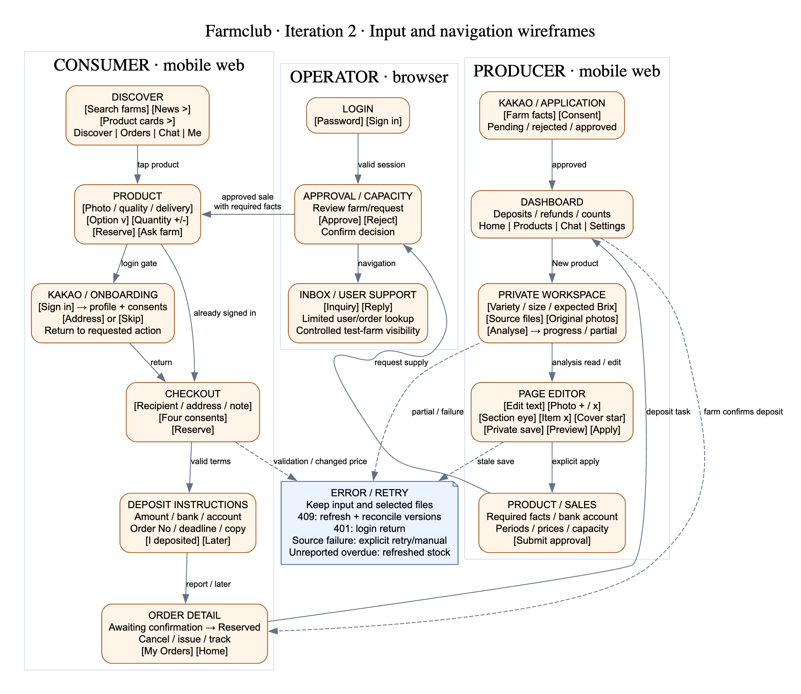

Figure 1a. Current schematic wireframes and user-triggered transitions for consumer, producer and operator. Error/retry branches preserve input; a private save and explicit product apply are separate actions. This diagram is a specification view, not a claim that every drawn state passed testing.

The images in sections 7.2–7.5 are archived I1 evaluation captures, not current v6 acceptance references. Current screen behavior is specified in the tables below and [UI 1.6](https://github.com/snuhcs-course/swpp-2026-project-team-06/blob/main/docs/spec/conversation-ui-1.6.md). The editable source is [Figma v6](https://www.figma.com/design/X8RKiRPZbFEEEwi4OhkF0G).

Current additions: AC-06-6 independent horizontal feeds; AC-07-6 same-option comparison and fixed purchase/tabs; AC-12-12 shelf defaults, draft retention and same-room replies; AC-14-4 fulfillment-only dashboard; AC-17-6 no harvest UI/automatic state transition. Chat previews do not show AI/direct-response badges; private-thread AI controls remain.

The API still supports the existing harvest transition for compatibility, but the current frontend never invokes it. A new operational policy for transitioning reserved orders is outside DEV-51; this release only ships orders already in PREPARING. The approved AI farm-story sample is used only by the matching Mock seed product, never as fabricated live product content.

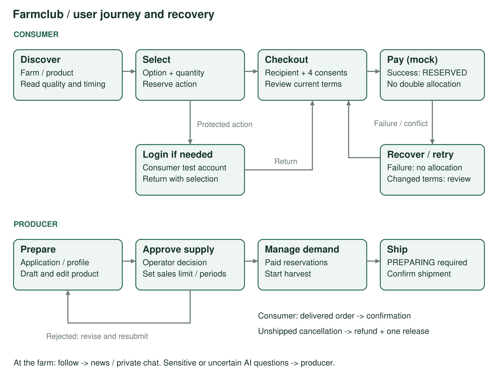

Figure 1b (historical I1). The earlier simulated-payment and harvest UI is superseded by the I2 deposit flow, current screen tables and Figure 1a. Initial sale still requires operator supply approval; editing an already selling page uses explicit apply and current version checks.

### 7.3 Consumer app screens

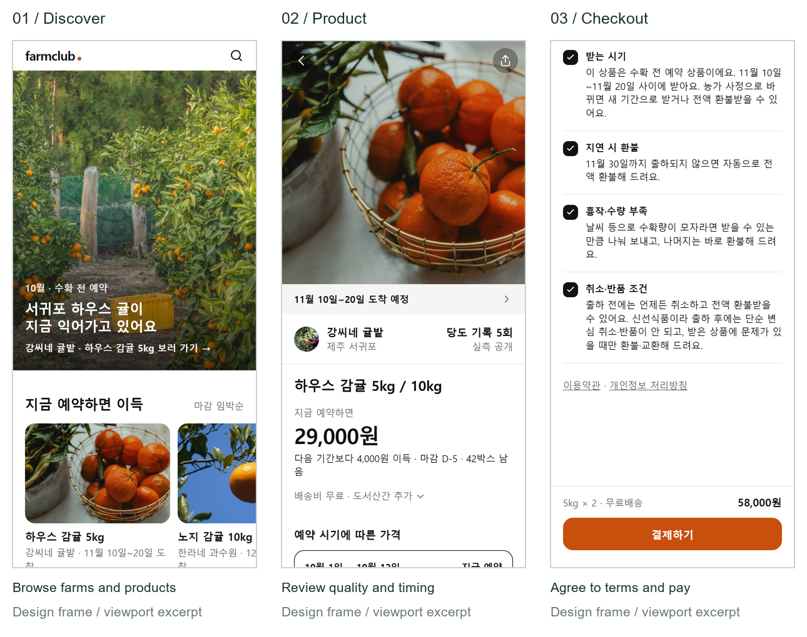

Figure 2. Discover (SCR-01), product detail (SCR-04) and checkout (SCR-10). The user picks a product, option and quantity, enters a recipient and agrees to four terms.

Key consumer screens:

| SCR-01 Discover | SCR-04 Product detail | SCR-10 Checkout | SCR-16 1:1 chat |
| --- | --- | --- | --- |
| 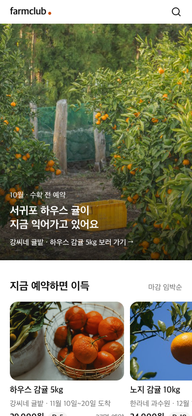 | 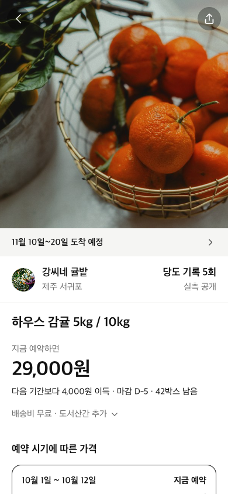 | 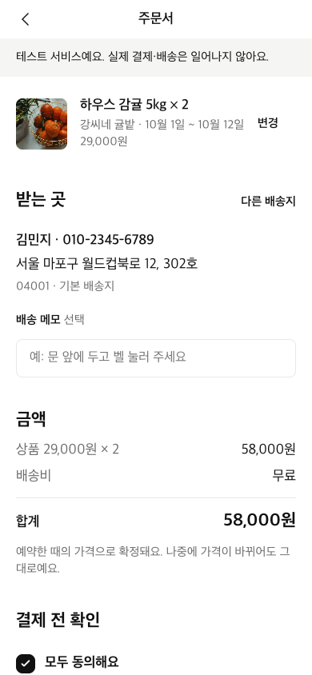 | 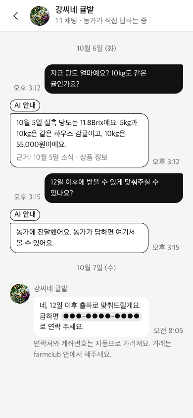 |

| SCR-03 Farm page | SCR-12 Order complete | SCR-13 My Orders | SCR-14 Order detail |
| --- | --- | --- | --- |
| 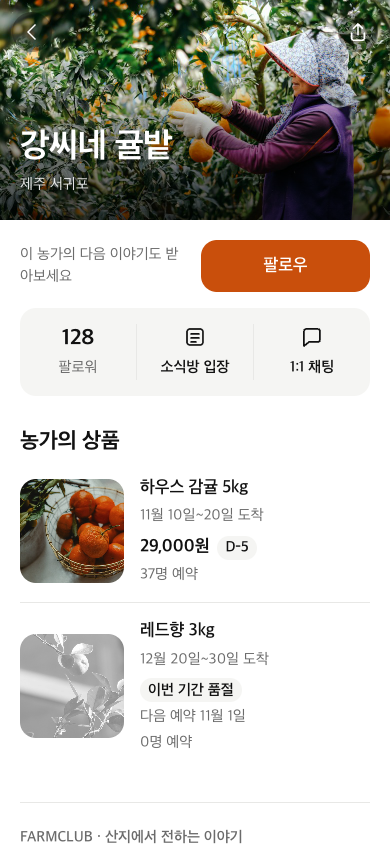 | 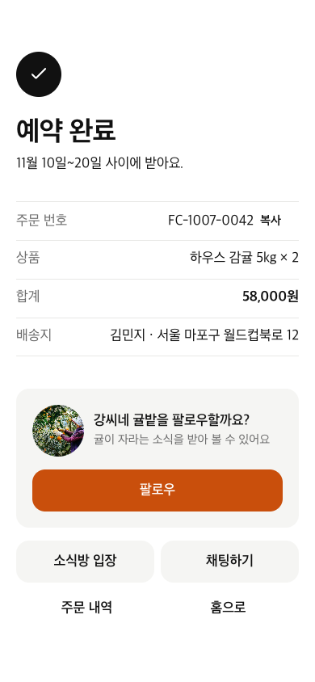 | 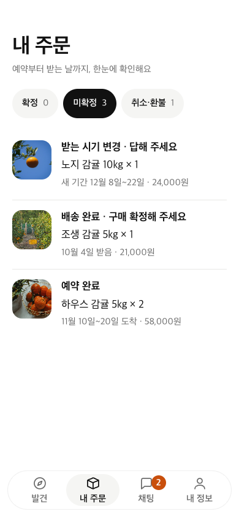 | 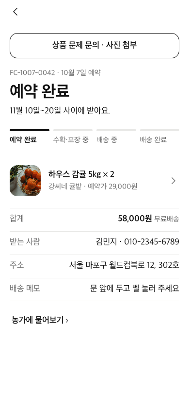 |

| Screen | What it does | Input and actions | Goes to | Failure / not allowed |
| --- | --- | --- | --- | --- |
| **SCR-01 Discover** | First screen: photo/text farm news, then products; each is an independent horizontal carousel | Search, open a news card or product | News/farm → direct room; product → SCR-04 | Each section has its own empty/error state; no profile-only row or seasonal hero |
| **SCR-02 Farm list** | Approved farms, closing soonest first, with search | Type a search term; scroll for more | Farm card → SCR-03 | No results: "We couldn't find that farm" and a link back to all farms |
| **SCR-03 Farm page** | Direct farm news room with profile and adjacent Follow button | Fold/unfold the product shelf, send a same-room reply, open short farm info | Product → SCR-04; profile → short info | Shelf expanded for consumers; public/follower access unchanged; no reply-privacy hint |
| **SCR-04 Product detail** | Photo, title, delivery, option prices, full-ratio story image/blocks, quality and disclosures | Reserve opens option sheet; explicit 1:1 inquiry; farm link | Checkout → SCR-10; farm → direct room | Purchase bar and four tabs stay fixed; no period price table; comparison is the same option’s final-period price only when higher and available |
| **SCR-05 Login** | Sign in with Kakao (returns through `/auth/kakao`); test accounts appear only while Kakao is off, and in the app Mock mode next to the Kakao button (same as the producer app, DEV-136) | Tap Kakao or an account; close | Back to the screen and action that asked for login; first sign-up goes through SCR-06. The Kakao return screen shows only a spinner and one line; a reload while signed in goes home without an error | Producer accounts are not listed. Test login off: "You can't log in right now". No server reply within 15 s: "Login is taking too long". Closing does nothing |
| **SCR-06 Sign-up** | First Kakao sign-up only, one screen: nickname, mobile number, consents (terms, privacy, age 14+ required; farm news alerts optional). Name and address are asked at the first checkout instead, like Karrot (DEV-142) | Fill in, agree, Start | Back to the screen and action that asked for login | Start stays off until required fields and consents are valid. Closing keeps the account and asks again at the next login gate. Kakao values are prefilled; only missing ones are typed |
| **SCR-10 Checkout** | Option, quantity, recipient, address, delivery note, total, five consents (incl. consent to share delivery details with the farm), intermediary notice | Change option, pick another saved address or enter a new one, check consents, Reserve | Address → address screen; Reserve → SCR-11 | Reserve is disabled until an address exists and all five consents are checked. Unfinished sign-up → SCR-06. With 50 saved addresses a new one is used for this order only. Price or stock changed meanwhile: screen refreshes with the latest values and keeps the input. The farm has no bank account: 409 explained on the checkout |
| **SCR-11 Deposit instructions** | Rows in the existing list style: amount, bank and account number (copy), account holder, depositor name = order number (copy), 24-hour deadline (amount, account number and depositor name in bold); seller information; "farmclub is a marketplace intermediary" notice; one factual line that buyers may use their own bank's escrow transfer (no recommendation) | "I made the deposit" (hint only), "I'll deposit later" | Both → SCR-12 | Unreported deadline passed: return to current checkout/stock. Reported transfers remain pending operator/farm reconciliation. Lost response on the deposit request: retried with the same key without taking stock twice |
| **SCR-12 Order received** | While unconfirmed: "Awaiting deposit confirmation" with the deposit rows, then product and address only (order number and total are not repeated). After confirmation: "Reserved" with order number, product, total and address; following | Copy account number or depositor name, Follow, My Orders, Home | SCR-13, SCR-01 | No news-room entry button; failed load offers retry |
| **SCR-13 My Orders** | Orders grouped into Confirmed / Unconfirmed / Canceled-Refunded with counts | Switch tabs, tap an order | Order → SCR-14 | No orders: "You haven't reserved anything yet" and Home. Empty tab: "No {tab} orders" |
| **SCR-14 Order detail** | Status steps, delivery window, tracking, available actions; while awaiting a deposit: the account card, deadline and "I made the deposit"; refunded: "the farm sends it back within 3 business days" or "Refund complete &lt;date&gt;"; expired: "canceled because the deposit deadline passed" | Cancel (confirm sheet; no refund before the deposit), Confirm receipt, accept the new window or take a refund, copy or track the number, report a problem | Report a problem → SCR-32 | No Cancel after shipping. Someone else's order → SCR-13. Status already changed: refreshes to the latest state |
| **SCR-15 / SCR-18 Chat** | News Rooms (farms you follow) and 1:1 chats in one tab | Switch views, open a room or chat | Room → news room; chat → SCR-16 | No chats: "Ask a farm anything" with a link to farms. Other buyers' replies never appear |
| **SCR-16 1:1 chat** | Private questions to one farm; labeled AI answers or "Sent to the farm" | Type up to 1,000 characters, attach up to 3 photos, Send | Farm header → SCR-03 | Explicit chat entry starts the thread and follows the eligible farm; inaccessible farms/roles are refused. After unfollowing, ordinary threads are hidden unless an order inquiry preserves access. Send fails: text and photos are kept for retry. AI fails or times out: question goes to the producer |
| **SCR-17 Me** | Nickname, followed farms, edit profile, address book (up to 50, edit and delete), "Start as a farm", log out | Tap a farm, edit profile, manage addresses, log out | Farm → SCR-03; profile → `/me/profile`; addresses → address book; log out → SCR-01 | Unfinished sign-up shows "Finish signing up". Starting a farm explains that the producer app needs its own account. 50 addresses: adding is off until one is deleted |
| **SCR-32 Order problem** | Report damage, quality, taste or other with up to 3 private photos | Pick a type, describe it, attach photos, Send | Success → SCR-16 with the order attached | Not your order or not paid: cannot be sent. Upload or send fails: input is kept, and a retry never files it twice |

### 7.4 Producer app screens

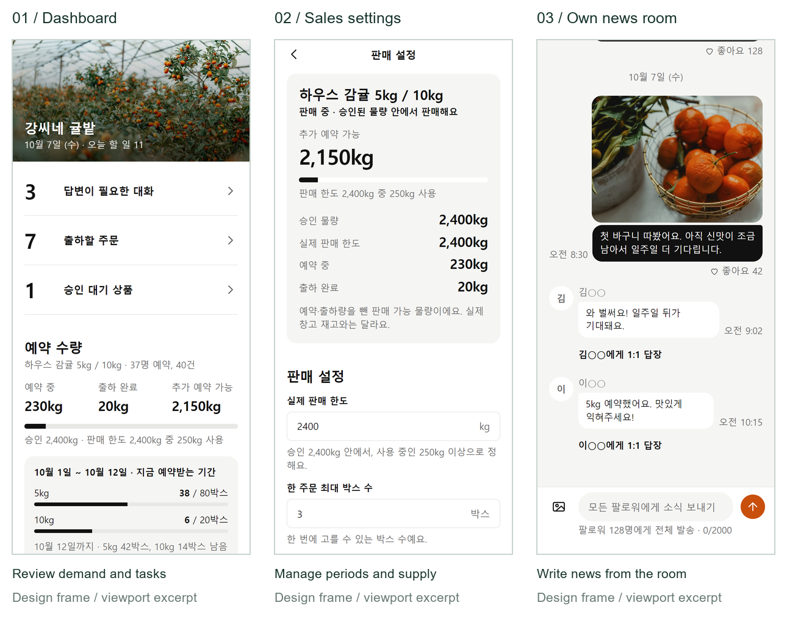

Figure 3. Dashboard (SCR-22), sales settings and the farm's own news room. The producer checks demand, manages supply and prices, and posts updates from the room.

Key producer screens:

**Help guide (DEV-109).** All four tab screens (SCR-22, 23, 28, 33) have a round question-mark "Help" button at the top right. Tapping it returns to the dashboard and starts a 13-step hands-on spotlight tour.
- **Display:** The screen is dimmed except for the element being explained, which is outlined. A card and an arrow point to that element.
- **Steps:** In "tap" steps the producer must tap the highlighted element and the real screen changes; taps on the dimmed area are blocked. "Explain" steps use Next.
- **Flow:** Welcome → Products tab → New product button (explained only: it opens the sales-page builder, where the AI reads text, photos and PDFs in Source materials to fill product details and draft the sales page, while product photos go in their own box) → Chat tab → News Room → 1:1 Chat → farmclub support room → how to ask (explained) → back → Settings tab → AI reply settings (repeated questions are answered by the AI, judgment calls are passed on) → auto-reply on/off (saved only with Save) → the Help button ("tap this button to see the guide again!", with the real Help icon in the text) with "please ask in the farmclub chat room" (DEV-111). The copy is friendly and gives concrete examples of what the AI does.
- **Exceptions:** With no 1:1 chats the conversation steps are skipped. If a target cannot be found for 3 seconds the card is centred with Next. X or Esc ends the tour at any time.
- **Auto-start:** It starts once automatically on an approved producer's first dashboard visit. Finishing or skipping records it in the app's localStorage.
- **Server state:** The tour never presses a server-changing button. New product is only explained because opening it creates a draft product on a real server (SCR-24).

| SCR-22 Dashboard | SCR-24 AI product draft | SCR-25 Product edit | SCR-29 Shipping |
| --- | --- | --- | --- |
| 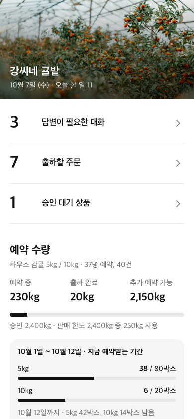 | 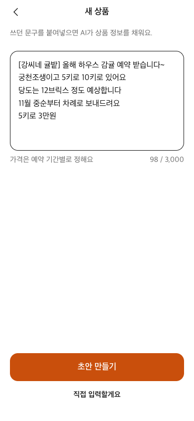 | 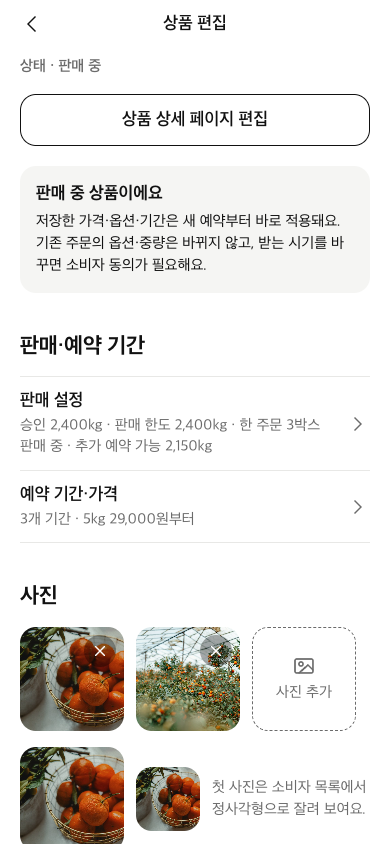 | 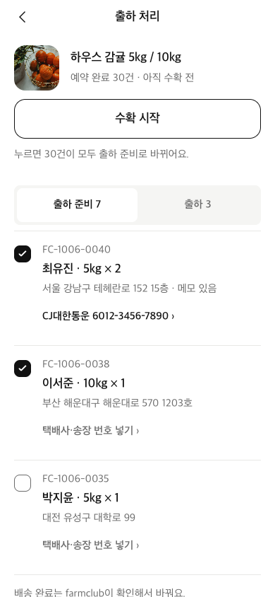 |

| SCR-21 Pending approval | SCR-26 Periods and prices | SCR-28 Chat | SCR-31 AI settings |
| --- | --- | --- | --- |
| 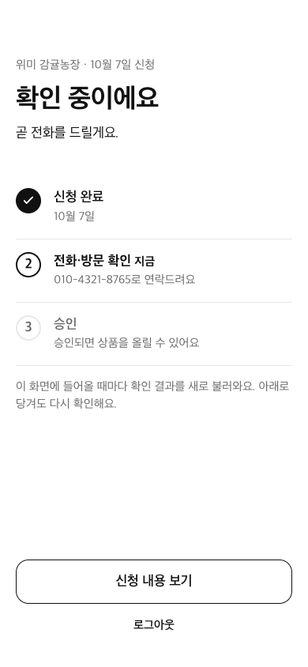 | 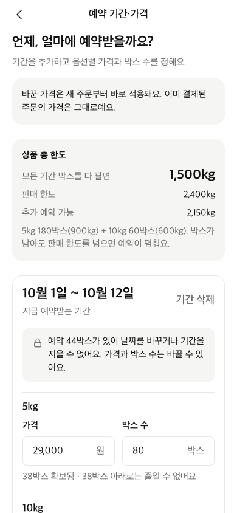 | 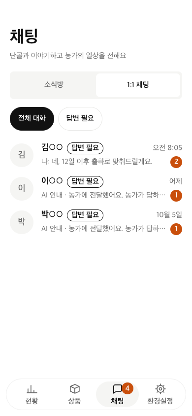 | 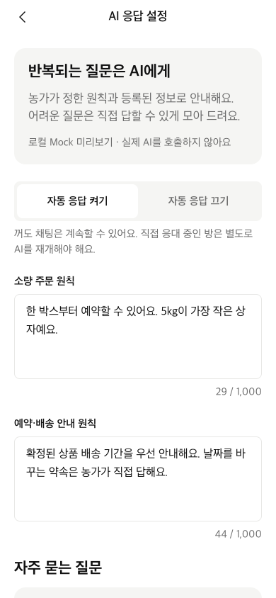 |

| Screen | What it does | Input and actions | Goes to | Failure / not allowed |
| --- | --- | --- | --- | --- |
| **SCR-19 Login** | Start with Kakao (returns through `/auth/kakao`); test accounts appear only while Kakao is off (the Mock keeps both for demos) | Tap Kakao, or an account and Start | No farm → SCR-20; under review or rejected → SCR-21; approved → SCR-22; suspended → suspension notice. The Kakao return screen shows only a spinner and one line, sends the producer straight to that screen, and a reload while signed in goes there too | Consumer accounts are not listed. Test login off: "You can't log in right now". No server reply within 15 s: "Login is taking too long" and Log in again |
| **SCR-20 Application** | Farm details for joining; creates the producer account | Owner name, farm name, region, main crops, mobile number, policy consent; Apply | SCR-21 | Field errors keep the input. Already applied → SCR-21. Reapplying after rejection fills in the previous values |
| **SCR-21 Pending approval** | Application status, refreshed every time the screen opens | View application, pull to refresh, log out, reapply if rejected | Approved → SCR-22 automatically; reapply → SCR-20 | Before approval, every other producer screen redirects here |
| **SCR-22 Dashboard** | To-do band (deposits to confirm, refunds to send, register a bank account), large 2×2 total/reserved/preparing/shipped counts and representative product reserved/shipped kg | Open a to-do, order or shipping management | SCR-29 filtered list, bank account screen | All cursor pages contribute to order counts (orders awaiting a deposit included); no chat tasks or news-writing entry |
| **SCR-23 Products** | Products grouped by status with reservation counts and kg | Filter, tap a product, "+ New product" | Product → SCR-25; new → SCR-24 | No products: "Add your first product" |
| **SCR-24 Product source workspace** | When analysis is enabled: basic variety/size/expected Brix, source attachments and a separate original-photo box; analyse and directly edit the page. Disabled flag: legacy text/manual editor | Save basic facts, add/edit text/TXT/image/PDF, describe/select photos, Analyse, edit modules, hide sections/items, choose representative photo, Save privately, Apply explicitly | Private page editor → preview → explicit apply → SCR-25 | Upload waits for pending basic-info save; show partial/failed work and explicit retry, preserve direct input/files, reject stale versions; no representative photo blocks new analysis/apply but not private editing. Legacy AI failure retains text and manual editing |
| **SCR-25 Product edit** | Product details, quality, options, delivery window, shipping fee, sales settings | Save, set periods, Submit for approval, pause or resume | Periods → SCR-26 | Submit stays disabled until required fields and period prices are set. Unsaved changes: confirm before leaving. Changing the delivery window with existing orders asks buyers to accept or refund |
| **SCR-26 Periods, prices and supply** | Date-based reservation periods with a price and box count per option | Add or remove periods, pick dates, enter prices and quantities, Save | Back to SCR-25 | Earlier price must be lower and periods cannot overlap. A period with reservations cannot be deleted or re-dated If someone else saved first, the input is kept |
| **SCR-28 Chat** | News Room / 1:1 Chat only; own room opens immediately by default. The 1:1 list also shows a "farmclub" support room with the logo, sorted by recent activity like other chats (DEV-111): the producer asks the farmclub team there and the team replies from the admin Inbox; no AI answers in that room and consumers never see it | Send, attach, fold product shelf, switch to private chat list | Private thread or attachment composer | Producer shelf starts collapsed; broadcast notice is the first scrolling system message; composer is fixed above four tabs |
| **SCR-27 Post news** | Text with up to 5 photos (10MB each) or 1 video (60s, 100MB); public or followers only | Write, attach, choose visibility, Post | Back to the farm's own room | Wrong format or size: reason per file. Attachment fails: the text is kept |
| **SCR-29 Orders and shipping** | Read all/awaiting deposit/reserved/preparing/shipped/refunded orders; confirm deposits; mark refunds as sent; ship existing preparing orders | "Confirm deposit ›" → sheet with amount and depositor name (No / Confirm deposit) → confirm; "I refunded ›" on refunded orders → sheet (No / Refund complete) records that the farm sent the money back; select preparing orders, edit invoice, confirm shipment | Back to the list | Rows awaiting a deposit hide the delivery address. No Start harvest controls or calls; no automatic RESERVED → PREPARING; stale states refresh after conflict |
| **SCR-33 Settings** | Farm summary, profile and share link, AI settings, log out | Tap an item | SCR-30, SCR-31, SCR-19 | Retry if loading fails |
| **SCR-30 Farm profile and link** | Edit name, region, introduction and the deposit bank account (bank, account number, holder); copy or share the farm link | Copy, Share, edit one field, change photo, register the account | Field → single-field edit screen; account → bank account screen | Name and region cannot be empty. The link is hidden until the farm is approved. Without a bank account the first capacity approval request is rejected (`NO_FARM_ACCOUNT`) |
| **SCR-31 AI settings** | AI on/off, answering guidelines, FAQs, extra handoff topics, preview | Edit, Save, Preview | Back to SCR-33 | Unsaved changes are marked and confirmed before leaving. On `STALE_VERSION`, fetch the latest version while keeping producer edits so they can save again |

### 7.5 Failure screens

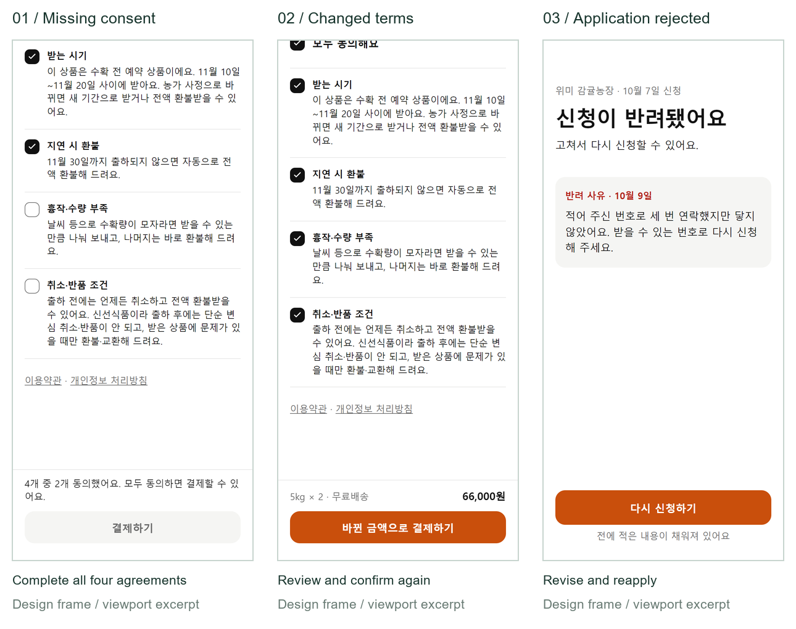

Figure 4. Missing consent, changed reservation terms and a rejected application. The app blocks the next step, asks the user to confirm the new terms, and lets a rejected farm apply again.

More failure states:

| Sold out (SCR-04) | Missing consent (SCR-10) | Payment failed (SCR-11) | AI draft failed (SCR-24) |
| --- | --- | --- | --- |
| 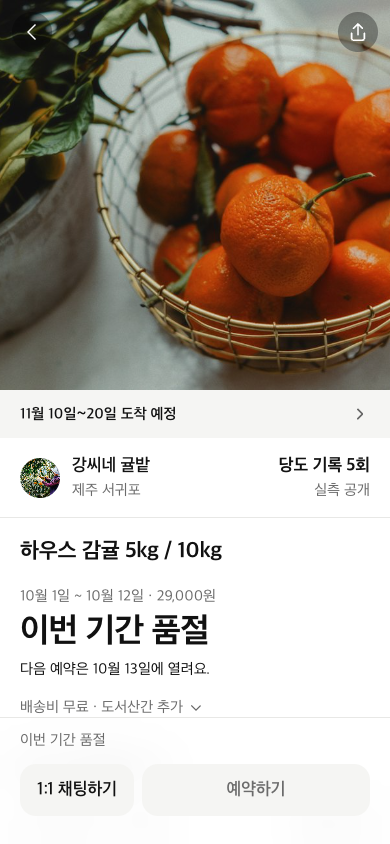 | 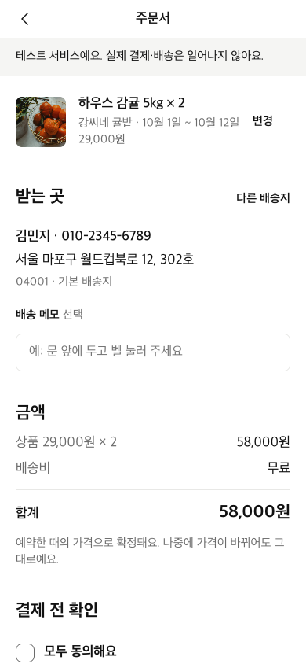 | 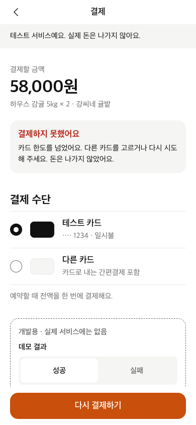 | 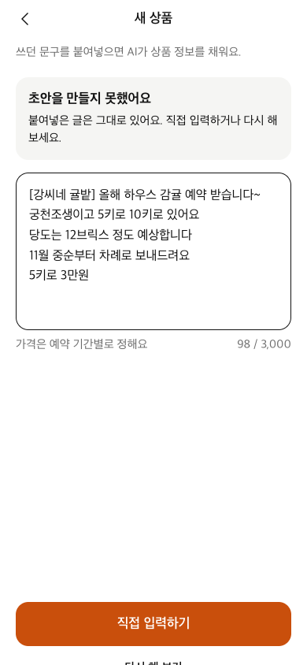 |

Rules that apply on every screen:
- Buttons lock while a request is being processed, and an order or payment is never processed twice even if the user taps again or the connection drops.
- When a save fails (network, validation or conflict), what the user typed and the photos they picked are kept, including after a detour to login.
- If the user is not allowed to see a screen, it shows "You can't view this screen" with a link to the first screen.
- Network errors show "Your connection is unstable" with Retry. Success messages appear as a short toast.

### 7.6 Operator screens (I2)

| Screen / input | Successful transition | Failure / restriction |
| --- | --- | --- |
| `/login`: shared operator password | Session → producer approvals | Invalid/expired session returns to login; token never enters browser storage |
| `/producers`: pending farm, review, approve/reject confirmation | Decision refreshes status; approval provisions support room | Role/session failure blocks action; failed response remains retryable |
| `/capacity`: initial/increase request, approve/reject | Updated approved limit and request state | Version/validation conflict refreshes; UI/proxy failure is not approval |
| `/farms`: preview controlled hide/restore | Test farm becomes absent/present on public discovery | Refuse hiding where protected non-test orders exist; hiding is distinct from pause or deletion |
| `/users` and user detail: search, tester marker, order lookup | Limited user and recent-order support data | Phone masked in search; recipient delivery fields excluded from support lookup |
| `/inbox`: select producer inquiry, reply | Read position and one operator message update | Operator only; photo count shown without photo viewing; no AI answer or order-state mutation |
| `/ai-cost`: view AI cost by feature | Per-feature and overall totals (this month, last 7 days, all time) for spec-code-review, product draft, detail draft, AI answer and source analysis; filterable call list | Read-only; amounts are estimates from public per-token prices (source analysis uses the provider-reported cost), unpriced calls are counted separately; spec-check runs are reported by CI with a dedicated token |

### 7.7 Room permissions

| Viewer | Public news | Follower news | Private replies | Can do |
| --- | --- | --- | --- | --- |
| Anonymous | Read | Hidden | Hidden | Log in first |
| Consumer, not following | Read | Hidden | Hidden | Like public news; follow to reply |
| Consumer, following | Read | Read | Own only | Reply; like news they can see |
| Owning approved producer | Read | Read | All replies in their room | Post news; open a private chat |
| Other producer | No access | No access | No access | None |

Reading a room never follows the farm automatically.

## 8. Implementation Status and References

| Area | I2 progress | Remaining boundary |
| --- | --- | --- |
| Accounts and communication | Kakao onboarding/state return, wrong-answer reports, farmclub support and producer help tour | Live account behavior needs environment-specific validation; external notifications are not implemented |
| Commerce | Farm account registration, deposit instructions/report/confirmation, expiry exceptions, refund settlement and retry protection | No automatic bank matching, payment custody or integrated escrow; no current UI action for RESERVED → PREPARING |
| Producer pages | Private source worker/editor, direct module editing, photos, explicit apply and manual/legacy fallback | Numeric OCR, omissions/conflicts and actual farmer acceptance require review; deployment does not establish general AI accuracy |
| Operator | Producer/capacity tools, controlled farm visibility, privacy-limited user lookup and support inbox | Shared admin identity; no full multi-operator case management or inbox image rendering |
| Deployment/media | Vercel clients/admin, Railway API/worker, R2 media/private sources, approved-farm Open Graph sharing, optional PostHog client instrumentation | Sentry/Langfuse and server analytics events are not wired; performance/uptime targets are not yet established |

The [Testing Documentation](https://github.com/snuhcs-course/swpp-2026-project-team-06/wiki/Testing-Documentation) preserves the final 77-case internal workbook and separately dated automated regressions. Later implementation commits do not retroactively change the workbook's deployed failures, blockers or not-ready results. The four role-based recordings and reproducible setup belong in the `iteration-2-demo` branch README. The recordings use controlled demonstration data and do not prove an actual bank transfer or a complete shipping workflow.

**I2 producer recovery:** empty AI strings/option arrays require review; manual creation excludes concurrent generation/retry; failed calls preserve text; missing origin/storage blocks initial supply submission. Failed browser sharing copies the server URL, while user cancellation is silent. Shipping saves carrier/tracking before a refresh retry and does not undo a successful shipment.

**Share boundary:** the public share endpoint renders escaped Open Graph metadata for approved visible farms. Ineligible/missing farms receive the same uncached 404 without private metadata. Share delivery and public visibility are distinct from product approval.

Sources: [PRD](https://github.com/snuhcs-course/swpp-2026-project-team-06/blob/main/docs/spec/prd.md), [functional criteria/rules](https://github.com/snuhcs-course/swpp-2026-project-team-06/tree/main/docs/spec/functional), [screen specification](https://github.com/snuhcs-course/swpp-2026-project-team-06/blob/main/docs/spec/screens.md), [source integration](https://github.com/snuhcs-course/swpp-2026-project-team-06/blob/main/docs/spec/source-integration.md), [source editor](https://github.com/snuhcs-course/swpp-2026-project-team-06/blob/main/docs/spec/source-editor.md), [UI 1.6](https://github.com/snuhcs-course/swpp-2026-project-team-06/blob/main/docs/spec/conversation-ui-1.6.md), [Design Documentation](https://github.com/snuhcs-course/swpp-2026-project-team-06/wiki/Design-Documentation). The later contracts' current-state notices take precedence over their retained historical proposals.
